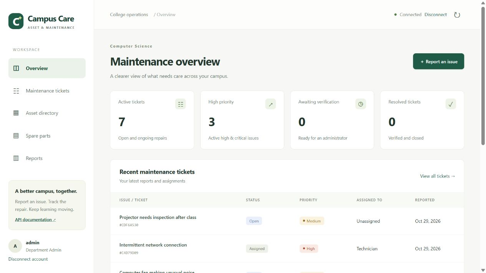
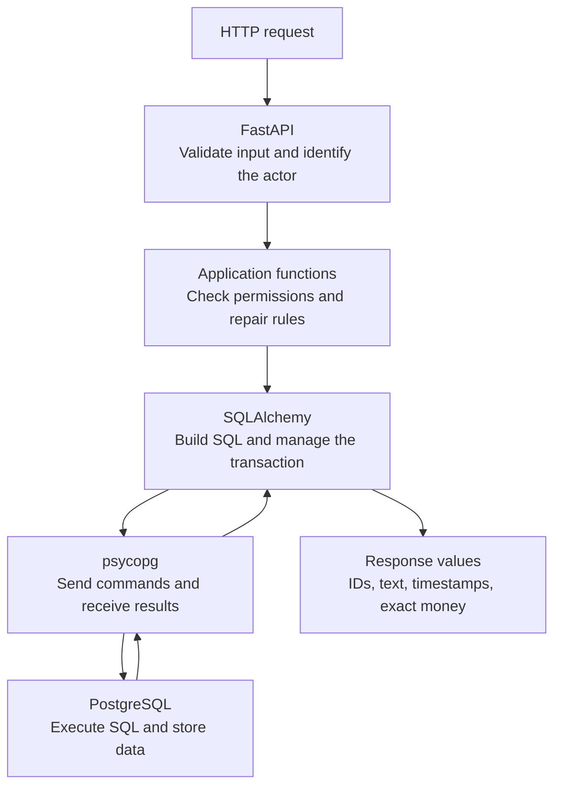
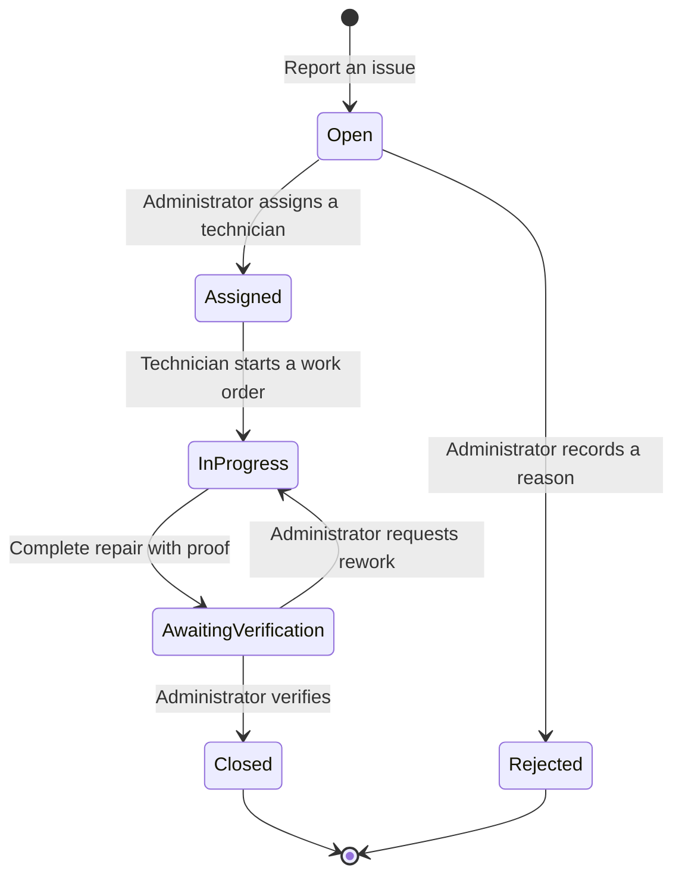

# Smart College Asset & Maintenance Management System

A college maintenance application with a responsive browser dashboard and Python API for reporting broken equipment, assigning repairs, using spare parts, and keeping a trustworthy maintenance history.

**SQLAlchemy connects the Python code to the database. PostgreSQL stores records, executes SQL, and enforces database rules.**

The project combines a working maintenance application with an **80-step PostgreSQL and SQLAlchemy learning archive**. FastAPI serves both the API and the Campus Care interface; Alembic manages database changes, and Docker Compose runs the local PostgreSQL environment.

## Campus Care dashboard



The screenshot uses disposable synthetic records. Starting the application does not create these accounts or tickets.

| View | What you can do |
|---|---|
| Overview | See active, urgent, awaiting-verification, and closed ticket counts across all records you can access. |
| Maintenance tickets | Filter by status or priority, move through pages, read issue descriptions, and add comments to active tickets. Administrators can assign, reject, verify, or request rework when the workflow permits it. |
| Report an issue | Find an asset by name or code, choose a priority, and describe the problem. Retired assets cannot be selected. |
| Asset directory | Search and browse assets within your department scope. |
| Spare parts | Staff can inspect campus stock, unit costs, and reorder alerts. |
| Reports | Administrators can compare completed repair costs and frequently reported assets within their authorized scope. |

The interface adapts to desktop and narrow screens, with keyboard focus indicators, labeled dialogs, status messages, and tables that scroll inside their panels. Account controls remain available on mobile. See the [dashboard guide](docs/UI.md) and [mobile preview](docs/images/dashboard-mobile.png).

Work-order editing, completion-proof uploads, inventory changes, and audit inspection are available through the API. The [API guide](docs/API.md) documents these operations.

## Roles and access

| Role | Ticket access | Additional capabilities |
|---|---|---|
| Student | Their own reports | Report issues and comment on eligible tickets. |
| Technician | Their own reports and assigned tickets | Carry out assigned repairs through work orders; inspect spare-parts stock. |
| Department Admin | Department tickets and their own reports | Assign technicians, review repairs, and inspect department reports. |
| Super Admin | All tickets | Administer maintenance across departments and inspect campus-wide reports. |

The server checks permissions for every operation. Connect with an administrator-provisioned bearer token; there is no public signup or password-login screen. Tokens stay in tab memory and are cleared on disconnect or reload. Provisioning instructions are in the [API guide](docs/API.md).

## Choose what you want to understand

| Page | What you will find |
|---|---|
| **[SQLAlchemy explained](docs/SQLALCHEMY.md)** | Engines, Sessions, models, queries, relationships, transactions, and results—with diagrams and code examples. |
| **[PostgreSQL explained](docs/POSTGRESQL.md)** | Tables, SQL functions, reports, indexes, locks, permissions, and recovery—with a visual database map. |
| [SQLAlchemy API index](docs/reference/SQLALCHEMY_APIS.md) | Observed SQLAlchemy/Alembic symbols and database methods, their purpose, and source examples. |
| [PostgreSQL function index](docs/reference/POSTGRESQL_FUNCTIONS.md) | SQL functions, expressions, routines, and commands used in the code, grouped by purpose. |
| [Application function map](docs/reference/APPLICATION_FUNCTIONS.md) | Every function defined in the core Python package, including routes and internal helpers. |

The explanations are organized by **concept and responsibility**. You can read either technology guide without following numbered lessons.

## How the parts connect



| Responsibility | Main code |
|---|---|
| Browser interface and dashboard reads | [dashboard.py](college_maintenance/dashboard.py), [HTML](college_maintenance/static/index.html), [JavaScript](college_maintenance/static/app.js), [CSS](college_maintenance/static/styles.css) |
| Connections and Sessions | [database.py](college_maintenance/database.py), [sessions.py](college_maintenance/sessions.py) |
| Stored records and relationships | [models.py](college_maintenance/models.py) |
| Ticket permissions and state changes | [workflow.py](college_maintenance/workflow.py) |
| Repairs, stock, and completion | [repairs.py](college_maintenance/repairs.py), [inventory.py](college_maintenance/inventory.py), [completion.py](college_maintenance/completion.py) |
| Reads, pagination, search, and reports | [reads.py](college_maintenance/reads.py), [pagination.py](college_maintenance/pagination.py), [search.py](college_maintenance/search.py), [reports.py](college_maintenance/reports.py), [analytics.py](college_maintenance/analytics.py) |
| HTTP, authentication, audit, and files | [api.py](college_maintenance/api.py), [authentication.py](college_maintenance/authentication.py), [auditing.py](college_maintenance/auditing.py), [attachments.py](college_maintenance/attachments.py) |

## The maintenance workflow



Completing a repair commits **stock deductions, inventory movements, frozen costs, work-order state, ticket state, and audit history together**. A failure rolls them back. Retrying a completed work order returns its original result. See the [Python transaction map](docs/SQLALCHEMY.md#one-repair-one-transaction) and [database concurrency map](docs/POSTGRESQL.md#transactions-locks-and-retries).

The backend also provides private attachments, scoped search, department costs, ranked failures, and monthly reports. Advanced experiments have their [application/adoption boundaries](docs/POSTGRESQL.md#application-features-and-isolated-experiments) documented separately.

Delayed responses are guarded so older searches cannot replace newer results, cancelled sign-in cannot reconnect an account, and completed requests cannot reopen closed dialogs or overwrite a new draft. Closing a dialog discards pending interface updates; a write already accepted by the server can still finish. [Debugging and verification record](docs/UI_VERIFICATION.md).

## Run locally

Use Docker Desktop with its Linux engine running, Python **3.11+**, and PowerShell 7 or Windows PowerShell 5.1. The recorded verification used Python 3.12.14. Run these commands from the repository root:

```powershell
python -m venv .venv
.\.venv\Scripts\python.exe -m pip install -r requirements.txt
.\labs\step-02\start.ps1
.\.venv\Scripts\python.exe -m alembic upgrade head
.\.venv\Scripts\python.exe -m uvicorn college_maintenance.api:app --host 127.0.0.1 --port 8000
```

Open [Campus Care](http://127.0.0.1:8000/) for the dashboard, or the [API documentation](http://127.0.0.1:8000/docs) for backend operations. The [dashboard guide](docs/UI.md) describes account connection, ticket reporting, filters, and role-based views. The [API guide](docs/API.md) explains provisioning actors and bearer credentials. PostgreSQL is available at `127.0.0.1:55432`; local credentials and uploads stay in ignored `.local/`.

The dashboard uses plain HTML, CSS, and JavaScript. It needs no frontend build, external fonts, or CDN. Node.js is only needed for the separate UI timing tests below.

For the separate Compose deployment with migration-owner/runtime logins, use the [deployment and recovery guide](docs/DEPLOYMENT_AND_RECOVERY.md).

## Verify the project

Run the dashboard acceptance and response-timing tests:

```powershell
.\tests\dashboard.ps1 -WriteEvidence
.\tests\dashboard-async.ps1 -WriteEvidence
```

The acceptance tests use real PostgreSQL and clean up their generated schema. The timing tests use Node's built-in test runner and a small DOM fixture to exercise the shipped JavaScript with controlled network responses. They cover cancelled dialogs, stale searches, account changes, and preservation of a newer report draft.

To run the same checks in Windows PowerShell 5.1:

```powershell
powershell.exe -NoProfile -File tests/dashboard.ps1 -WriteEvidence
powershell.exe -NoProfile -File tests/dashboard-async.ps1 -WriteEvidence
```

| Recorded verification | Result in each shell | Evidence |
|---|---|---|
| Latest dashboard acceptance | 11 tests passed | [PowerShell 7](tests/dashboard-evidence-powershell7.txt) · [PowerShell 5.1](tests/dashboard-evidence-powershell5.txt) |
| Latest UI timing regression | 8 tests passed | [PowerShell 7](tests/dashboard-async-evidence-powershell7.txt) · [PowerShell 5.1](tests/dashboard-async-evidence-powershell5.txt) |
| Dashboard API checkpoint, Steps 31–40 | 232 checks passed | [PowerShell 7](tests/dashboard-regression-powershell7.txt) · [PowerShell 5.1](tests/dashboard-regression-powershell5.txt) |
| Original full learning checkpoint, Steps 2–80 | 1,783 checks passed | [PowerShell 7](tests/evidence-powershell7.txt) · [PowerShell 5.1](tests/evidence-powershell5.txt) |

The full checkpoint is the saved learning baseline: 1,769 lab assertions and 14 runner checks across 79 executable labs. Step 1 records business decisions. The dashboard and subsequent fixes have separate evidence; the latest debugging pass did not rerun the entire 80-step path or browser-layout checks.

To repeat the full learning checkpoint:

```powershell
.\tests\run.ps1 -WriteEvidence
```

Run numbered lab suites sequentially because they share fixed study namespaces. See the [verification instructions](tests/README.md) for ten-step checkpoints, selected ranges, prerequisites, and cleanup behavior.

The function indexes are generated from source. Check or refresh them with:

```powershell
.\.venv\Scripts\python.exe tools\build_reference.py --check
.\.venv\Scripts\python.exe tools\build_reference.py
.\.venv\Scripts\python.exe tools\check_docs.py
```

The scanner uses the reviewed explanations in [reference_data.py](tools/reference_data.py). When adding a new SQL function or database method, review that vocabulary too; dynamic Python and SQL cannot be fully inferred by a static index. [Documentation verification](docs/DOCUMENTATION_VERIFICATION.md) records the coverage, link, and diagram checks.

<details>
<summary>Original learning archive and detailed evidence</summary>

The [learning checklist](docs/LEARNING_PATH.md), [business contract](docs/PROJECT_CONTRACT.md), [reference coverage](docs/REFERENCE_COVERAGE.md), and experiments under `labs/` remain available for detailed proofs and historical progression. The two technology guides above are the primary reading pages.

</details>
