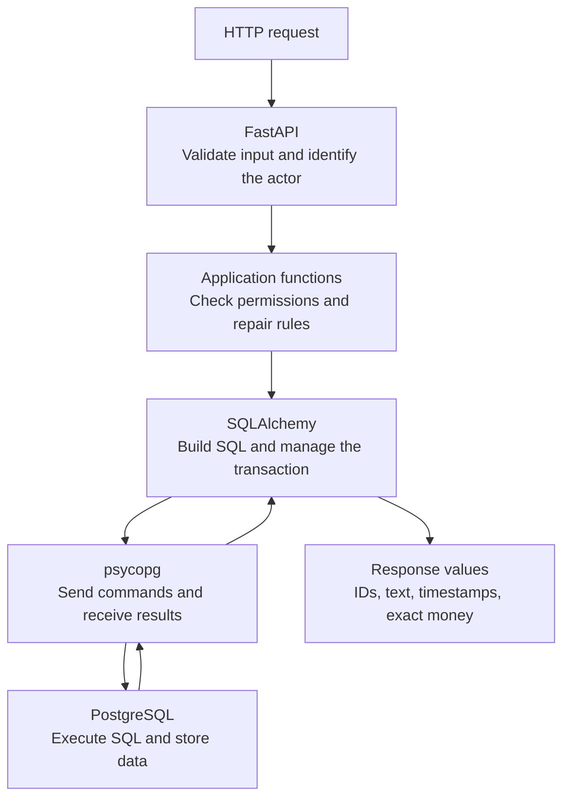
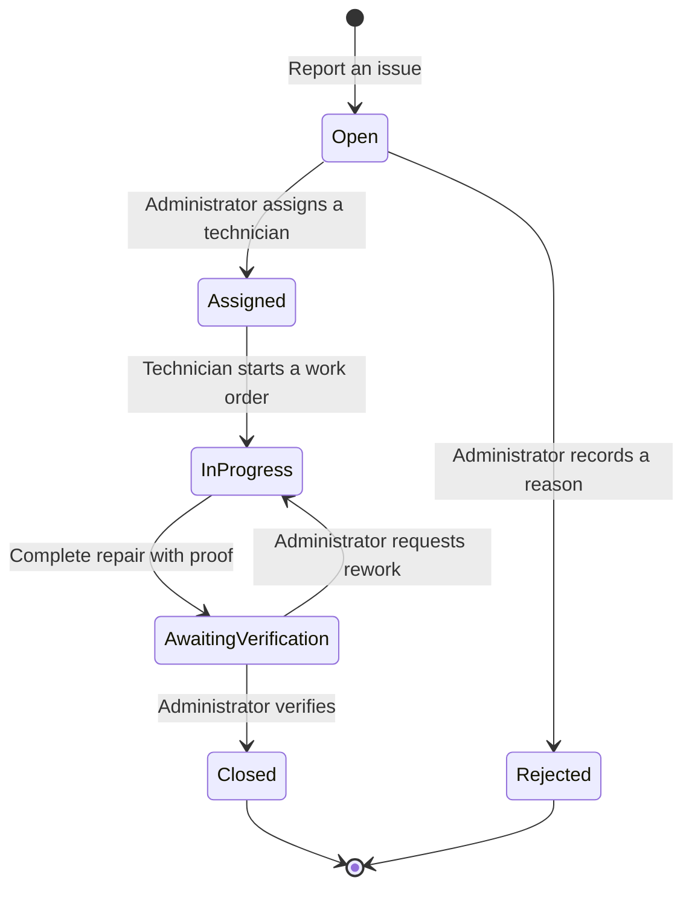

# Smart College Asset & Maintenance Management System

A college maintenance application with a responsive browser dashboard and Python API for reporting broken equipment, assigning repairs, using spare parts, and keeping a trustworthy maintenance history.

**SQLAlchemy connects the Python code to the database. PostgreSQL stores records, executes SQL, and enforces database rules.**

## Choose what you want to understand

| Page | What you will find |
|---|---|
| **[SQLAlchemy explained](docs/SQLALCHEMY.md)** | Engines, Sessions, models, queries, relationships, transactions, and results—with diagrams and code examples. |
| **[PostgreSQL explained](docs/POSTGRESQL.md)** | Tables, SQL functions, reports, indexes, locks, permissions, and recovery—with a visual database map. |
| [SQLAlchemy API index](docs/reference/SQLALCHEMY_APIS.md) | Observed SQLAlchemy/Alembic symbols and database methods, their purpose, and source examples. |
| [PostgreSQL function index](docs/reference/POSTGRESQL_FUNCTIONS.md) | SQL functions, expressions, routines, and commands used in the code, grouped by purpose. |
| [Application function map](docs/reference/APPLICATION_FUNCTIONS.md) | Every function defined in the core Python package, including routes and internal helpers. |

The explanations are organized by **concept and responsibility**. You can read either technology guide without following numbered lessons.

## How the parts connect



| Responsibility | Main code |
|---|---|
| Connections and Sessions | [database.py](college_maintenance/database.py), [sessions.py](college_maintenance/sessions.py) |
| Stored records and relationships | [models.py](college_maintenance/models.py) |
| Ticket permissions and state changes | [workflow.py](college_maintenance/workflow.py) |
| Repairs, stock, and completion | [repairs.py](college_maintenance/repairs.py), [inventory.py](college_maintenance/inventory.py), [completion.py](college_maintenance/completion.py) |
| Reads, pagination, search, and reports | [reads.py](college_maintenance/reads.py), [pagination.py](college_maintenance/pagination.py), [search.py](college_maintenance/search.py), [reports.py](college_maintenance/reports.py), [analytics.py](college_maintenance/analytics.py) |
| HTTP, authentication, audit, and files | [api.py](college_maintenance/api.py), [authentication.py](college_maintenance/authentication.py), [auditing.py](college_maintenance/auditing.py), [attachments.py](college_maintenance/attachments.py) |

## The maintenance workflow



Completing a repair commits **stock deductions, inventory movements, frozen costs, work-order state, ticket state, and audit history together**. A failure rolls them back. Retrying a completed work order returns its original result. See the [Python transaction map](docs/SQLALCHEMY.md#one-repair-one-transaction) and [database concurrency map](docs/POSTGRESQL.md#transactions-locks-and-retries).

The backend also provides private attachments, scoped search, department costs, ranked failures, and monthly reports. Advanced experiments have their [application/adoption boundaries](docs/POSTGRESQL.md#application-features-and-isolated-experiments) documented separately.

## Run locally

Use Docker Desktop, Python **3.11+**, and PowerShell 7 or Windows PowerShell 5.1. The recorded verification used Python 3.12.14.

```powershell
python -m venv .venv
.\.venv\Scripts\python.exe -m pip install -r requirements.txt
.\labs\step-02\start.ps1
.\.venv\Scripts\python.exe -m alembic upgrade head
.\.venv\Scripts\python.exe -m uvicorn college_maintenance.api:app --host 127.0.0.1 --port 8000
```

Open [Campus Care](http://127.0.0.1:8000/) for the dashboard, or the [API documentation](http://127.0.0.1:8000/docs) for backend operations. The [dashboard guide](docs/UI.md) describes account connection, ticket reporting, filters, and role-based views. The [API guide](docs/API.md) explains provisioning actors and bearer credentials. PostgreSQL is available at `127.0.0.1:55432`; local credentials and uploads stay in ignored `.local/`.

For the separate Compose deployment with migration-owner/runtime logins, use the [deployment and recovery guide](docs/DEPLOYMENT_AND_RECOVERY.md).

## Verify the project

```powershell
.\tests\run.ps1 -WriteEvidence
```

The recorded full checkpoint passed **1,783 checks in each shell**: 1,769 lab assertions and 14 runner regressions across 79 executable labs. [Verification instructions](tests/README.md) · [PowerShell 7 evidence](tests/evidence-powershell7.txt) · [PowerShell 5.1 evidence](tests/evidence-powershell5.txt).

The function indexes are generated from source. Check or refresh them with:

```powershell
.\.venv\Scripts\python.exe tools\build_reference.py --check
.\.venv\Scripts\python.exe tools\build_reference.py
.\.venv\Scripts\python.exe tools\check_docs.py
```

The scanner uses the reviewed explanations in [reference_data.py](tools/reference_data.py). When adding a new SQL function or database method, review that vocabulary too; dynamic Python and SQL cannot be fully inferred by a static index. [Documentation verification](docs/DOCUMENTATION_VERIFICATION.md) records the coverage, link, and diagram checks.

<details>
<summary>Original learning archive and detailed evidence</summary>

The [learning checklist](docs/LEARNING_PATH.md), [business contract](docs/PROJECT_CONTRACT.md), [reference coverage](docs/REFERENCE_COVERAGE.md), and experiments under `labs/` remain available for detailed proofs and historical progression. The two technology guides above are the primary reading pages.

</details>
