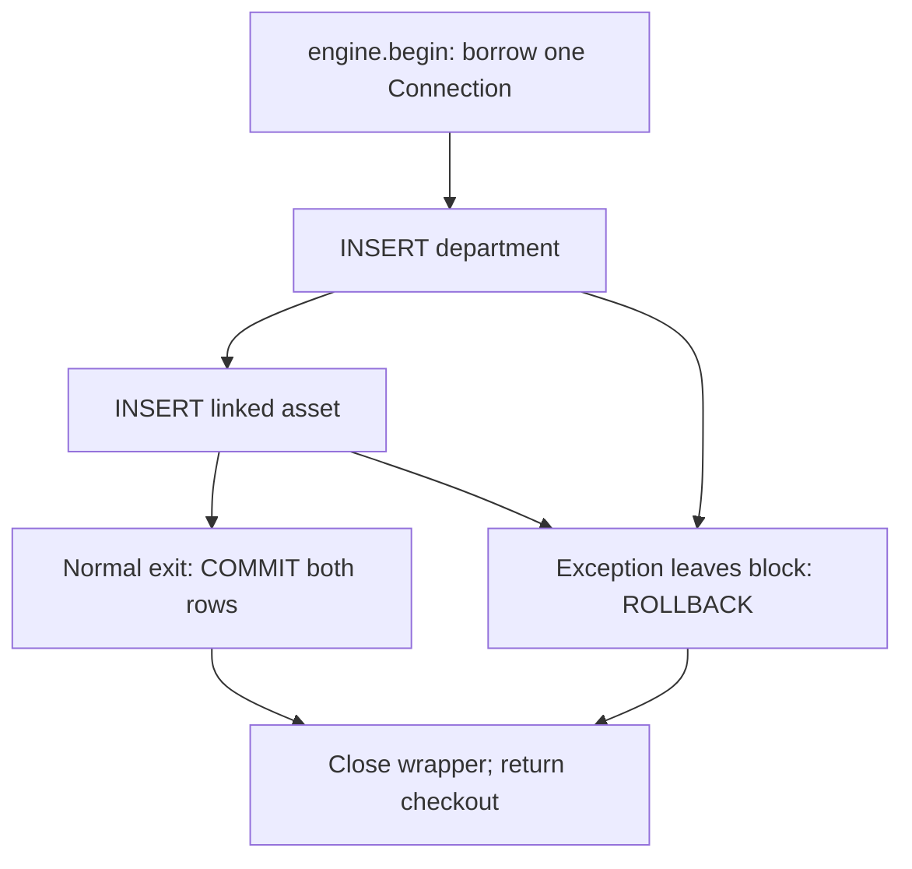

# Step 14: control a Core connection and bind values

The [Step 14 lab](../labs/step-14/notes.md) reuses the [shared application Engine](../college_maintenance/database.py). It looks up an asset with bound input and registers a department with its linked asset in one transaction. A separate psql connection checks persistence before the temporary fixture is removed.

## Choose the transaction owner

| Pattern in this lab | Transaction behavior | On leaving the context |
|---|---|---|
| `with engine.connect() as connection` | First execution autobegins; the caller may commit or roll back explicitly | Outstanding work rolls back; the Connection closes |
| `with engine.begin() as connection` | Context owns the Connection and its transaction | Success commits; a propagated exception rolls back; the Connection closes |

Even a SELECT autobegins a transaction with the configured Engine. Closing a `connect()` block does not commit successful writes. See the [SQLAlchemy transaction tutorial](https://docs.sqlalchemy.org/en/21/tutorial/dbapi_transactions.html).

The operation helper accepts the caller's Connection. Both inserts use that same checkout; the helper does not acquire another connection or decide when to commit. In [python_lab.py](../labs/step-14/python_lab.py), this is `register_pair`:

```python
with engine.begin() as connection:
    register_pair(connection, department_id, asset_id,
                  "ECE", "PC-003", supplied_name)
```

The helper's first INSERT creates the department; its second INSERT references that department. If both succeed and the block exits normally, both commit. The lab also raises an application exception after both inserts have succeeded and confirms that both disappear. A separate scenario makes the second INSERT fail with a duplicate asset code and confirms that the preceding department INSERT disappears too.

Catch these expected exceptions outside the `with engine.begin()` block, so the context sees them and rolls back before control reaches the handler. Returning normally after swallowing an application exception inside the block could commit completed writes. A PostgreSQL statement error also leaves its transaction needing rollback. These are distinct failure situations; neither should be treated as a successful operation. See [transaction context management](https://docs.sqlalchemy.org/en/21/core/connections.html#connect-and-begin-once-from-the-engine).



## Keep input values separate from SQL

The lookup uses SQLAlchemy `text()` with an unquoted named placeholder and a separate mapping:

```python
lookup = text("""SELECT asset_code, name FROM college_step14.assets
                 WHERE asset_code = :asset_code""")
with engine.connect() as connection:
    rows = connection.execute(lookup, {"asset_code": supplied_code}).all()
```

The normal value `PC-001` returns one row. The values `PC-001' OR '1'='1` and `PC-001'; DROP TABLE college_step14.assets; --` return no rows. Cursor observations show identical SQL for all three calls, with different parameter values. The PostgreSQL dialect adapts `:asset_code` to psycopg's `%(asset_code)s` placeholder. See [sending parameters with Core](https://docs.sqlalchemy.org/en/21/tutorial/dbapi_transactions.html#sending-parameters).

The successful write stores this deliberately awkward name exactly:

```text
O'Brien'); DROP TABLE college_step14.assets; --
```

Quotes and SQL-looking characters remain part of the value. The driver sends query structure and values separately; building SQL by concatenating or formatting that input would lose this separation. See [psycopg parameter passing](https://www.psycopg.org/psycopg3/docs/basic/params.html).

The fixture checks business validity independently: the duplicate code still fails even though it is safely bound. Parameter binding does not authorize a user, check a business permission, or make an otherwise invalid value acceptable.

## Select identifiers through a closed allowlist

Table names, column names, and sort directions form SQL structure. Binding `"asset_code"` in `SELECT :column_name` produces the string `asset_code` for each row. It does not select the column. This distinction is also described in [psycopg's parameter rules](https://www.psycopg.org/psycopg3/docs/basic/params.html).

The lab exposes two public sort choices through a fixed mapping:

```python
SORT_COLUMNS = {"code": "asset_code", "name": "name"}
column = SORT_COLUMNS[sort_key]  # reject unsupported keys
statement = text(
    f'SELECT asset_code FROM college_step14.assets ORDER BY {column} COLLATE "C", id'
)
```

Only a trusted dictionary value enters the formatted SQL. An unsupported key raises ValueError before the cursor executes anything; raw input never becomes the identifier. The actual helper translates the dictionary's KeyError to a clear ValueError. Code order returns PC-001 then PC-002; name order returns PC-002 then PC-001. A fixed collation and UUID tie-breaker make this fixture's order deterministic. Later Core column expressions provide another way to compose known identifiers.

## Observe errors and resource cleanup

| Scenario | Checked outcome |
|---|---|
| Omit the required lookup value | StatementError wraps InvalidRequestError; no cursor execution |
| Call `begin()` after SELECT has autobegun | InvalidRequestError; the existing transaction remains active |
| Explicit `rollback()` after the reads | SQLAlchemy reports no active transaction |
| Close `connect()` after two writes without commit | Neither row persists |
| Raise InjectedFailure after both writes in `begin()` | Exception escapes; both rows roll back |
| Insert a duplicate PC-001 as the second write | IntegrityError wraps psycopg UniqueViolation, SQLSTATE 23505, constraint uq_step14_assets_code; the first write rolls back |

The exception relationships are documented in the [SQLAlchemy exception reference](https://docs.sqlalchemy.org/en/21/core/exceptions.html). Beginning an outer transaction requires a Connection that has not already autobegun, or one whose preceding transaction has ended; see [mixing transaction styles](https://docs.sqlalchemy.org/en/21/core/connections.html#mixing-styles).

All contexts return their checkouts before final Engine disposal. Closing a Connection wrapper returns the physical connection to the pool. The short-lived lab process disposes its Engine after the final read, and independent psql confirms the original backend has disconnected. An application would normally retain its shared Engine for its process lifetime.

The [saved evidence](../labs/step-14/evidence.txt) records **32 checks**: 25 in Python, four independent persistence checks, one wrong-run cleanup refusal, and two cleanup checks. The temporary schema carries a unique run marker; cleanup verifies that marker and ownership, then drops only known objects without CASCADE. No study object remains after verification. This completes Step 14's connection and binding proof; metadata, mapped models, and application services follow later in the learning path.
