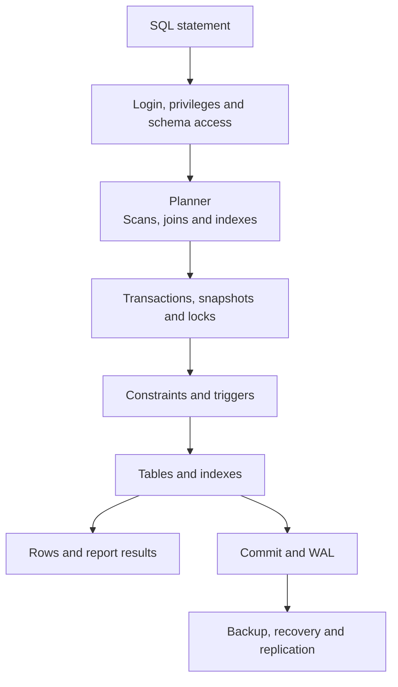
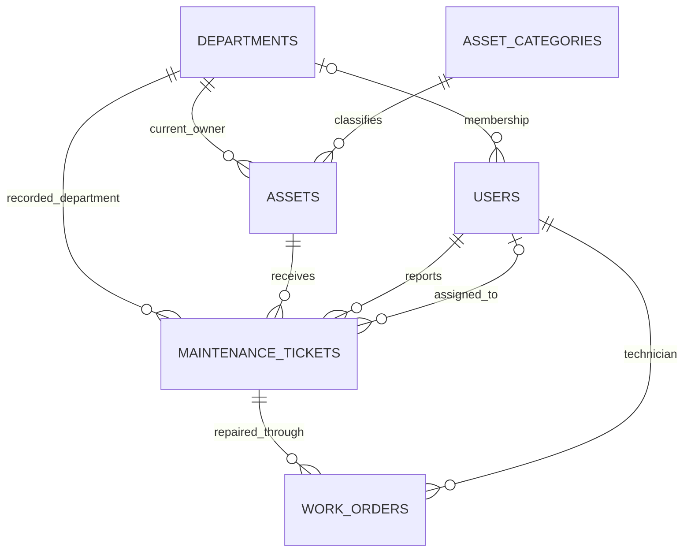
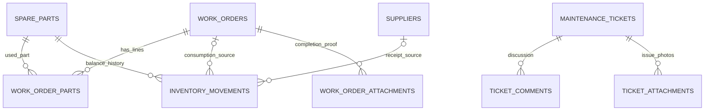
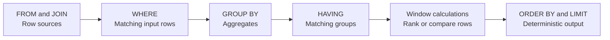
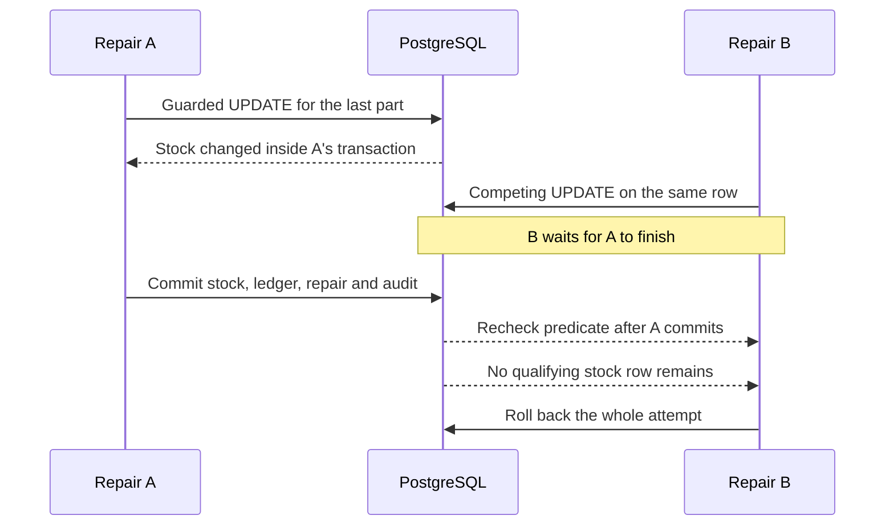

# PostgreSQL: the database

[Project overview](../README.md) · [SQLAlchemy guide](SQLALCHEMY.md) · [Complete function and command index](reference/POSTGRESQL_FUNCTIONS.md)

PostgreSQL executes SQL, stores rows, checks constraints, coordinates concurrent transactions, and supplies reporting, indexing, and recovery features. This project targets **PostgreSQL 18**. SQLAlchemy builds statements in Python and psycopg transports them to the server.

## A visual map



| Term | Meaning here |
|---|---|
| Server / cluster | The PostgreSQL instance containing databases. |
| Database | The learning/application database is `college_learning`. |
| Schema | A namespace. Core application tables use `public`; experiments use guarded isolated schemas. |
| Table / row / column | A record type, one stored record, and an individual stored field. |
| Database role | A login/privilege identity such as the learner, migration owner, or limited runtime login. |
| Application role | A user-record value: student, technician, department admin, or super admin. |

References: [concepts](https://www.postgresql.org/docs/18/tutorial-concepts.html), [schemas](https://www.postgresql.org/docs/18/ddl-schemas.html), [roles](https://www.postgresql.org/docs/18/user-manag.html).

## Records and relationships

**Reporting and repair ownership:**



A ticket keeps its **department at report time**. An eligible asset transfer later does not move historical repair costs. Ordinary user roles require department membership; Super Admin may have no department.

**Stock and repair history:**



Audit events also reference the actor and optional asset, ticket, and recorded department. The **14 application tables** are mapped in [models.py](../college_maintenance/models.py):

| Group | Tables |
|---|---|
| People and catalog | `departments`, `users`, `asset_categories` |
| Equipment and issues | `assets`, `maintenance_tickets` |
| Repair facts | `work_orders`, `work_order_parts` |
| Central stock | `spare_parts`, `suppliers`, `inventory_movements` |
| Discussion and proof | `ticket_comments`, `ticket_attachments`, `work_order_attachments` |
| Business history | `audit_events` |

`alembic_version` is migration bookkeeping. Attachment tables store metadata and digests; file bytes live in private storage.

## Types and constraints

| Mechanism | Project use | Protection |
|---|---|---|
| UUID primary keys | `gen_random_uuid()` defaults. | Identity independent of a business code. |
| `UNIQUE` | Asset code, SKU, normalized email. | Duplicate business identities. |
| Composite primary key | `(work_order_id, spare_part_id)`. | Duplicate repair part lines. |
| Foreign key with `RESTRICT` | Historical parent references. | Missing parents and destructive removal of referenced records. |
| `NOT NULL` | Required fields. | Missing data. |
| `CHECK` | Status, quantity, stock, cost, nonblank text. | Invalid individual row values. |
| `numeric(12,2)` | Prices and labor. | Stored decimal money; Python validates precision before conversion. |
| `timestamptz` | Creation, completion, audit. | Aware instants; reports choose a grouping timezone explicitly. |
| `jsonb` | Audit payloads. | Structured event details alongside relational IDs. |
| Partial unique index | Active order per ticket; consumption per order/part. | Uniqueness over the relevant subset. |

A `CHECK` returning NULL does not reject a row by itself; required values also need `NOT NULL`. A foreign key does not automatically index the referencing columns, so lookup indexes are declared deliberately.

References: [constraints](https://www.postgresql.org/docs/18/ddl-constraints.html), [numeric types](https://www.postgresql.org/docs/18/datatype-numeric.html), [date/time](https://www.postgresql.org/docs/18/datatype-datetime.html).

## SQL: from rows to answers



This is a reasoning model. The planner can choose a different physical execution order.

```sql
-- One row per department, including an empty department.
SELECT d.code, count(t.id) AS ticket_count
FROM departments AS d
LEFT JOIN maintenance_tickets AS t ON t.department_id = d.id
GROUP BY d.id, d.code
ORDER BY d.code;
```

`count(t.id)` avoids counting the unmatched outer-join placeholder. For costs, parts aggregate to one row per work order **before** other joins; joining comments directly into the money calculation would multiply totals.

| Question | SQL feature | Source |
|---|---|---|
| Page issues | Compound ordering, keyset bounds, `LIMIT`/`OFFSET`. | [pagination](../college_maintenance/pagination.py) |
| Retain unassigned issues | `LEFT JOIN`, nullable assignee. | [reads](../college_maintenance/reads.py) |
| Total costs correctly | `sum`, `coalesce`, grouped subqueries. | [reports](../college_maintenance/reports.py) |
| Latest comment | `LATERAL`, correlated query, `DISTINCT ON`, timestamp/UUID ties. | [advanced reports](../college_maintenance/advanced_reports.py) |
| Rank failures | `dense_rank`, `row_number`, `OVER`. | [analytics](../college_maintenance/analytics.py) |
| Fill reporting months | `generate_series`, `date_trunc`, `timezone`, `lag`. | [monthly reports](../college_maintenance/analytics.py) |
| Search text | `to_tsvector`, `plainto_tsquery`, `@@`, `ts_rank_cd`. | [search](../college_maintenance/search.py) |

References: [queries](https://www.postgresql.org/docs/18/queries.html), [aggregates](https://www.postgresql.org/docs/18/functions-aggregate.html), [window functions](https://www.postgresql.org/docs/18/functions-window.html).

## Functions, expressions, commands, and tools

| Kind | Examples | Role |
|---|---|---|
| Database function | `lower()`, `sum()`, `date_trunc()`, `pg_backend_pid()` | Produces a value or performs a defined server action. |
| SQL expression/syntax | `CASE`, `COALESCE`, `CAST`, `EXISTS`, `OVER` | Language constructs; not all are ordinary functions. |
| SQL command | `SELECT`, `UPDATE`, `CREATE TABLE`, `GRANT`, `VACUUM` | An instruction sent to the database. |
| Project-defined routine | `protect_history()`, assertion and trigger functions. | A function defined by this repository. |
| Client tool | `psql`, `pg_dump`, `pg_restore`, `pg_basebackup`, `pg_ctl` | A program connecting to or operating PostgreSQL. |
| Python driver API | `psycopg.connect`, `execute`, `copy`, `write_row` | Python transport/result handling, separate from server functions. |

The **[function and command index](reference/POSTGRESQL_FUNCTIONS.md)** groups the discovered names, explains them, and links to source. Reference: [PostgreSQL 18 functions and operators](https://www.postgresql.org/docs/18/functions.html).

## Transactions, locks, and retries

At the default READ COMMITTED isolation level, a competing updater waits for the row and rechecks its predicate after the other transaction commits:



This parameterized SQL shape runs inside completion (`$1` is a part ID and `$2` is a validated positive quantity):

```sql
UPDATE spare_parts
SET stock_quantity = stock_quantity - $2
WHERE id = $1
  AND stock_quantity >= $2
  AND is_archived = false
RETURNING current_unit_cost, stock_quantity;
```

[consume_guarded()](../college_maintenance/inventory.py) obtains the result. [complete_in_session()](../college_maintenance/completion.py) also locks parents, verifies proof, writes movements, freezes costs, changes states, and writes audit. Any shortage or later failure rolls back the attempt.

| Mechanism | Demonstrated behavior |
|---|---|
| `BEGIN`, `COMMIT`, `ROLLBACK` | All-or-nothing business operations. |
| READ COMMITTED | A committed snapshot per statement; Python object caching is separate. |
| `FOR UPDATE` | Explicit row protection and parent/child coordination. |
| Consistent lock order | Ticket, order, and sorted parts reduce conflicting acquisition patterns. |
| `40001`, `40P01` | Serialization/deadlock failures retried as bounded whole transactions. |
| `23505`, `23514`, `23503` | Unique, check, foreign-key failures with different meanings. |
| Version predicates | Reject stale edits; Core/bulk writers must include them deliberately. |
| Durable work-order identity | Repeated completion resolves its original result without repeating stock movements. |

References: [isolation](https://www.postgresql.org/docs/18/transaction-iso.html), [locking](https://www.postgresql.org/docs/18/explicit-locking.html), [error codes](https://www.postgresql.org/docs/18/errcodes-appendix.html).

## History, performance, and operations

| Area | What to inspect | Source |
|---|---|---|
| Triggers | Completed-fact protection and append-only history. | [history migration](../migrations/versions/0010_history_guards.py) |
| Migrations | Ordered changes and exact installed constraint names. | [revisions](../migrations/versions) |
| Plans/indexes | Actual rows, buffers, loops, scans, sorts, and measured index alternatives. | [performance helper](../labs/shared/performance_lab.py) |
| Roles/RLS | Owner/runtime separation and actual non-owner row-security tests. | [deployment guide](DEPLOYMENT_AND_RECOVERY.md), [RLS proof](../labs/step-74/python_lab.py) |
| Maintenance | Blockers, idle transactions, statistics, `VACUUM`/`ANALYZE`. | [maintenance proof](../labs/step-60/python_lab.py) |
| Recovery | Dump/restore, separate file backups, WAL recovery and replication. | [recovery guide](DEPLOYMENT_AND_RECOVERY.md), [recovery script](../labs/step-78/recovery.sh) |

An index is chosen for a query and its data distribution. A sequential scan can be appropriate for common rows or a small table. The experiments record plans rather than promising a universal speed improvement.

References: [EXPLAIN](https://www.postgresql.org/docs/18/using-explain.html), [indexes](https://www.postgresql.org/docs/18/indexes.html), [backup](https://www.postgresql.org/docs/18/backup.html).

## Application features and isolated experiments

| Core backend | Isolated demonstrations / optional prototypes |
|---|---|
| Asset/ticket tables and constraints | Alternate inheritance, arrays, ranges, domains and composites |
| Authorized queries, search and analytics | Alternate indexes, views, materialized views and JSONB mutation |
| Atomic repair, stock, audit and history | RLS, async streaming and partition retention |
| Local deployment with separate owner/runtime | Private PITR/replication clusters and simulated outbox |
| Reviewed core migration history | Independent preventive-booking API/schema and exclusion constraint |

The [reference coverage page](REFERENCE_COVERAGE.md) explains adoption boundaries. The [SQLAlchemy guide](SQLALCHEMY.md) explains the Python side of these mechanisms. The original [experiment archive](LEARNING_PATH.md) retains detailed proofs.
