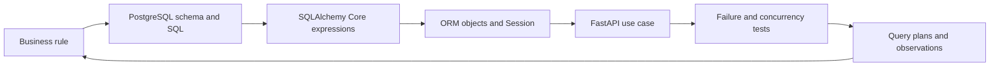

**Learn PostgreSQL and SQLAlchemy through the Smart College Asset & Maintenance Management System**

Research date: 18 October 2026. Starting point: comfortable with Python and basic SQL, new to SQLAlchemy. Progress is based on demonstrated understanding, with no schedule or time allocation.

This is a proposed learning and implementation guide, not an implemented application or a claim that the examples have been executed. SQL examples assume the schema decisions described below. The exercises and acceptance criteria are original recommendations; the linked official documentation supports the database and library behavior.

Step 1 now has a written [project contract](PROJECT_CONTRACT.md) and [worked acceptance examples](../labs/step-01/notes.md). The contract is the project's source for business decisions; the technical mechanisms below remain implementation guidance for later lessons.

Step 2 now has a running PostgreSQL 18 learning environment with [inspection instructions](../labs/step-02/notes.md) and [captured execution evidence](../labs/step-02/evidence.txt). Its disposable transaction probe is rolled back; application tables and SQLAlchemy models are still later steps.

Step 3 now has a [logical relational model](RELATIONAL_MODEL.md), [normalization lab](../labs/step-03/notes.md), and [executed model evidence](../labs/step-03/evidence.txt). The five-table demonstration is rolled back after verification; permanent application schema and ORM implementation remain later steps.

Step 4 now has [identifier and ordinary-type decisions](IDENTIFIERS_AND_TYPES.md), a [UUID/identity/type lab](../labs/step-04/notes.md), and [executed evidence](../labs/step-04/evidence.txt). It verifies independent UUID/business-key constraints and generator/type behavior; its demonstration objects are rolled back.

Step 5 now has [money/time decisions](MONEY_AND_TIME.md), a [Decimal/datetime and SQL lab](../labs/step-05/notes.md), and [executed evidence](../labs/step-05/evidence.txt). It verifies exact repair costs, validation before numeric rounding, aware instants, and local-midnight reporting across SQL and Python. Its SQL objects are rolled back.

Step 6 now has [row-validity decisions](ROW_VALIDITY.md), a [constraint and NULL/default lab](../labs/step-06/notes.md), and [executed evidence](../labs/step-06/evidence.txt). Its 48 PostgreSQL checks include 37 expected rejections, independent business-key constraints, a composite primary key, and comparisons of nullable CHECK/UNIQUE behavior. Its tables and helper are rolled back; foreign keys and full workflow enforcement remain later steps.

Step 7 now has [referential-integrity decisions](REFERENTIAL_INTEGRITY.md), a [foreign-key/deletion lab](../labs/step-07/notes.md), and [executed evidence](../labs/step-07/evidence.txt). Its 43 PostgreSQL checks include 28 expected rejections, seven explicit project foreign keys, composite nullable references, and deletion-action comparisons. Historical department/user/asset links survive transfer and lifecycle-flag changes. Its objects are rolled back; permanent schema and complete workflow enforcement remain later steps.

Step 8 now has a [SQL CRUD/transaction guide](SQL_CRUD_AND_TRANSACTIONS.md), a [committed-baseline and rollback lab](../labs/step-08/notes.md), and [executed evidence](../labs/step-08/evidence.txt). Its 23 verification checks cover RETURNING values, affected-row counts, rollback of inserts/updates/deletes, aborted-transaction recovery, independent observation, and guarded committed cleanup. No study schema remains afterward; permanent application schema and authorized workflows remain later steps.

Step 9 now has a [filtering/ordering guide](FILTERING_AND_ORDERING.md), a [prediction-based SQL lab](../labs/step-09/notes.md), and [executed evidence](../labs/step-09/evidence.txt). Its 37 PostgreSQL checks verify scoped active/unassigned lists, NULL/empty/case distinctions, pattern matching, functions/casts, and unique ORDER BY/LIMIT results on tied timestamps. Its objects are rolled back; SQLAlchemy translation follows in later lessons.

Step 10 now has a [join guide](SQL_JOINS.md), a [ticket-display and join-prediction lab](../labs/step-10/notes.md), and [executed evidence](../labs/step-10/evidence.txt). Its 26 PostgreSQL checks verify required and optional reference paths, distinct reporter/assignee aliases, ON versus WHERE, historical department attribution, and one-to-many/self-join multiplicity. All objects are rolled back; SQLAlchemy translation follows in later lessons.

Step 11 now has an [aggregation guide](SQL_AGGREGATION.md), a [hand-counted reporting lab](../labs/step-11/notes.md), and [executed evidence](../labs/step-11/evidence.txt). Its 25 PostgreSQL checks verify zero-inclusive department/priority counts, COUNT variants, WHERE/HAVING/FILTER/CASE distinctions, completed-labor SUM/AVG, absent versus zero values, join grain, and wider exact numeric report results. All objects are rolled back; SQLAlchemy translation follows in later lessons.

Step 12 now has an [existence/subquery guide](SQL_EXISTENCE_AND_SUBQUERIES.md), a [fixture-based comparison lab](../labs/step-12/notes.md), and [executed evidence](../labs/step-12/evidence.txt). Its 31 PostgreSQL checks compare NOT EXISTS, anti-joins, scalar counts, nullable NOT IN, and set operations while distinguishing current from historical assignments. All objects are rolled back; the next lab introduces Python database layers and SQLAlchemy.

Step 13 now has a [Python database-layer guide](PYTHON_DATABASE_LAYERS.md), a shared [application Engine configuration](../college_maintenance/database.py), a [Core/driver tracing lab](../labs/step-13/notes.md), and [executed evidence](../labs/step-13/evidence.txt). Its 23 checks verify SQLAlchemy 2.1.6 with psycopg 3.3.6, the dialect/cursor/server path, lazy Engine creation, physical connection reuse, SQL logging, error propagation/recovery, and independently observed disposal. No mapped model or permanent application table is introduced.

Step 14 now has a [Core connection/binding guide](CORE_CONNECTIONS_AND_BINDING.md), a [related-write transaction lab](../labs/step-14/notes.md), and [executed evidence](../labs/step-14/evidence.txt). Its 32 checks verify bound values, a closed identifier allowlist, autobegin, commits, exception propagation, atomic rollback, and resource cleanup using the existing shared Engine. Independent psql confirms exact committed rows, literal injection-shaped text, and the absence of rolled-back pairs before guarded cleanup. No mapped model or permanent application schema is introduced.

Step 15 now has a [metadata/reflection guide](SCHEMA_METADATA_AND_REFLECTION.md), [Core schema declarations](../labs/step-15/schema.py), an [inspection and drift lab](../labs/step-15/notes.md), and [executed evidence](../labs/step-15/evidence.txt). Its 31 checks compare live PostgreSQL columns and constraints with declarations and isolated reflection, verify naming/schema qualification, and expose create_all's inability to migrate existing tables. The full disposable DDL transaction rolls back; migration ownership remains a later lesson.

Step 16 now has a [Core DML/results guide](CORE_DML_AND_RESULTS.md), an [asset CRUD and cardinality lab](../labs/step-16/notes.md), and [executed evidence](../labs/step-16/evidence.txt). Its 40 checks verify generated-ID RETURNING, exact affected rows, result representations, zero/one/many contracts, NULL versus absence, consumption, and rowcount interpretation. Core and raw SQL agree before complete transactional cleanup. This completes the initial Core sequence; typed ORM mappings begin in Step 17.

Step 17 now has [five typed application mappings](../college_maintenance/models.py), a [mapping guide](TYPED_ORM_MAPPINGS.md), a [mapper/database enforcement lab](../labs/step-17/notes.md), and [executed evidence](../labs/step-17/evidence.txt). Its 48 checks distinguish Python annotations, ORM configuration, and installed PostgreSQL constraints. The mappings cover 36 columns and seven reference policies; eleven direct-SQL rejections verify database enforcement independently. Only a disposable translated schema is created and rolled back. Session persistence begins in Step 18.

Step 18 now has a [shared Session factory](../college_maintenance/sessions.py), a [Session persistence guide](ORM_SESSION_PERSISTENCE.md), [lesson-local asset CRUD](../labs/step-18/asset_crud.py), a [prediction lab](../labs/step-18/notes.md), and [executed evidence](../labs/step-18/evidence.txt). Its 32 checks verify short-lived Sessions, mapped-object results, committed CRUD, rollback on close and exceptions, SQL logging, and resource release. Independent psql checks the exact committed rows after writer disposal, then exact-run guarded cleanup removes the fixture. Detailed lifecycle/recovery, relationships, migrations, and full application workflows remain later lessons.

Step 19 now has an [object lifecycle guide](ORM_OBJECT_LIFECYCLE.md), [prediction lab](../labs/step-19/notes.md), and [executed evidence](../labs/step-19/evidence.txt). Its 39 checks inspect 15 state checkpoints, new/dirty/deleted collections, attribute history, same-value updates, delete timing, detachment, and rollback restoration. Independent psql confirms the exact surviving row after disposal; guarded cleanup removes the committed fixture. Flush visibility and failed-Session recovery are Step 20.

Step 20 now has a [flush/commit guide](ORM_FLUSH_AND_COMMIT.md), [ticket visibility and recovery lab](../labs/step-20/notes.md), and [executed evidence](../labs/step-20/evidence.txt). Its 35 checks compare a live writer with a separate read-only backend, prove rollback of successful flushes, inspect autoflush controls, and recover the same Session after a CHECK failure. Exact statement ordering and independent psql confirm three committed tickets, unchanged references, disposed connections, and guarded cleanup. Identity freshness and relationships follow later.

Follow the [sequential learning path](LEARNING_PATH.md): 64 project steps followed by 16 specialist extensions. Advance when you can demonstrate the result and explain the failure cases. Finishing CRUD alone will not establish practical mastery.

Use PostgreSQL 18 and SQLAlchemy 2.1 documentation consistently for this route. The SQLAlchemy download page currently identifies 2.1 as the current series and 2.0 as the maintenance series. Pin the selected package versions in the project rather than depending on an unbounded latest release. Use psycopg 3, Alembic, pytest, FastAPI, Docker Compose, psql, and pgAdmin as supporting tools. Begin with synchronous SQLAlchemy; add async after the transaction and loading exercises. [SQLAlchemy release information](https://www.sqlalchemy.org/download.html), [PostgreSQL documentation](https://www.postgresql.org/docs/18/index.html).

**The learning method**

For every important feature, follow this loop:

1. State the business rule and the invariant that must survive errors and concurrency.
2. Implement a small version directly in SQL and inspect it in psql.
3. Express the same operation with SQLAlchemy Core or the ORM.
4. Inspect the emitted SQL and its parameters.
5. Make it fail deliberately, including from a second connection where relevant.
6. Record the evidence: assertions, query count, execution plan, or restored data.

SQLAlchemy Core builds SQL expressions and handles connections and results. The ORM adds mapped objects, relationship management, an identity map, and a unit of work. PostgreSQL executes SQL and enforces database constraints. Learn all three layers together; the official Unified Tutorial follows a Core-first progression into ORM concepts. [SQLAlchemy Unified Tutorial](https://docs.sqlalchemy.org/en/21/tutorial/index.html).



At each stage, combine targeted reading, implementation, SQL/ORM comparisons, failure experiments, and explanation. Use FastAPI's API documentation as the initial interface. Build the React dashboard after the database workflow is reliable.

**Connect each concept to a feature**

The following is a curriculum map, not a suggestion to implement every topic at once.

| Project feature | PostgreSQL concepts | SQLAlchemy concepts | Evidence of understanding |
|---|---|---|---|
| Department and asset registry | Normalization, primary/candidate keys, foreign keys | DeclarativeBase, metadata, Mapped, mapped_column | Draw the schema and explain every key |
| Required fields and valid stock | NOT NULL, CHECK, UNIQUE | nullable, CheckConstraint, UniqueConstraint | Invalid direct SQL is rejected |
| Asset identity | UUID, natural versus surrogate keys | UUID mapping, Python/server defaults | Duplicate asset_code fails independently of UUID |
| Money and dates | NUMERIC, timestamptz, NULL semantics | Decimal, Numeric, DateTime(timezone=True), is_(None) | Exact costs; correct timezone conversion |
| Department users and assets | One-to-many foreign-key design | relationship, back_populates | Explain relationship versus database FK |
| Reporter and assignee | Two foreign keys to the same users table | foreign_keys, aliased | Query both user roles without ambiguity |
| Work order part usage | Junction table with attributes; composite key | Association object mapping | Persist quantity and unit cost on the link |
| Asset containment, optional | Self-referencing FK; recursive CTE | remote_side, aliased, recursive cte | Traverse a lab and its contained equipment |
| Basic CRUD | INSERT, SELECT, UPDATE, DELETE, RETURNING | Core DML, Session.add/get/delete | Predict SQL and inspect results |
| Search and filtering | WHERE, JOIN, outer join, EXISTS, ordering | select, join, outerjoin, exists, any/has | Include assets with zero tickets correctly |
| Reporting | GROUP BY, HAVING, CASE, COALESCE | func, case, labeled expressions | Totals match a hand-calculated fixture |
| Advanced reporting | Subqueries, CTEs, window functions | subquery, cte, over, aliased | Top failing assets per department |
| Ticket feed | Deterministic ordering, keyset pagination | Composable select and cursor predicates | Equal timestamps do not duplicate page rows |
| Object persistence | Database transaction versus Python object state | Identity map, unit of work, flush | Explain why flush is not commit |
| Repeated object access | Query execution and transaction snapshots | get, identity map, refresh, expire | Show identity-map reuse and stale state |
| Ticket list display | Join row multiplication and query round trips | selectinload, joinedload, raiseload, unique | Query count remains bounded as rows grow |
| Ticket deletion and history | ON DELETE policies, referential integrity | Cascades, delete-orphan, passive_deletes | Historical work is preserved by policy |
| Schema changes | ALTER TABLE, backfills, DDL locks | Alembic revisions, target_metadata | Upgrade a populated older database |
| Repair completion | Atomic multi-table changes | Explicit transaction boundary | Injected failure rolls back every write |
| Competing repairs | MVCC, row locks, guarded UPDATE | with_for_update, update().returning() | Last unit cannot be consumed twice |
| Duplicate requests | Unique constraints and durable operation state | IntegrityError handling, transaction scope | Completion retry creates no extra movement |
| Conflicting ticket edits | Conditional UPDATE; optimistic concurrency | version_id_col or explicit version predicate | Stale edit is detected |
| Bulk asset import | COPY, staging tables, ON CONFLICT | PostgreSQL insert, Core bulk execution, savepoints | Bad rows are handled by a documented policy |
| Flexible equipment details | JSONB and targeted GIN/expression indexes | JSONB mapping, mutable tracking | A JSON edit persists and can be queried |
| Ticket text search | Full-text search and GIN | PostgreSQL functions/expressions | Search returns ranked relevant tickets |
| Department access | Roles, GRANT, optional RLS | Authorized query predicates, transaction context | Another department's rows are inaccessible |
| Audit history | Transactional INSERT, optional triggers | Service-layer writes, events as a comparison | Failed changes leave no success audit row |
| Slow queue | B-tree/composite/partial indexes, EXPLAIN | Index definitions and emitted SQL | Before/after plans explain an improvement |
| Repeated dashboard queries | Views and materialized views | Query projections or explicit read mappings | Refresh/staleness policy is stated |
| Production behavior | Statistics, VACUUM, locks, backup/restore | Pooling, session cleanup, timeouts | Restore and connection cleanup succeed |
| Async extension | Same isolation/locking guarantees | AsyncEngine, AsyncSession, explicit loading | Separate session per concurrent task |

The expression and result APIs above are documented in [SELECT statements](https://docs.sqlalchemy.org/en/21/tutorial/data_select.html). This map assigns their use to this project's requirements; it is not a prescribed architecture from the documentation.

**Make the schema teach the right lessons**

Keep the eleven original tables, and add three tables as they become necessary:

| Table | Purpose and important choices |
|---|---|
| departments | UUID key, unique department code, name |
| users | Department FK, role, unique normalized email, password hash, active flag; a Super Admin may have no department |
| asset_categories | Category code and name; define once rather than repeat category details on assets |
| assets | Unique asset_code, category FK, department FK, status, location, optional JSONB specifications |
| maintenance_tickets | Asset, reporter, nullable assignee, department snapshot, priority, status, timestamps, approval/rejection details |
| ticket_comments | Ticket, author, body, created_at |
| work_orders | Ticket, technician, status, labor_cost, completed_at, completion notes |
| spare_parts | Unique SKU, preferred supplier, stock_quantity, reorder_level, standard unit cost |
| suppliers | Supplier identity and contact details |
| inventory_transactions | Part, signed quantity_delta, kind, actor, timestamp, optional work-order reference |
| audit_logs | Actor, action, entity type/id, timestamp, request identifier, minimal structured change details |
| work_order_parts | Composite key (work_order_id, spare_part_id), quantity_used, nullable draft/final unit_cost_at_use |
| ticket_attachments | Ticket FK and file metadata/storage key |
| work_order_attachments | Work order FK and file metadata/storage key |

These are design recommendations. WorkOrderPart is an association object because the relationship carries business data. Avoid two competing writable paths: an association model plus an independent writable secondary relationship to the same table can produce conflicting inserts. [SQLAlchemy association objects](https://docs.sqlalchemy.org/en/21/orm/basic_relationships.html#association-object).

Record these decisions before writing models:

- An asset belongs to one department. A ticket captures its department at creation; later asset transfers do not silently move historical costs. If ticket transfers are added, define their history and authorization explicitly.
- Reporter and assignee are separate relationships to users. A foreign key proves that a user exists; it does not prove the assignee is a technician. Enforce role and department rules in the authorized assignment use case. [Multiple foreign-key paths](https://docs.sqlalchemy.org/en/21/orm/join_conditions.html#handling-multiple-join-paths).
- One work order contains at most one consolidated line per spare part. Completed work orders and their cost snapshots become immutable. Additional repair work uses another work order.
- Begin with at most one active work order per ticket, enforced by a partial unique index on ticket_id for draft/in_progress orders. A ticket may still have many completed orders over its history. Define a different verification rule explicitly if simultaneous active orders are introduced later.
- Use one currency initially. Compute cost as labor_cost + SUM(quantity_used * unit_cost_at_use). Freeze standard part cost at completion for this learning version; receipt-lot costing is a later extension.
- Draft part lines do not reserve inventory. Availability is checked again at completion. Add reservations only when you are ready to model reserved versus physical stock.
- Every stock change, including opening balances and corrections, produces a ledger movement in the same transaction as the balance change. Reconcile stock_quantity with SUM(quantity_delta).
- Retire assets and deactivate users when they have history. Avoid broad cascading deletion of tickets, work orders, inventory movements, and audit records.
- Store attachment metadata in PostgreSQL and file bytes in a file/object storage location. File storage is outside the database transaction; upload first, attach the storage key transactionally, and provide orphan cleanup or compensation.
- Prefer typed columns for relationships, status, dates, and money. Use JSONB for varying specifications such as RAM or projector lumens, not the entire relational model.

Use UUID values for identifiers, NUMERIC(12,2)/Decimal for money, integer stock quantities, and timestamptz/timezone-aware datetime values for events. PostgreSQL normalizes timestamptz instants and displays them in a session timezone; it does not preserve the original timezone name. Use an explicit reporting timezone when grouping dates. [Numeric types](https://www.postgresql.org/docs/18/datatype-numeric.html), [Date/time types](https://www.postgresql.org/docs/18/datatype-datetime.html).

Database defaults and Python defaults are different: an ORM-side default only applies when that SQLAlchemy path supplies the value; server_default is part of database DDL. Experiment with an insert from psql to see the difference. Use CHECK plus NOT NULL where both value restrictions and mandatory presence are intended. PostgreSQL CHECK is not an appropriate mechanism for looking up another table's current role or stock. Foreign keys also do not automatically index their referencing columns. [PostgreSQL constraints](https://www.postgresql.org/docs/18/ddl-constraints.html).

**A milestone route with practical gates**

The full [learning path](LEARNING_PATH.md) gives an individual learn/apply/prove checklist for every step.

| Steps | Build and study | Pass condition |
|---|---|---|
| 1–8 | Business rules, PostgreSQL tools, schema, types, constraints, SQL CRUD | Explain and enforce the first relational invariants |
| 9–16 | SQL queries and SQLAlchemy Core | Equivalent SQL/Core operations with understood results |
| 17–24 | ORM models, Session state, relationships | Correct object graph and explained persistence behavior |
| 25–32 | Deletion policy, migrations, transaction ownership, loading | Safe schema evolution and predictable ticket reads |
| 33–40 | API workflow, permissions, audit, inventory, completion | One complete authorized repair use case |
| 41–48 | Failure injection, MVCC, locking, retries, versioning | Correct results under rollback and concurrent requests |
| 49–56 | Analytics, views, plans, indexes, realistic fixtures | Correct totals and evidence-based tuning |
| 57–64 | Imports, security, integration tests, operation, recovery | Reproducible setup, restored data, full acceptance demonstration |
| 65–80 | Specialist extensions with stated prerequisites | Keep features only after their value and correctness are demonstrated |

Do not skip concurrency, migrations, or report correctness to finish the checklist faster.

**Understand a Session before building many endpoints**

Be able to distinguish these concepts:

| Concept | Meaning to demonstrate |
|---|---|
| Engine | Application-level database interface with a dialect and connection pool |
| Connection | A checked-out database connection used to execute SQL |
| Session | ORM identity map and unit of work operating through database transactions |
| add | Associate a new object with the unit of work; not a promise of an immediate INSERT |
| flush | Emit pending SQL inside the current transaction; rollback can still undo it |
| commit | Flush pending changes and commit the database transaction |
| rollback | Abort the transaction and restore a usable transactional boundary |
| refresh / expire | Reload state now / mark attributes to reload on later access |

Trace transient, pending, persistent, deleted, and detached states using inspect(obj). Compare two Session.get calls for one primary key with a filtered SELECT: identity-map reuse is not a general query-result cache. Demonstrate default expiration after commit and a failed flush requiring rollback before continued use. [Session basics](https://docs.sqlalchemy.org/en/21/orm/session_basics.html), [State management](https://docs.sqlalchemy.org/en/21/orm/session_state_management.html).

Own the transaction at the use-case boundary. Helpers may query, add, or flush; they should not independently commit the pieces of a repair. A new sessionmaker.begin() context creates a session and transaction and commits or rolls back on exit. Ordinary reads can trigger autobegin, so do not call session.begin() blindly after authentication has already queried through the same Session. Choose and document one outer transaction owner. [Transaction management](https://docs.sqlalchemy.org/en/21/orm/session_transaction.html).

For the initial FastAPI app, use synchronous routes with synchronous database calls, one Session per request/use case, and guaranteed cleanup. Do not share a Session across threads or use one AsyncSession in multiple concurrent tasks. Add async only after you can predict which accesses cause SQL. [Session concurrency guidance](https://docs.sqlalchemy.org/en/21/orm/session_basics.html#is-the-session-thread-safe-is-asyncsession-safe-to-share-in-concurrent-tasks), [Async SQLAlchemy](https://docs.sqlalchemy.org/en/21/orm/extensions/asyncio.html).

**Work-order completion is the central transaction exercise**

The use case must establish all of these invariants together:

1. The actor may complete this particular work order.
2. The ticket is in a state that allows work; a completed work order is never consumed again.
3. Part lines cannot change while completion calculates and consumes them.
4. All quantities are positive and sufficient stock exists for every line.
5. The balance, consumption ledger, frozen costs, work-order state, ticket state, and success audit entry commit together.
6. A retry after an uncertain response returns the existing completed result without another stock movement.

Suggested transaction protocol, expressed as pseudocode rather than complete application code:

```text
BEGIN
  Locate the immutable ticket_id for this work order.
  Lock the ticket row, then the work order row, following a documented order.
  Check actor identity and resource scope.
  If already completed, return its stored result without consuming stock.
  Otherwise, check allowed ticket and work-order states.
  Load the work order's consolidated part lines.
  Lock the required spare-part rows in ascending primary-key order.
  Validate every requested quantity and snapshot the locked standard costs.
  Decrease each stock balance.
  Insert each consumption inventory transaction.
  Mark the work order completed and freeze its lines and labor cost.
  Set the ticket to awaiting_verification under the ticket lock.
  Insert a success audit entry.
COMMIT
```

Every path that edits the work order's lines must acquire the same parent work-order lock and recheck its status. Every path that changes ticket completion/verification state must participate in the ticket-lock protocol. Locking only existing line rows does not by itself stop a different transaction from inserting a new line. Keep the parent references immutable or revalidate them when establishing locks.

Add NOT NULL and nonnegative stock constraints as a backstop. Under the one-line-per-part policy, add a unique consumption key scoped to (work_order_id, spare_part_id) for kind='consume'; receipts and explicit correction movements use their own identities. This protects against duplicate consumption records, while the transaction protocol keeps state and balances consistent. A UNIQUE key alone is not a whole idempotency design.

As an alternative stock primitive, study this schema-dependent guarded update:

```sql
UPDATE spare_parts
SET stock_quantity = stock_quantity - :quantity
WHERE id = :part_id
  AND stock_quantity >= :quantity
RETURNING id, stock_quantity;
```

The named parameters above are SQLAlchemy/driver bind placeholders, not a psql command to paste unchanged. Validate quantity > 0 before execution. No returned row means the identifier is missing or stock is insufficient; resolve that distinction within the use case. Multiple part updates still need a single surrounding transaction and consistent acquisition order. Under PostgreSQL READ COMMITTED, an UPDATE waiting on a concurrent update re-evaluates its condition against the updated row. [Transaction isolation](https://www.postgresql.org/docs/18/transaction-iso.html).

The SQLAlchemy expression for that primitive is:

```python
from sqlalchemy import update

statement = (
    update(SparePart)
    .where(
        SparePart.id == part_id,
        SparePart.stock_quantity >= quantity,
    )
    .values(stock_quantity=SparePart.stock_quantity - quantity)
    .returning(SparePart.id, SparePart.stock_quantity)
)
row = session.execute(statement).one_or_none()
```

This is an illustrative fragment, not the complete completion service. Compare it with ORM objects loaded using select(...).with_for_update(). In the ORM version, use a fresh transaction or explicitly refresh previously loaded attributes; acquiring a lock is not a blanket refresh of everything already in an identity map. Do not issue network uploads or user interactions while holding inventory locks. [PostgreSQL row locking](https://www.postgresql.org/docs/18/explicit-locking.html), [SQLAlchemy PostgreSQL RETURNING support](https://docs.sqlalchemy.org/en/21/dialects/postgresql.html#insert-update-returning).

**Run these concurrency experiments with two independent connections**

| Experiment | Setup and expected lesson |
|---|---|
| Unprotected stock edit | Start with one unit; both sessions read it; each writes a Python-calculated balance. Observe how two claimed consumptions can leave an inconsistent ledger |
| Guarded stock edit | Both attempt to consume the last unit. One commits consumption; the other gets no eligible update and rolls back its repair |
| READ COMMITTED | Repeat a SELECT while another session commits. Successive statements can observe different committed data |
| REPEATABLE READ | Repeat that experiment using a transaction-wide snapshot; then exercise conflicting writes and required retries |
| Deadlock | Lock part A then B in one session, B then A in another. Observe PostgreSQL aborting one participant; apply consistent lock ordering |
| Duplicate completion | Submit two completions for the same work order. After the first commits, the second observes completed state and adds no movement |
| Stale ticket edit | Load the same version in two sessions. Accept one edit; reject the other using a version predicate |

Use test synchronization barriers or deliberate manual transaction pauses to establish the interleaving, rather than relying on timing sleeps. The default isolation level is READ COMMITTED. SERIALIZABLE can detect broader anomalies but requires retrying the entire failed transaction; it does not remove the need to understand business rules. Handle deadlock and serialization failures with bounded full-transaction retries and independent Sessions, not a retry of only the last statement. [Isolation levels](https://www.postgresql.org/docs/18/transaction-iso.html), [Deadlocks and locking](https://www.postgresql.org/docs/18/explicit-locking.html#LOCKING-DEADLOCKS).

For optimistic editing, map a non-null version_id_col or use an explicit UPDATE ... WHERE id=:id AND version=:expected predicate. ORM version checks occur during individual object flushes; bulk/Core UPDATE paths need their own concurrency predicates. Test both paths. [Version counters](https://docs.sqlalchemy.org/en/21/orm/versioning.html).

**Learn loading by measuring the ticket feed**

Create a page showing each ticket's asset, department, reporter, assignee, and comments. First implement ordinary relationship access, count the SELECTs, and inspect which accesses caused them. Then compare selectinload for collections, joinedload for scalar relationships, and raiseload to expose accidental lazy loads. Collection joinedload requires explicit Result.unique(). Query count alone is insufficient: also inspect multiplied rows and transferred columns. [Relationship loading](https://docs.sqlalchemy.org/en/21/orm/queryguide/relationships.html).

Exercise target: with a fixed page size, additional result rows should not cause one extra SELECT per ticket. A simple fixture loading only tickets and their comments with selectinload will commonly use a ticket query and a batched comments query; more relationships or batching can add queries. Assert the budget for your chosen fixture, rather than declaring two queries a universal rule.

Know the distinction between join(), which changes the query's relational result, and eager-loader options, which populate object attributes. Paginate tickets before expanding collections. Construct the response while the required data is available; do not let a serializer accidentally load relationships after session cleanup. Compare database ON DELETE behavior with ORM cascade and use delete-orphan only where ownership and deletion policy justify it. [Cascades and database deletes](https://docs.sqlalchemy.org/en/21/orm/cascades.html).

**Build a report catalogue that forces you to learn SQL**

Implement each report first in SQL and then as a SQLAlchemy expression. State the grain of its input and result: for example, one row per ticket, completed work order, or department-month. Use fixed fixtures before random data.

| Business question | Concepts to practice | Edge case |
|---|---|---|
| Which assets have never had a ticket? | LEFT JOIN ... IS NULL and NOT EXISTS | Assets with no related rows |
| How many open tickets does each department have? | GROUP BY, filtered aggregate, outer join | Department with zero tickets |
| Which assets fail most frequently? | COUNT, GROUP BY, HAVING | Define which statuses count as a reported failure |
| Which three assets fail most per department? | CTE/subquery plus dense_rank or row_number | State the policy for ties |
| What is maintenance cost by department and month? | Pre-aggregation, joins, date_trunc, SUM | Multiple parts/comments; reporting timezone |
| Which technicians have the largest backlog? | Aggregate workload, aliases, conditional count | Unassigned tickets |
| How long do repairs take? | Timestamp subtraction and interval aggregates | Unfinished tickets and reopened work |
| How did monthly costs change? | Aggregate then lag() window function | Missing months versus zero-cost months |
| Which parts are below reorder level? | Column comparison, joins to suppliers | Equality at the threshold |
| Does stock match the movement ledger? | SUM, COALESCE, outer join, mismatch filter | Opening balance must be represented |
| What is the latest comment for each ticket? | row_number, lateral join, or DISTINCT ON | Equal timestamps need an ID tiebreaker |
| Which tickets have an issue mentioned in text? | Full-text query, ranking, GIN | Empty descriptions and language configuration |

Test a deliberate fan-out bug: one work order has labor cost 100, two part lines, and three ticket comments. Joining all three child collections before SUM can count labor six times. Aggregate part costs to one row per work order first; join only the dimensions required by the report. COUNT(DISTINCT ticket.id) can fix a particular count, but does not generally fix inflated cost sums.

Use views for reusable query definitions. Use a materialized view only after demonstrating a repeated reporting cost and defining when refresh happens and how stale results may be. ORM-mapped views need an actual unique row identity; plain result projections are often enough. [Window functions](https://www.postgresql.org/docs/18/functions-window.html), [CTEs](https://www.postgresql.org/docs/18/queries-with.html), [Materialized views](https://www.postgresql.org/docs/18/rules-materializedviews.html).

**Tune a realistic workload**

Keep two datasets: a small deterministic fixture for correctness and a larger generated set for plans. A suggested experiment is 10 departments, 2,000 assets, and 100,000 tickets, with most tickets already closed and a few departments much busier than others. These are learning-scale choices, not a capacity recommendation.

For the department's recent open-ticket queue, compare a composite B-tree index with a smaller partial index. For example, test (department_id, status, created_at DESC, id DESC), then a partial index on (department_id, created_at DESC, id DESC) restricted to active statuses. Evaluate the actual predicate, ordering, data distribution, and prepared statement plan; do not assume a candidate is always used. Do not duplicate the index already supplied by a primary key or unique constraint. [Multicolumn indexes](https://www.postgresql.org/docs/18/indexes-multicolumn.html), [Partial indexes](https://www.postgresql.org/docs/18/indexes-partial.html).

For each experiment, save query text and parameters, dataset size/distribution, EXPLAIN (ANALYZE, BUFFERS), estimated versus actual rows, loops, scan/join/sort choices, and query count. A sequential scan is sometimes correct. EXPLAIN ANALYZE executes its statement; start with SELECTs in a disposable learning database. [Reading execution plans](https://www.postgresql.org/docs/18/using-explain.html).

Learn statistics and VACUUM through ticket updates and inventory traffic. Observe long idle transactions and dead tuples; distinguish ANALYZE's planner statistics from VACUUM's maintenance work. Use pg_stat_activity and pg_locks to diagnose blocking, and optionally pg_stat_statements for aggregated query workload statistics. Explain pool_size, max_overflow, checkout timeouts, and why a Session must release its connection. [Routine vacuuming](https://www.postgresql.org/docs/18/routine-vacuuming.html), [pg_stat_statements](https://www.postgresql.org/docs/18/pgstatstatements.html), [SQLAlchemy pooling](https://docs.sqlalchemy.org/en/21/core/pooling.html).

**Treat migrations, permissions, and auditing as database work**

Use Alembic as the application schema history. Make a disposable raw-SQL learning database first; once migrations own the application schema, do not silently edit production tables or use create_all as a migration substitute. Import all model metadata in the migration environment, use consistent constraint names, review generated revisions, and test upgrades against both empty and populated databases. Autogenerate cannot infer a table/column rename and may represent one as drop plus add. [Alembic autogenerate](https://alembic.sqlalchemy.org/en/latest/autogenerate.html).

Practice adding a required field using add nullable -> deploy/backfill -> validate -> set NOT NULL, with the exact sequence chosen for your app and data size. Discuss DDL locks and the separate handling required by CREATE INDEX CONCURRENTLY, which cannot run inside a regular transaction block. Migrations affecting native enums, views, triggers, and data transformations require explicit review and sometimes handwritten operations. Do not claim a destructive downgrade recovers deleted data. [CREATE INDEX concurrency](https://www.postgresql.org/docs/18/sql-createindex.html).

Keep application roles separate from PostgreSQL roles. A Student is normally an authenticated application identity, not an individual database login. Use a limited runtime database role and a separate migration owner. Scope department queries and authorize each mutation by the target resource. Then optionally add RLS and prove it using the runtime role: superusers and BYPASSRLS roles bypass it, and owners normally do too. If using pooled connections and transaction-local application context, set it within the same transaction and verify it does not leak into the next request. [Row-level security](https://www.postgresql.org/docs/18/ddl-rowsecurity.html).

Write initial audit entries explicitly in the same transaction as the business change. Compare this with ORM events and a PostgreSQL trigger as a later exercise. App-level logging can miss raw SQL or other writers; a trigger can cover database writes but needs a trustworthy way to identify the application actor. An audit table is not automatically tamper-proof. Decide whether failed/denied attempts belong in separate operational/security logging, since rolling back a business transaction also rolls back its audit insert. [Trigger functions](https://www.postgresql.org/docs/18/plpgsql-trigger.html).

For bulk imports, first choose all-or-nothing versus per-row rejection. Compare a staging table plus COPY, Core bulk INSERT, and PostgreSQL ON CONFLICT with a named conflict target. Practice savepoints for recoverable row failures; begin_nested performs a flush of already-pending state, so stage each experiment deliberately. [COPY](https://www.postgresql.org/docs/18/sql-copy.html), [PostgreSQL upserts](https://docs.sqlalchemy.org/en/21/dialects/postgresql.html#insert-on-conflict-upsert), [Savepoints](https://docs.sqlalchemy.org/en/21/orm/session_transaction.html#using-savepoint).

**Use failure tests to assess mastery**

Run PostgreSQL integration tests for PostgreSQL-specific behavior. SQLite does not demonstrate PostgreSQL locking, isolation, JSONB, indexing, or migration semantics. A test that uses a single Session cannot establish multi-session concurrency behavior.

Keep a small fixture containing an empty department, an asset without tickets, an unassigned ticket, equal timestamps, a zero-cost repair, multiple comments/parts, and a part with exactly one unit. Test these outcomes:

- Duplicate asset codes, invalid foreign keys, forbidden statuses, negative stock, and nonpositive line quantities fail at the appropriate layer.
- A student cannot assign technicians; an unauthorized department cannot read or mutate another department's restricted records.
- A work-order completion fails on one unavailable part without consuming any of the other available parts.
- An exception after inventory UPDATE but before completion/audit causes a complete rollback.
- Concurrent completion of two work orders cannot consume one unit twice.
- Retrying one completed work order creates no new balance change or consumption ledger record.
- A completed work order cannot be edited; further work creates a new order.
- A part-price edit does not rewrite completed repair costs.
- Asset transfers do not silently reattribute historical department costs.
- Reports do not multiply costs when comments or parts are joined.
- Query count stays within the budget for the specified page and loader choices.
- An older populated schema upgrades without losing required data.
- A backup restores into a fresh database and passes the integrity/report fixtures.

Use independent committed transactions and multiple connections for contention tests. A rollback fixture or SAVEPOINT around a single connection is useful for ordinary tests but does not replace real commit/visibility tests. Document which test model each case needs. [Session transaction testing patterns](https://docs.sqlalchemy.org/en/21/orm/session_transaction.html#joining-a-session-into-an-external-transaction-such-as-for-test-suites).

**Stretch topics after the core gates**

| Extension | Connection to this project | Required lesson |
|---|---|---|
| JSONB specifications | Different fields for computers, buses, projectors | Query/index JSON selectively; in-place nested edits need deliberate mutation tracking |
| Full-text search | Search title/description and rank tickets | Tokenization, language configuration, GIN tradeoffs |
| RLS | Department isolation inside PostgreSQL | Correct runtime role and transaction-scoped context |
| Optimistic API editing | Two administrators edit the same ticket | Expected version from client through conditional write |
| Recursive hierarchy | Equipment inside labs/classrooms | Self-reference, traversal, cycle-prevention policy |
| Preventive maintenance | Planned service windows | Range types and exclusion constraints for overlap rules |
| Async API | Concurrent I/O at the application boundary | Explicit loads; AsyncSession per task; same database correctness rules |
| Outbox | Reliable repair-completion notifications | Commit event with repair, publish separately, tolerate duplicate delivery |
| Large audit history | Retention and partitioning experiment | Partition only after a workload demonstrates the benefit |
| Recovery study | Accidental changes or server loss | WAL/PITR and replication are separate operational studies |

JSONB mutation tracking is an ORM concern as well as a storage choice: reassignment is tracked differently from arbitrary nested in-place changes. Verify the saved result with a fresh Session. [PostgreSQL JSON](https://www.postgresql.org/docs/18/datatype-json.html), [SQLAlchemy mutable extension](https://docs.sqlalchemy.org/en/21/orm/extensions/mutable.html). For search, start from [PostgreSQL full-text search](https://www.postgresql.org/docs/18/textsearch-intro.html). For backups, complete a logical dump/restore exercise before extending into recovery infrastructure. [SQL dump and restore](https://www.postgresql.org/docs/18/backup-dump.html).

**Keep the implementation easy to inspect**

Use a small structure when implementation begins; these paths are proposed, not existing code:

```text
app/
  db.py                 # Engine, sessionmaker; no global Session instance
  models/               # Mapped classes and explicit constraints
  schemas/              # Request and response validation
  queries/              # Read queries and report expressions
  services/             # Authorized business use cases and transaction ownership
  api/                  # Thin routes and dependency wiring
alembic/                # Reviewed schema revisions
tests/                  # PostgreSQL integration and concurrency tests
labs/                   # SQL experiments and observed outcomes
docs/                   # Schema decisions, query plans, learning journal
```

Avoid a generic repository framework during the learning stage: it can hide selects, result shapes, eager loading, and transaction boundaries. Introduce abstractions when repeated code supplies a clear reason. Keep authentication and UI work sufficient to exercise real access rules, while spending most of the time on data behavior.

Your journal should contain the invariant, SQL version, SQLAlchemy version, emitted SQL, failure case, and evidence for each feature. Rebuild one feature from a blank file later and explain it without referring to the original implementation.

**Final demonstration**

Complete this journey against a fresh migrated database: a student reports a projector issue; a department admin assigns a technician; the technician completes a repair using two spare parts; a competing repair fails because one part is exhausted; a repeat completion request causes no additional deduction; the admin verifies the repair; a department cost report matches frozen costs; an audit query explains who did what; a backup is restored and the same totals remain correct.

You have reached strong practical competence when you can explain the SQL, choose the transaction boundary, reproduce the concurrency failure, justify the loader/index choices with evidence, and recover the data. Broader PostgreSQL mastery also includes deeper operations and workload experience beyond this application's scope.
