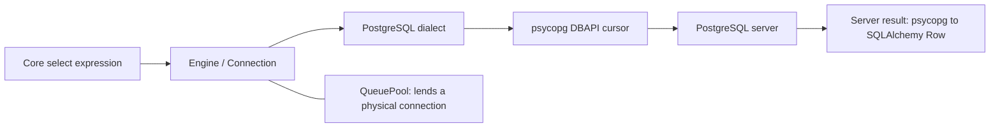

# Step 13: understand the Python database layers

The [Step 13 lab](../labs/step-13/notes.md) introduces synchronous SQLAlchemy Core over psycopg 3 and the existing PostgreSQL learning database. The application module [database.py](../college_maintenance/database.py) defines one shared Engine. No mapped application models or permanent schema are created.

## Identify each layer by its job

| Layer | Job | Concrete observation in this lab |
|---|---|---|
| Core expression | Describe a SQL statement in Python | `select(literal(...), func.current_database(), ...)` |
| Engine | Own connection configuration, dialect, and pool | One imported `engine` supplies both checkouts |
| PostgreSQL dialect | Compile for PostgreSQL and adapt driver interactions | Dialect name postgresql, driver psycopg |
| QueuePool | Retain and lend physical connections | One connect event, two checkout/checkin pairs |
| SQLAlchemy Connection | Wrap one borrowed driver connection and its transaction state | Two separate Connection wrappers share one Engine |
| DBAPI driver | Send commands and receive server results | Actual `psycopg.Connection` and `psycopg.Cursor` objects |
| PostgreSQL | Execute SQL and enforce server behavior | Database/role/backend PID returned by the server |
| ORM Session | Coordinate mapped objects, identity, and units of work | Imported as a type comparison; no Session is instantiated |

An Engine is the shared source of connections, not a per-request ORM Session. Constructing it does not establish a database connection. See the [Engine tutorial](https://docs.sqlalchemy.org/en/21/tutorial/engine.html). A Session adds ORM object-state management; it uses an Engine for database access. See [Session basics](https://docs.sqlalchemy.org/en/21/orm/session_basics.html).



The diagram describes responsibilities. It is not a claim that the pool compiles SQL or that every request creates another Engine.

## Configure the shared Engine once

The [root requirements](../requirements.txt) include the existing timezone lab plus SQLAlchemy 2.1.6 and psycopg 3.3.6 with its binary extra. These versions were installed and executed for this step. The binary driver includes the client libraries needed for this development setup. See [SQLAlchemy releases](https://www.sqlalchemy.org/download.html) and [psycopg installation](https://www.psycopg.org/psycopg3/docs/basic/install.html).

| Setting | Chosen learning value |
|---|---|
| Driver URL | postgresql+psycopg |
| Host/database/user | 127.0.0.1 / college_learning / college_learner |
| Host port | COLLEGE_POSTGRES_PORT, default 55432, matching Compose |
| Password | Read privately from ignored .local/college-learner-password |
| Timezone/application name | UTC / college_step13 |
| QueuePool capacity | One pooled connection, no overflow |
| Connection/pool wait | Five seconds each |
| Connection liveness | pool_pre_ping enabled |
| Logging | Off by default; the local lab enables SQL echo |

`URL.create()` accepts the password as a field, avoiding manual URL escaping. The configured dialect explicitly selects psycopg 3. Automatic parameter logging is hidden, and the displayed URL masks its password. See [Engine configuration](https://docs.sqlalchemy.org/en/21/core/engines.html) and the [psycopg dialect](https://docs.sqlalchemy.org/en/21/dialects/postgresql.html#module-sqlalchemy.dialects.postgresql.psycopg).

The single pool slot makes reuse visible; it is not production sizing guidance. An application should reuse its Engine through its process lifetime. Later lessons add transaction ownership, mapped objects, API use cases, and workload-based pool decisions.

## Trace one real SELECT

The Python expression in [python_lab.py](../labs/step-13/python_lab.py) corresponds to this SQL shape:

```sql
SELECT 'step-13' AS lesson,
       current_database() AS database_name,
       CURRENT_USER AS role_name,
       pg_backend_pid() AS backend_pid,
       current_setting('application_name') AS application_name,
       current_setting('TimeZone') AS timezone,
       current_setting('server_version_num') AS server_version_num;
```

The actual compiled SQL keeps the lesson and setting names in bound parameters. Compilation happens before any physical connection is opened. The lab then:

1. Borrows a SQLAlchemy Connection and obtains its underlying psycopg connection.
2. Executes the tagged Core expression.
3. Observes statement text, parameters, cursor type, and backend PID at `before_cursor_execute`.
4. Observes returned column metadata at `after_cursor_execute`.
5. Reads the SQLAlchemy row and checks its values against the driver and server identity.

These events observe the real execution boundary; they do not replace `cursor.execute`. See [cursor execution events](https://docs.sqlalchemy.org/en/21/core/events.html#sqlalchemy.events.ConnectionEvents.before_cursor_execute). The server PID is compared with psycopg's [connection information](https://www.psycopg.org/psycopg3/docs/api/objects.html#psycopg.ConnectionInfo.backend_pid).

The SQL log also contains PostgreSQL dialect initialization queries. They are distinct from the tagged lesson SELECT. This is a connection-layer trace, not an ORM query-count or performance experiment.

## Separate wrapper closure from physical connection closure

| Phase | SQLAlchemy wrapper | Physical psycopg connection |
|---|---|---|
| Import Engine / compile expression | No checkout | None opened |
| First with-block | First Connection open | Open, checked out |
| After first with-block | First Connection closed | Open, returned to pool |
| Second with-block | New Connection wrapper | Same driver object and backend PID |
| After second with-block | Second Connection closed | Open, returned to pool |
| Final disposal | No outstanding checkout | Returned physical connection closed |

Returning a connection normally rolls back outstanding transaction work and leaves the driver connection reusable. Disposal closes idle pooled connections; it does not close a connection still checked out elsewhere. The lab returns both checkouts before disposal. See [pooling and reset on return](https://docs.sqlalchemy.org/en/21/core/pooling.html) and [Engine disposal](https://docs.sqlalchemy.org/en/21/core/connections.html#sqlalchemy.engine.Engine.dispose).

## Follow an error back through the layers

The deliberately invalid `SELECT 1 / 0` produces PostgreSQL SQLSTATE 22012. psycopg exposes DivisionByZero, and SQLAlchemy raises DataError with that driver exception in `.orig`. The lab checks the original exception, rolls back, and successfully executes a recovery SELECT on the same connection. See [SQLAlchemy exceptions](https://docs.sqlalchemy.org/en/21/core/exceptions.html) and [PostgreSQL error codes](https://www.postgresql.org/docs/18/errcodes-appendix.html).

Local echo records SQL, implicit BEGIN, and ROLLBACK. The traced parameter values are fixed public probe strings. `hide_parameters=True` hides automatic parameter-value output; it does not redact arbitrary SQL text or custom prints. The actual credential is checked absent from the captured log and rendered URL.

The [saved evidence](../labs/step-13/evidence.txt) contains 21 Python checks and two independent psql checks. After disposal, another backend confirms the original Engine backend is gone and no Step 13 schema exists. The lab uses only SELECT statements and creates no application tables. Step 14 next develops Core connection ownership, binding, and related writes in more detail.
