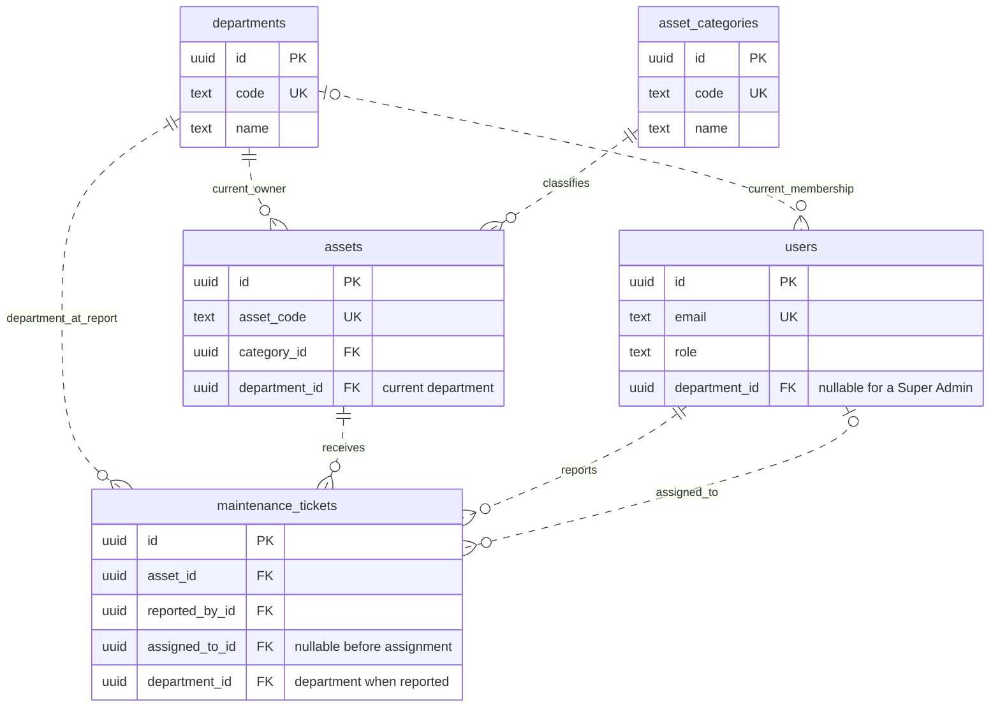
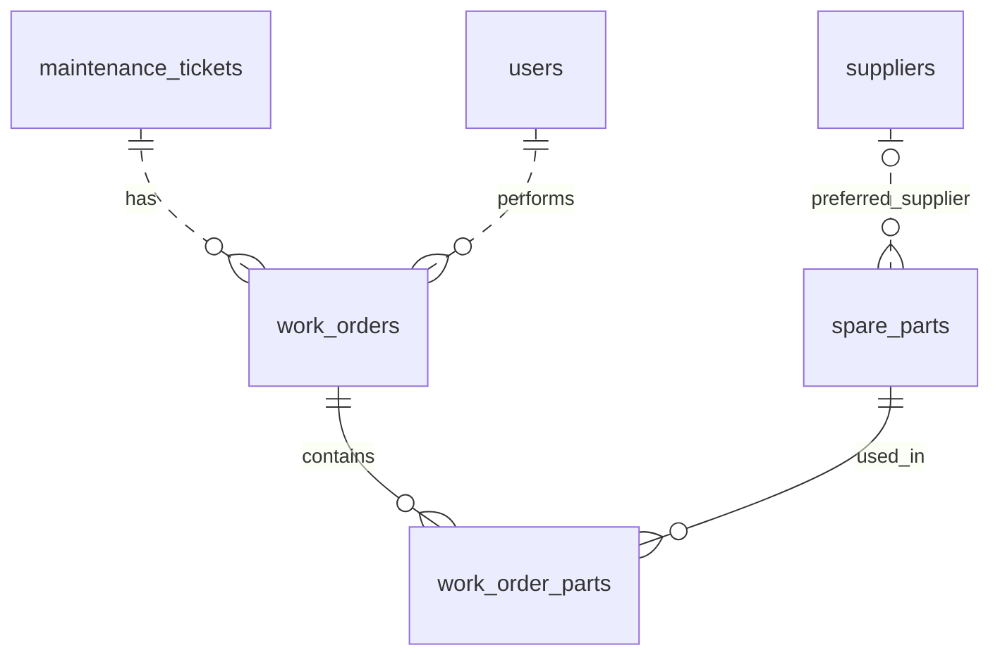

# Step 3: relational model

This is the logical design for the first five application entities, following the [project contract](PROJECT_CONTRACT.md). It identifies which facts belong together, their keys, and their relationships. The [Step 3 lab](../labs/step-03/notes.md) verifies a small version in PostgreSQL and rolls it back. The [Step 17 typed mappings](../college_maintenance/models.py) now represent these entities using the later type/constraint decisions; the [mapping guide](TYPED_ORM_MAPPINGS.md) explains their verified scope. Permanent schema installation and complete workflow enforcement remain later lessons.

## 1. Identify the entities and facts

One row should describe one instance of the table's subject. A department name, a user's current membership, an asset's current location, and a maintenance report are different facts with different lifetimes.

| Entity | One row represents | Key / independent business identity | Owned facts |
|---|---|---|---|
| `departments` | One college department | `id`; unique `code` | `name`, `is_archived` |
| `asset_categories` | One reusable kind of asset | `id`; unique `code` | `name`, `is_archived` |
| `users` | One application account | `id`; unique normalized `email` | `display_name`, `password_hash`, `role`, current `department_id`, `is_active` |
| `assets` | One tracked asset | `id`; unique `asset_code` | `name`, `category_id`, current `department_id`, `status`, `location` |
| `maintenance_tickets` | One report concerning one asset | `id` | `asset_id`, `reported_by_id`, nullable `assigned_to_id`, recorded `department_id`, `title`, `description`, `priority`, `status`, lifecycle details |

Lifecycle details include the creation/assignment/rejection/closure instants and the rejection reason when applicable. Successful workflow changes and verification/rework reasons will also be recorded in audit history. Event types, defaults, and conditional requirements are examined in later steps.

Names are display values, not unique identifiers: two computers may both be called "Lab Computer", and a person's display name may change. `users.email` stores the chosen normalized form; uniqueness is about that stored identity, not the display name. UUID generation and ordinary column types are now described in the [Step 4 decision record](IDENTIFIERS_AND_TYPES.md); money and timestamps are Step 5.

`users.role` is one application role value. A separate roles table becomes useful if roles acquire their own editable metadata; four fixed role names alone do not require another entity. PostgreSQL login roles from Step 2 are separate from these application accounts.

## 2. Draw the relationships

The diagram shows identifiers and relationship fields; the table above describes the other facts. UUID identifiers already follow the contract. Optional links use `o|`; a mandatory single parent uses `||`; `o{` means zero or many children. Dashed links reference a parent without making its foreign key part of the child's primary key.



## 3. State cardinality and optionality precisely

| Relationship | For one child | For one parent | Additional business condition |
|---|---|---|---|
| Department -> User | Zero or one department | Zero or many users | Only a Super Admin may lack a department; a Super Admin may also have one |
| Department -> Asset | Exactly one department | Zero or many assets | The link describes the current owner |
| Category -> Asset | Exactly one category | Zero or many assets | Category details live once in the category catalog |
| Asset -> Ticket | Exactly one asset | Zero or many tickets | Even an asset with no issues is a valid asset |
| Department -> Ticket | Exactly one recorded department | Zero or many tickets | Capture the asset's department when reporting |
| Reporter -> Ticket | Exactly one reporter | Zero or many reported tickets | The reporter is the signed-in actor |
| Assignee -> Ticket | Zero or one assignee | Zero or many assigned tickets | A selected assignee must be an active technician in the ticket's recorded department |

`reported_by_id` and `assigned_to_id` both reference `users.id`, but express different roles in the same relationship graph. They must stay separate. They may refer to the same person if an eligible technician reports and is assigned their own issue. SQL joins need two user aliases; later SQLAlchemy relationships need explicit foreign-key selection.

A foreign key verifies the referenced user's identity. It does not, by itself, verify their role, active status, or current departmental eligibility. Those assignment rules remain authorized workflow checks. Ordinary foreign keys also do not make a ticket's reporter, asset, or recorded department immutable after creation. Reference: [PostgreSQL foreign keys](https://www.postgresql.org/docs/18/tutorial-fk.html).

## 4. Write the functional dependencies

`X -> Y` means that a given X value determines one Y value for the relation being described. It is a design rule for every allowed state, not something proven from two coincidentally equal sample rows.

| Relation | Important dependencies | Consequence |
|---|---|---|
| `departments` | `id -> code, name, is_archived`; `code -> id` | `id` and `code` are candidate keys; department names do not belong in each asset row |
| `asset_categories` | `id -> code, name, is_archived`; `code -> id` | Store the category name once |
| `users` | `id -> email, display_name, password_hash, role, department_id, is_active`; `email -> id` | Store account facts once; do not repeat department names or reporter emails on tickets |
| `assets` | `id -> asset_code, name, category_id, department_id, status, location`; `asset_code -> id` | Current category/department references belong to the asset |
| `maintenance_tickets` | `id -> asset_id, reported_by_id, assigned_to_id, department_id, title, description, priority, status, lifecycle details` | A report is its own event, not another copy of the asset |

Alternative candidate keys must remain unique and required in the eventual physical schema. Adding a surrogate `id` alone does not remove accidental duplication or validate the rest of the design.

## 5. Normalize the facts

For this design, use these checks:

1. **First normal form:** a relationship field holds one intended identifier, and collections become related rows. A description may contain commas as ordinary text; a comma-separated list of part IDs is an encoded relationship collection that our keys cannot address individually.
2. **Second normal form:** every non-key fact depends on the whole of each candidate key, rather than part of a composite key. For future `work_order_parts`, `(work_order_id, spare_part_id)` determines quantity and the price frozen for that use. A part's name depends only on `spare_part_id`, so it belongs in `spare_parts`.
3. **Third normal form:** avoid storing non-key facts that depend transitively on another non-key fact. In a flat repair record, `ticket_id -> supplier_id -> supplier_phone` is a reason to separate the supplier's current contact details. Keep supplier identity/contact data in `suppliers`.

These checks describe the stated dependencies of this project. They are not a claim that every possible future field or business rule is already normalized. An introductory reference is [Microsoft's normalization guide](https://learn.microsoft.com/en-us/office/troubleshoot/access/database-normalization-description).

### Proof A: why supplier details do not belong on each ticket

Consider a bad design:

| ticket | supplier | supplier phone |
|---|---|---|
| T-1 | SUP-1 | CONTACT-OLD |
| T-2 | SUP-1 | CONTACT-NEW |

The same supplier now has conflicting current contact details. Updating one repair record failed to update the other: an **update anomaly**. If a supplier can exist only through a repair row, onboarding one requires a fake repair (**insertion anomaly**), and deleting its final repair can erase its identity (**deletion anomaly**).

The repair is to store one supplier record and reference it from the appropriate relationship. A ticket does not necessarily have one supplier: its work orders may consume multiple parts sourced through different suppliers. Our initial `spare_parts.preferred_supplier_id` is an optional preference, while a receipt's actual supplier will be recorded on the inventory transaction. Changing a preference must not rewrite old receipt references.

Current supplier contact data is looked up through its identity. If the project later needs a historical invoice address, define that as a separate historical document snapshot with an explicit meaning; do not create uncontrolled copies of a "current phone" field.

### Proof B: why part IDs are not stored as a comma-separated ticket field

A string such as `PART-1,PART-10` cannot give each referenced part its own ordinary foreign key, quantity, or historical unit cost. Substring searching for `PART-1` also matches `PART-10`. Removing duplicates and changing one quantity become text-parsing tasks.

The actual relationship is:



| Future relation | Identity and references | Facts that belong there |
|---|---|---|
| `suppliers` | `id` | Supplier name and current contact details |
| `spare_parts` | `id`, unique `sku`, optional `preferred_supplier_id` | Part name, current stock/reorder level, standard unit cost |
| `work_orders` | `id`, `ticket_id`, `technician_id` | Repair state, labor cost, completion details |
| `work_order_parts` | Composite key `(work_order_id, spare_part_id)` | Positive quantity used; `unit_cost_at_use` absent until completion, then required and immutable |

This resolves the many-to-many relationship between repairs and parts: one order may use many parts; one part may be used by many orders. The connecting row owns the quantity and eventual cost snapshot. Do not put parts directly on the ticket, because a ticket can require several work orders, including rework.

The extension is a logical preview needed to explain normalization. Its real models and completion transactions are built in later steps; Step 3's five-table SQL probe does not install inventory or work-order tables.

## 6. Preserve department history deliberately

There are two facts with different meanings:

```text
assets.department_id                 = current asset owner
maintenance_tickets.department_id    = department when that report was created
```

When reporting, copy the asset's current department into the new ticket on the server. Later asset transfers require all existing tickets for that asset to be terminal. A transfer changes only the asset's current department; it never rewrites old tickets.

| Event | Asset's current department | Old ticket's recorded department | New ticket's recorded department |
|---|---|---|---|
| Report T-OLD against PRJ-001 | CSE | CSE | No new ticket yet |
| Admin rejects T-OLD with a reason | CSE | CSE | No new ticket yet |
| Transfer PRJ-001 to ECE | ECE | CSE | No new ticket yet |
| Report T-NEW after transfer | ECE | CSE | ECE |

Across those reports, `asset_id -> ticket.department_id` does **not** hold: the same asset has reports attributed to different departments. `ticket.id -> department_at_report` does hold. This is an intentional event fact, not an accidental duplicate of the current asset department.

Keep independent foreign keys from the ticket to its asset and recorded department. A composite foreign key forcing `(ticket.asset_id, ticket.department_id)` to equal the asset's **current** pair would obstruct a permitted transfer or encourage rewriting history. Equality is a rule at report creation, not a permanent equality constraint between current and historical records.

Department access checks and future repair costs use `ticket.department_id`. Do not derive them from the asset's or reporter's current department. Department IDs and attribution are preserved; display names still come from the current department record unless a separate name-snapshot requirement is introduced.

## 7. Connect the design to later enforcement

| Decision | Contract rule | Later work |
|---|---|---|
| Separate identities and unique business identifiers | INV-02 | Steps 4, 6, 17 |
| Required and optional reference links | INV-02, INV-10 | Steps 6-7, 23, 25 |
| Reporter/assignee relationships express distinct roles | INV-01, INV-02 | Steps 23, 34-35 |
| Department captured on each ticket | INV-02, INV-10 | Steps 34-35, 49-52 |
| One consolidated work-order/part row | INV-04, INV-09 | Steps 24, 39-40 |
| History survives changes to current records | INV-09, INV-10 | Steps 25, 39, 44, 59 |

The Step 3 lab demonstrates valid model instances, shared references, and the historical snapshot. The [Step 7 reference decisions](REFERENTIAL_INTEGRITY.md) and [executed deletion-policy lab](../labs/step-07/notes.md) now verify explicit foreign keys, retained history, and composite-reference comparisons. Lifecycle authorization, immutable-history protection, complete audit writes, and transfer concurrency remain explicit obligations of the later application. See [PostgreSQL constraints](https://www.postgresql.org/docs/18/ddl-constraints.html) for the database mechanisms examined in Steps 6-7.
