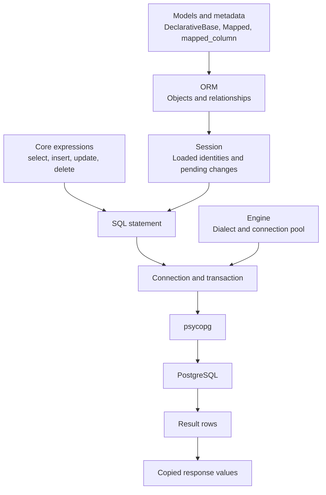
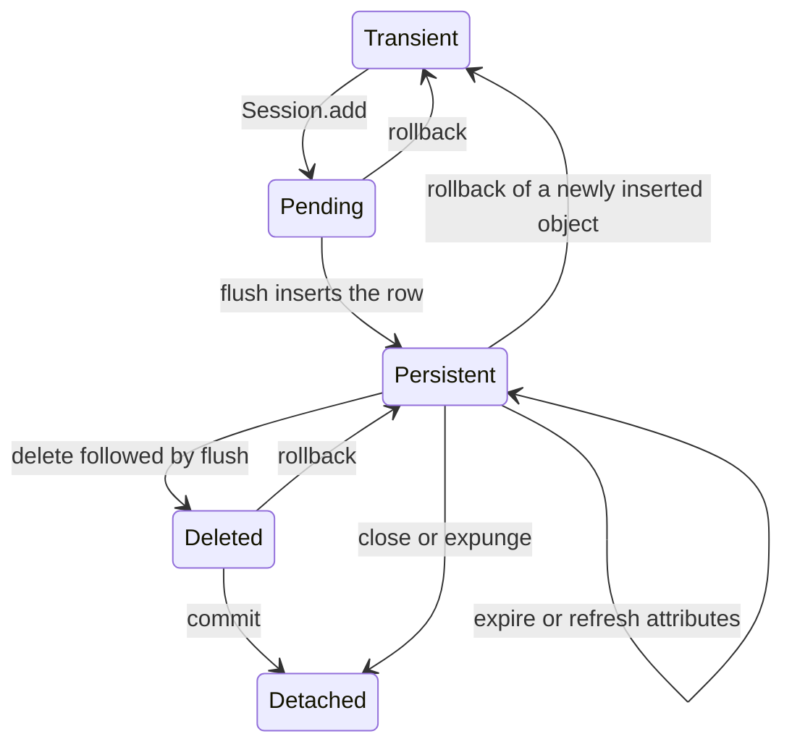
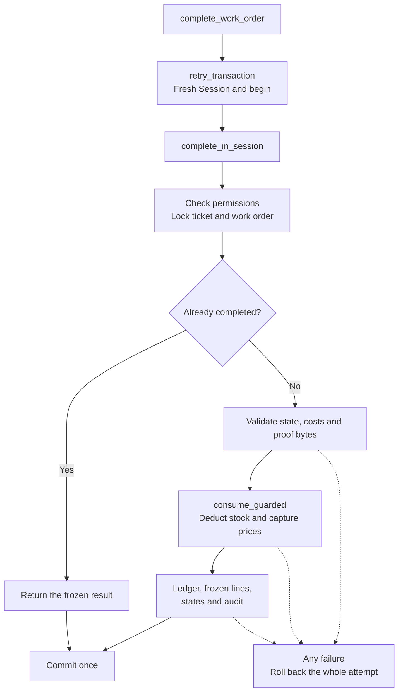
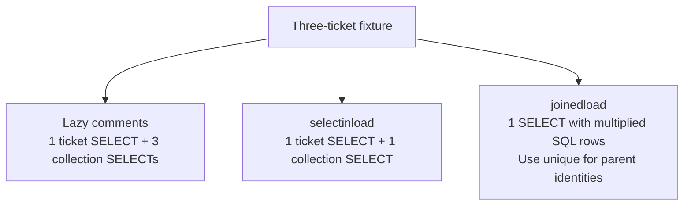

# SQLAlchemy: the Python database layer

[Project overview](../README.md) · [PostgreSQL guide](POSTGRESQL.md) · [Complete API index](reference/SQLALCHEMY_APIS.md) · [Application functions](reference/APPLICATION_FUNCTIONS.md)

SQLAlchemy describes tables, builds SQL, manages mapped Python objects, and coordinates transactions. PostgreSQL executes the SQL. **psycopg** is the driver between them. This project pins **SQLAlchemy 2.1**.

## A visual map



| Term | Plain meaning | Code |
|---|---|---|
| Engine | Shared configuration, PostgreSQL dialect, and connection pool. Connections open when needed. | [database.py](../college_maintenance/database.py) |
| Connection | A checked-out database connection used to execute statements. | [connection examples](../labs/step-14/python_lab.py) |
| SessionFactory | A configured factory for short-lived Sessions. | [sessions.py](../college_maintenance/sessions.py) |
| Session | Tracks mapped objects and pending changes within an operation. | [workflow.py](../college_maintenance/workflow.py) |
| Transaction | The commit/rollback boundary for related operations. | [retries.py](../college_maintenance/retries.py) |
| Model | A Python class mapped to a table. | [models.py](../college_maintenance/models.py) |
| Result | Rows or scalar values returned by execution. | [result examples](../labs/step-16/python_lab.py) |

References: [Unified Tutorial](https://docs.sqlalchemy.org/en/21/tutorial/index.html), [connections](https://docs.sqlalchemy.org/en/21/core/connections.html).

## Models and relationships

The mapping below is shortened from the real `WorkOrderPart` model:

```python
class WorkOrderPart(Base):
    __tablename__ = "work_order_parts"

    work_order_id: Mapped[UUID] = mapped_column(
        ForeignKey("work_orders.id", ondelete="RESTRICT"), primary_key=True
    )
    spare_part_id: Mapped[UUID] = mapped_column(
        ForeignKey("spare_parts.id", ondelete="RESTRICT"), primary_key=True
    )
    quantity_used: Mapped[int] = mapped_column()
    unit_cost_at_use: Mapped[Decimal] = mapped_column(Numeric(12, 2))
```

The two IDs form the composite identity: each work-order/part pair has one consolidated line. The full [mapping](../college_maintenance/models.py) also declares constraints, relationships, and a hybrid line total.

| API family | Purpose |
|---|---|
| `DeclarativeBase`, `MetaData` | Registry and table descriptions. |
| `Mapped`, `mapped_column` | Typed Python attributes and stored columns. |
| `ForeignKey`, `CheckConstraint`, `UniqueConstraint`, `Index` | Database integrity and index declarations. |
| `Uuid`, `String`, `Text`, `Numeric`, `DateTime`, `JSONB` | Stored types and Python value conversion. |
| `relationship` | Python navigation and ORM synchronization between objects. |
| `hybrid_property` | A value usable in Python and in SQL expressions. |

**A relationship is Python navigation; a foreign key is a database rule.** Declaring metadata also does not upgrade an existing database. Reviewed Alembic revisions own application schema changes.

References: [declarative tables](https://docs.sqlalchemy.org/en/21/orm/declarative_tables.html), [relationships](https://docs.sqlalchemy.org/en/21/orm/relationships.html), [Alembic](https://alembic.sqlalchemy.org/en/latest/tutorial.html).

## Queries: construct, then execute

```python
from sqlalchemy import select
from college_maintenance.models import MaintenanceTicket

statement = (
    select(MaintenanceTicket.id, MaintenanceTicket.title)
    .where(MaintenanceTicket.status == "open")
    .order_by(MaintenanceTicket.created_at.desc(), MaintenanceTicket.id.desc())
    .limit(20)
)
```

This constructs a statement. A Session or Connection executes it later. Actual application queries also apply the authenticated actor's scope.

| Question | APIs used |
|---|---|
| Which rows and columns? | `select`, `where`, `and_`, `or_`, `in_`, `is_`, `with_only_columns` |
| How do records connect? | `join`, `outerjoin`, `aliased` |
| How is output bounded and ordered? | `order_by`, `desc`, `limit`, `offset` |
| How are grouped reports calculated? | `func.sum`, `func.count`, `group_by`, `label` |
| How are intermediate queries reused? | `subquery`, `cte`, `scalar_subquery`, `correlate`, `lateral` |
| How are rows ranked or compared? | `over`, `func.dense_rank`, `func.row_number`, `func.lag` |
| How are identities combined? | `union`, `union_all`, `intersect`, `except_`, `exists` |
| How are rows changed? | `insert`, `update`, `delete`, `values`, `returning` |

`func.sum(...)` builds a PostgreSQL function expression; Python does not calculate that aggregate. Its database meaning is in the [PostgreSQL function index](reference/POSTGRESQL_FUNCTIONS.md).

Examples: [scoped reads](../college_maintenance/reads.py), [advanced reports](../college_maintenance/advanced_reports.py), [window/monthly reports](../college_maintenance/analytics.py), [search](../college_maintenance/search.py). Reference: [SELECT expressions](https://docs.sqlalchemy.org/en/21/tutorial/data_select.html).

## Session lifecycle and state



Rollback of a previously stored deletion restores persistence; rollback of a newly inserted object returns it to transient state. `expire` and `refresh` change attribute freshness while the object remains persistent.

| Operation | What it does |
|---|---|
| `get(Model, id)` | Finds a primary-key identity, possibly using an already-loaded object. |
| `add`, `add_all` | Enlist objects. An INSERT need not happen immediately. |
| `flush` | Sends pending writes inside the current transaction. Other connections cannot read those uncommitted writes. |
| `commit` | Flushes and commits. Default expiration can cause a later attribute access to SELECT again. |
| `rollback` | Rolls back the transaction and recovers a failed Session for further use. |
| `refresh` | Reloads attributes now. |
| `expire` | Marks attributes for reload on access. |
| `merge` | Copies state into a managed object and returns it; the source object does not become attached automatically. |
| `close` | Releases Session resources and detaches loaded objects. |

The identity map caches Python objects within a Session. PostgreSQL isolation governs database visibility. A cached entity may be stale even when a fresh SQL projection sees a later committed value.

Examples: [freshness](../labs/step-21/python_lab.py), [flush/rollback](../labs/step-20/python_lab.py), [MVCC](../labs/step-42/python_lab.py). Reference: [Session basics](https://docs.sqlalchemy.org/en/21/orm/session_basics.html).

## One repair, one transaction



[complete_work_order()](../college_maintenance/completion.py) delegates transaction ownership to [retry_transaction()](../college_maintenance/retries.py). Helpers flush but do not commit independently. Only selected deadlock/serialization failures cause a bounded retry with a fresh Session.

`with_for_update()` expresses row protection. Stock deduction uses arithmetic `UPDATE`, a stock predicate, and `RETURNING`; PostgreSQL handles the concurrent update. The application also validates Decimal totals, quantities, permissions, and proof.

The same ownership pattern for a read:

```python
from college_maintenance.sessions import SessionFactory
from college_maintenance.reads import scope_for_actor, ticket_query, ticket_rows

# authenticated_actor_id comes from the trusted authentication boundary.
with SessionFactory() as session, session.begin():
    scope = scope_for_actor(session, authenticated_actor_id)
    response = ticket_rows(session, ticket_query(scope).limit(20))

# Copied response values need no lazy ORM access after Session cleanup.
```

Reference: [Session transactions](https://docs.sqlalchemy.org/en/21/orm/session_transaction.html).

## Results and loading costs

| Result API | Shape or guarantee |
|---|---|
| `execute` | Result containing rows. |
| `scalars` | One selected column, often mapped entities. |
| `mappings` | Dictionary-style row mappings. |
| `scalar` | First column of the first row; no exactly-one assertion. |
| `one`, `scalar_one` | Exactly one row/value, otherwise an exception. |
| `one_or_none` | Zero or one row; multiple rows are an error. |
| `all`, `fetchall` | Materialize remaining rows. |
| `first` | Take the first result; use SQL `limit` to bound database work. |
| `unique` | Deduplicate ORM identities in joined-collection results. |
| `partitions`, async `stream` | Process batches in the isolated streaming example. |



These counts describe the small fixture, not every possible dataset. `raiseload` exposes accidental relationship access; `load_only` and `defer` control columns. A parent page limit does not limit its child collection, so large comment histories use separate child pagination.

Examples: [loading.py](../college_maintenance/loading.py), [result contracts](../labs/step-16/python_lab.py). References: [relationship loading](https://docs.sqlalchemy.org/en/21/orm/queryguide/relationships.html), [Result API](https://docs.sqlalchemy.org/en/21/core/connections.html#sqlalchemy.engine.Result).

## The rest of the toolbox

| Area | APIs and purpose | Source |
|---|---|---|
| Inspection | `inspect`, `get_columns`, `get_foreign_keys`, `get_indexes`, `get_check_constraints` examine installed objects. | [schema comparison](../labs/step-50/python_lab.py) |
| Migrations | Alembic `Config`, `command.upgrade`, and `op` operations apply reviewed changes. | [migration entry point](../college_maintenance/migrations.py), [revisions](../migrations/versions) |
| Errors | `IntegrityError`, `DBAPIError`, `StaleDataError`, and cardinality errors require different handling. | [retry policy](../college_maintenance/retries.py), [API](../college_maintenance/api.py) |
| Pooling | `NullPool`, `QueuePool`, `dispose`, pre-ping, and finite pool settings control reuse. | [connection settings](../college_maintenance/database.py) |
| Advanced mapping | `association_proxy`, `composite`, dataclasses, `column_property`, inheritance, `TypeDecorator`, `validates`, and `MutableDict`. | [complete index](reference/SQLALCHEMY_APIS.md), [scope](REFERENCE_COVERAGE.md) |
| Async | `create_async_engine`, `async_sessionmaker`, `run_sync`, `stream`, and `partitions`. | [isolated async example](../labs/step-75/python_lab.py) |

The core API uses synchronous Sessions. The [full API index](reference/SQLALCHEMY_APIS.md) covers the observed library surface, including specialist experiments. The [application function map](reference/APPLICATION_FUNCTIONS.md) explains project-defined functions. Original detailed proofs remain in the [experiment archive](LEARNING_PATH.md).
