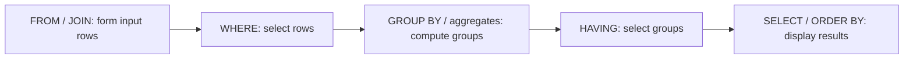

# Step 11: aggregate data

The [Step 11 lab](../labs/step-11/notes.md) turns six ticket rows into department/priority counts and reports completed labor from five work orders. Handwritten expected rows are compared with the real PostgreSQL results. The examples build on [Step 10 joins](SQL_JOINS.md) and use the ticket's recorded department for attribution.

## Define the row being counted

COUNT(*) counts input rows; COUNT(expression) counts non-NULL expression values. SUM and AVG use non-NULL values, including real zeros. COUNT returns bigint, and SUM/AVG of numeric inputs return numeric. See [aggregate functions](https://www.postgresql.org/docs/18/functions-aggregate.html).

```sql
SELECT d.code, count(*) AS joined_rows,
       count(t.id) AS tickets,
       count(t.assigned_to_id) AS assignments
FROM departments AS d
LEFT JOIN maintenance_tickets AS t ON t.department_id = d.id
GROUP BY d.id, d.code
ORDER BY d.code COLLATE "C";
```

| Department | Joined rows: COUNT(*) | Tickets: COUNT(t.id) | Assignments: COUNT(t.assigned_to_id) |
|---|---|---|---|
| CSE | 4 | 4 | 3 |
| ECE | 2 | 2 | 1 |
| MECH | 1 | 0 | 0 |

MECH's unmatched left row survives with NULL ticket columns. COUNT(*) therefore reports one, while counting the nonnullable ticket key correctly reports zero. The three CSE assignments all refer to Ravi: `count(DISTINCT t.assigned_to_id)` is one, a different metric from assignments. See [aggregate expressions](https://www.postgresql.org/docs/18/sql-expressions.html#SYNTAX-AGGREGATES).

## Make missing priority buckets explicit

Grouping the department left join by `t.priority` yields only observed priorities, plus one NULL-priority group for MECH. It does not invent every absent priority. Create the desired report axes first:

```sql
SELECT d.code, p.priority, count(t.id) AS tickets
FROM departments AS d
CROSS JOIN (VALUES ('low', 1), ('medium', 2),
                   ('high', 3), ('critical', 4)) AS p(priority, sort_rank)
LEFT JOIN maintenance_tickets AS t
  ON t.department_id = d.id AND t.priority = p.priority
GROUP BY d.id, d.code, p.priority, p.sort_rank
ORDER BY d.code COLLATE "C", p.sort_rank;
```

The cross join supplies three departments times four priorities; the left join supplies matching tickets. This yields twelve rows with an explicit business sort order. The VALUES list is a report axis, not a new application table. Grouping and join behavior are described in [table expressions](https://www.postgresql.org/docs/18/queries-table-expressions.html#QUERIES-GROUP).

| Department | low | medium | high | critical | Total |
|---|---|---|---|---|---|
| CSE | 1 | 0 | 2 | 1 | 4 |
| ECE | 0 | 1 | 1 | 0 | 2 |
| MECH | 0 | 0 | 0 | 0 | 0 |

COALESCE can replace a NULL value in an existing output row; it cannot create an absent group. The lab verifies that a grouped query with no input returns no rows, even with COALESCE in its select list.

## Choose where the condition belongs

Think of the following as logical query stages, not a physical execution plan:



WHERE limits group inputs, HAVING selects completed groups, and FILTER limits one aggregate's inputs. An aggregate cannot determine its own input through WHERE. See the [aggregate tutorial](https://www.postgresql.org/docs/18/tutorial-agg.html).

```sql
SELECT d.code, count(t.id) AS total,
       count(t.id) FILTER (WHERE t.priority IN ('high', 'critical')) AS urgent
FROM departments AS d
LEFT JOIN maintenance_tickets AS t ON t.department_id = d.id
GROUP BY d.id, d.code
HAVING count(t.id) FILTER (WHERE t.priority IN ('high', 'critical')) >= 2
ORDER BY d.code COLLATE "C";
```

The report defines urgent as high/critical. Only CSE qualifies, with total four and urgent three. Moving the priority predicate to WHERE changes CSE's total to three. HAVING `count(t.id) = 0` selects MECH; HAVING `count(t.id) >= 3` selects CSE with four tickets.

For open-ticket counts, `count(t.id) FILTER (WHERE t.status = 'open')` returns 1, 1, 0 across CSE/ECE/MECH while retaining each department's total. Putting the same status condition in WHERE drops MECH. Putting it in ON preserves MECH, but the joined inputs now contain only open matches, so another count over them cannot recover the all-ticket total.

## Use CASE with the right NULL behavior

These three open-count expressions agree in the lab:

```sql
count(t.id) FILTER (WHERE t.status = 'open')
sum(CASE WHEN t.status = 'open' THEN 1 ELSE 0 END)
count(CASE WHEN t.status = 'open' THEN 1 END)
```

CASE without ELSE returns NULL when no branch matches. COALESCE returns the first non-NULL argument. See [conditional expressions](https://www.postgresql.org/docs/18/functions-conditional.html).

`count(t.status = 'open')` counts false as well as true because both are non-NULL. `count(CASE ... THEN 1 ELSE 0 END)` counts the zeros too. Finally, `count(*) FILTER (WHERE t.assigned_to_id IS NULL)` miscounts MECH's unmatched row as an unassigned ticket; use `count(t.id)` for that metric. The lab records all three incorrect results beside their intended alternatives.

## Sum completed labor and preserve the average's meaning

```sql
SELECT d.code,
       count(w.id) FILTER (WHERE w.status = 'completed') AS completed_orders,
       coalesce(sum(w.labor_cost) FILTER (WHERE w.status = 'completed'),
                0.00::numeric) AS labor_total,
       avg(w.labor_cost) FILTER (WHERE w.status = 'completed') AS mean_completed_labor
FROM departments AS d
LEFT JOIN maintenance_tickets AS t ON t.department_id = d.id
LEFT JOIN work_orders AS w ON w.ticket_id = t.id
GROUP BY d.id, d.code
ORDER BY d.code COLLATE "C";
```

| Department | Completed labor inputs | Completed orders | Labor total, INR | Mean labor per completed order, INR |
|---|---|---|---|---|
| CSE | 600.50, 0.00 | 2 | 600.50 | 300.25 |
| ECE | 75.50 | 1 | 75.50 | 75.50 |
| MECH | None | 0 | 0.00 | NULL |

The 1000.00 in-progress and 2000.00 draft estimates are excluded. T4's earlier completed order remains counted while rework proceeds, and T6's completed order counts while verification is pending. These are frozen labor components, not whole repair totals; parts are outside this projection. This follows the [cost contract](PROJECT_CONTRACT.md) and [money decisions](MONEY_AND_TIME.md).

SUM over no selected values is NULL; this report displays it as 0.00. AVG with no selected values remains NULL, distinguishing no completed work from a completed zero-cost repair. The isolated values 6.00, NULL, 0.00 have sum 6.00 and mean 3.00; filling the missing observation with zero changes the mean to 2.00. See [empty-input aggregate behavior](https://www.postgresql.org/docs/18/functions-aggregate.html).

`avg(CASE WHEN completed THEN labor_cost END)` matches the filtered average. Adding ELSE 0.00 changes its denominator: the joined CSE input has five rows but only two completed orders, producing 120.10 rather than 300.25. An average may have fractional cents; it is a report statistic, not a newly stored two-place cost.

Joining work orders also repeats T4. Counting ticket IDs afterward yields five CSE rows, while counting distinct ticket IDs yields four tickets. Labor sums here have one input per work order and no other child joins. Additional independent one-to-many joins must preserve that grain before summing. DISTINCT on amount is not a general repair: separate valid orders can have the same cost.

The lab sums two valid per-record maximums to exactly 19999999999.98. Keep report numeric results wider than NUMERIC(12,2); forcing that total back into the per-record type fails with `22003`. No floating point conversion or raw-money validation mechanism is introduced here.

The [executed evidence](../labs/step-11/evidence.txt) records 25 passing checks, including full expected report rows, three expected SQL errors, and rollback cleanup from a fresh connection. Permanent migrations, repair completion enforcement, authorization, and ORM translation remain later lessons.
