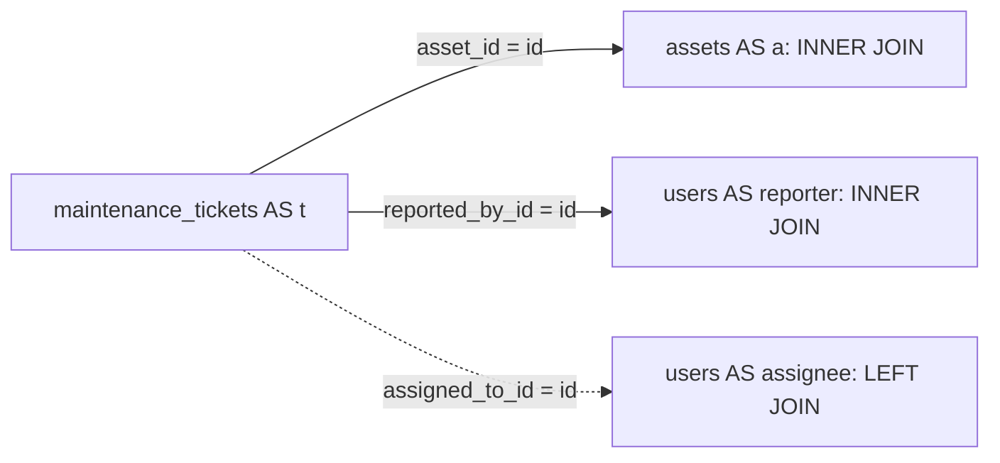

# Step 10: join related data

The [Step 10 lab](../labs/step-10/notes.md) displays tickets with asset, reporter, and optional assignee names. It uses reduced projections of the five entities from the [relational model](RELATIONAL_MODEL.md). Each reference joins on an ID; repeated display names are deliberately present in the fixture.

## Follow each reference with an explicit alias

```sql
SELECT t.id, t.title, a.asset_code, a.name AS asset_name,
       reporter.display_name AS reporter_name,
       assignee.display_name AS assignee_name,
       assignee.is_active AS assignee_active
FROM maintenance_tickets AS t
JOIN assets AS a ON a.id = t.asset_id
JOIN users AS reporter ON reporter.id = t.reported_by_id
LEFT JOIN users AS assignee ON assignee.id = t.assigned_to_id
ORDER BY t.id;
```

An inner join emits matching pairs. A left join also retains an unmatched left row with NULL right-side columns. This query returns all six fixture tickets, including the two without an assignee. See the [join tutorial](https://www.postgresql.org/docs/18/tutorial-join.html).



Reporter and assignee are distinct roles even when both refer to Ravi on T4. Two users named Alex are distinguished by their recorded UUIDs. Two assets named Lab Computer are distinguished by asset IDs/codes. Joining names or departmental membership cannot recover the recorded reference reliably.

The aliases qualify every reference and separate both appearances of `users`. Once a table has an alias, use that qualifier in the query. The lab catches ambiguous `id` (`42702`), reused aliases (`42712`), and a reference to the replaced `users` qualifier (`42P01`). See [table aliases](https://www.postgresql.org/docs/18/queries-table-expressions.html#QUERIES-TABLE-ALIASES) and [error codes](https://www.postgresql.org/docs/18/errcodes-appendix.html).

## Predict ON versus WHERE

T1 and T3 have no stored assignment. T5 retains a historical assignment to Mira, now inactive. The canonical query above displays Mira and her false active flag; it preserves historical attribution.

| Assignee query choice | Returned tickets | Meaning |
|---|---|---|
| Normal LEFT JOIN | T1, T2, T3, T4, T5, T6 | Every ticket; absent assignments have NULL display columns |
| INNER JOIN | T2, T4, T5, T6 | Requires an assignee match |
| Normal LEFT JOIN, `WHERE assignee.is_active` | T2, T4, T6 | Removes inactive and unmatched rows |
| LEFT JOIN with `AND assignee.is_active` inside ON | T1, T2, T3, T4, T5, T6 | Keeps every ticket; matches only active profiles |
| That filtered ON, `WHERE assignee.id IS NULL` | T1, T3, T5 | No active match, including an inactive stored assignment |
| That filtered ON, `WHERE t.assigned_to_id IS NULL` | T1, T3 | No stored assignment |
| Normal LEFT JOIN, `WHERE assignee.is_active OR assignee.id IS NULL` | T1, T2, T3, T4, T6 | Retains unmatched rows but still loses the real inactive match |

ON determines matches; WHERE then filters joined rows, retaining only TRUE. An unmatched assignee makes the active predicate NULL, so the WHERE form discards it. Moving the predicate into ON permits an unmatched left row to survive. See [joined tables and WHERE](https://www.postgresql.org/docs/18/queries-table-expressions.html#QUERIES-JOIN).

A matched inactive row is not replaced by another NULL row after WHERE removes it. Therefore the OR form still loses T5. Conversely, testing a filtered joined ID for NULL can mistake an inactive assignment for no assignment. Check the stored foreign key when that is the question.

A left-side predicate such as `WHERE t.department_id = ...` keeps all tickets in that department, including its unassigned and historical tickets. The effect depends on the predicate; a WHERE clause does not automatically turn every outer join into an inner join.

## Preserve multiplicity and the correct history

Joining assets to tickets returns one row per matching pair: six inner-join rows for five assets, because PRJ-001 and PC-002 each have two tickets, while PC-003 has none. The left join returns seven rows, including the unused asset. Filtering child status in WHERE leaves two assets with open tickets; placing it in ON retains all five assets with NULL ticket columns where no open match exists. Step 11 will count those matches deliberately.

The deliberately incorrect reporter join on department produces sixteen rows from six tickets. It matches every departmental user rather than each ticket's recorded reporter. Inspect the join path and expected row grain before treating a repeated row as a duplicate to remove.

T5 records CSE, while its transferred asset now belongs to ECE. Separate department aliases join `t.department_id` for recorded attribution and `a.department_id` for current ownership. Current names are looked up; no historical name snapshot is implied. This follows the [historical-department policy](RELATIONAL_MODEL.md).

## Use a self join for a pairwise question

```sql
SELECT first_user.email, second_user.email
FROM users AS first_user
JOIN users AS second_user
  ON first_user.department_id = second_user.department_id
 AND first_user.id < second_user.id
ORDER BY first_user.id, second_user.id;
```

This yields four unordered same-department pairs. The ID inequality removes self-pairs and mirrored pairs; it expresses no chronology. Without it, the fixture yields thirteen pairs. The Super Admin's NULL department does not equal another NULL. This example includes inactive users and is not an eligible-technician selector.

All 26 checks in the [saved evidence](../labs/step-10/evidence.txt) passed, including full projected values, ordered pairs, three expected SQL errors, and rollback cleanup through a fresh connection. The lab implements SQL query behavior; permanent schema, assignment authorization, and ORM relationship loading remain later lessons.
