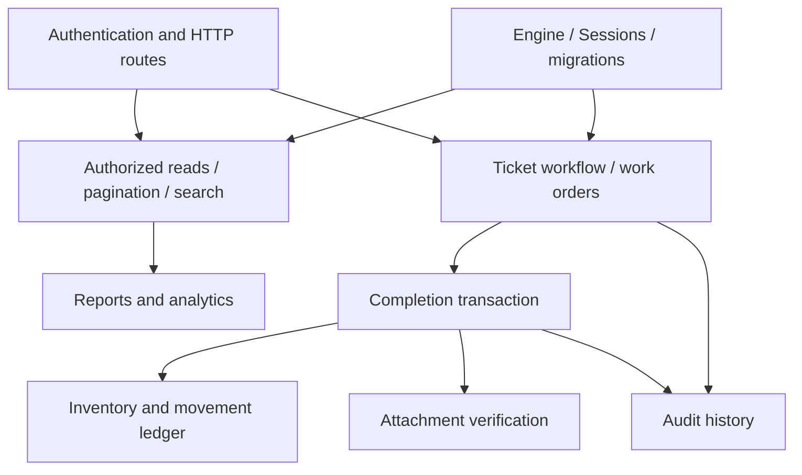

# Application function map

[Overview](../../README.md) · [SQLAlchemy explained](../SQLALCHEMY.md) · [PostgreSQL explained](../POSTGRESQL.md)

This source-derived inventory covers **all 136 Python function definitions** in `college_maintenance/*.py`: public functions, private helpers, methods, nested dependencies, and route/error handlers. Type annotations/default values are omitted from signatures for readability; the source is authoritative. A name such as `create_app.get_ticket` describes lexical nesting, not an importable dotted path. Constructors generated by libraries/dataclasses, lab functions, and migration revision functions are outside this core definition inventory.

Function names here belong to the project. [SQLAlchemy symbols/methods](SQLALCHEMY_APIS.md) and [PostgreSQL functions/commands](POSTGRESQL_FUNCTIONS.md) have separate indexes. Core code also contains optional prototypes such as `report_views`; inclusion here does not make them active HTTP features.

## Same-origin dashboard, account identity, scoped summaries, and asset discovery

Module: [`dashboard.py`](../../college_maintenance/dashboard.py)

| Function / method | Purpose | Source |
|---|---|---|
| `install_dashboard(app, actor_id, session_dependency)` | Register static dashboard assets and authenticated, scoped read projections. | [dashboard.py:16](../../college_maintenance/dashboard.py#L16) |
| `install_dashboard.dashboard_page()` | Handle **GET /**; validate dependencies, call the service, and return its response. | [dashboard.py:20](../../college_maintenance/dashboard.py#L20) |
| `install_dashboard.current_user(identity, session)` | Handle **GET /me**; validate dependencies, call the service, and return its response. | [dashboard.py:28](../../college_maintenance/dashboard.py#L28) |
| `install_dashboard.summary(identity, session)` | Handle **GET /dashboard/summary**; validate dependencies, call the service, and return its response. | [dashboard.py:37](../../college_maintenance/dashboard.py#L37) |
| `install_dashboard.assets(q, limit, offset, identity, session)` | Handle **GET /assets**; validate dependencies, call the service, and return its response. | [dashboard.py:51](../../college_maintenance/dashboard.py#L51) |
| `install_dashboard.technicians(department_id, identity, session)` | Handle **GET /dashboard/technicians**; validate dependencies, call the service, and return its response. | [dashboard.py:67](../../college_maintenance/dashboard.py#L67) |

## Latest records and reusable report expressions

Module: [`advanced_reports.py`](../../college_maintenance/advanced_reports.py)

| Function / method | Purpose | Source |
|---|---|---|
| `latest_comment_cte()` | Build the latest-comment-per-ticket CTE with deterministic tie breaking. | [advanced_reports.py:7](../../college_maintenance/advanced_reports.py#L7) |
| `latest_comments_query(scope, strategy)` | Join authorized tickets to their latest comment without losing uncommented tickets. | [advanced_reports.py:12](../../college_maintenance/advanced_reports.py#L12) |
| `repair_costs_cte()` | Expose completed repair costs as a reusable CTE. | [advanced_reports.py:30](../../college_maintenance/advanced_reports.py#L30) |

## Ranking and month-by-month analysis

Module: [`analytics.py`](../../college_maintenance/analytics.py)

| Function / method | Purpose | Source |
|---|---|---|
| `ranked_failures_query(scope, *, top, include_ties)` | Rank asset failure counts within each recorded department. | [analytics.py:6](../../college_maintenance/analytics.py#L6) |
| `monthly_costs_query(scope, start, end, zone)` | Generate bounded department/month totals, fill empty months, and compare previous months. | [analytics.py:19](../../college_maintenance/analytics.py#L19) |

## HTTP routes, dependencies, and error responses

Module: [`api.py`](../../college_maintenance/api.py)

| Function / method | Purpose | Source |
|---|---|---|
| `create_app(session_factory, authenticate, storage)` | Construct the FastAPI application with injectable Sessions, authentication, and storage. | [api.py:99](../../college_maintenance/api.py#L99) |
| `create_app.actor_id(credentials)` | Resolve a bearer token to an actor ID or return HTTP 401. | [api.py:104](../../college_maintenance/api.py#L104) |
| `create_app.session_dependency()` | Yield and close a Session for one request. | [api.py:110](../../college_maintenance/api.py#L110) |
| `create_app.ready(session)` | Handle **GET /health/ready** by executing SELECT 1 through the configured Session. | [api.py:118](../../college_maintenance/api.py#L118) |
| `create_app.request_identifier(x_request_id)` | Use the supplied request UUID or generate one for audit correlation. | [api.py:122](../../college_maintenance/api.py#L122) |
| `create_app.forbidden(request, error)` | Translate permission failures to HTTP 403. | [api.py:126](../../college_maintenance/api.py#L126) |
| `create_app.invalid(request, error)` | Translate invalid business input to HTTP 400. | [api.py:129](../../college_maintenance/api.py#L129) |
| `create_app.conflict(request, error)` | Translate database integrity violations to HTTP 409. | [api.py:132](../../college_maintenance/api.py#L132) |
| `create_app.database_error(request, error)` | Translate exhausted retryable failures to HTTP 503, other database failures to HTTP 500. | [api.py:135](../../college_maintenance/api.py#L135) |
| `create_app.state_conflict(request, error)` | Translate business state conflicts to HTTP 409. | [api.py:141](../../college_maintenance/api.py#L141) |
| `create_app.stale_edit(request, error)` | Translate optimistic version conflicts to HTTP 409. | [api.py:144](../../college_maintenance/api.py#L144) |
| `create_app.not_found(request, error)` | Translate missing authorized resources to HTTP 404. | [api.py:147](../../college_maintenance/api.py#L147) |
| `create_app.post_ticket(body, identity, session, request_id)` | Handle **POST /tickets**; validate dependencies, call the service, and return its response. | [api.py:150](../../college_maintenance/api.py#L150) |
| `create_app.patch_report(ticket_id, body, identity, session, request_id)` | Handle **PATCH /tickets/{ticket_id}/report**; validate dependencies, call the service, and return its response. | [api.py:155](../../college_maintenance/api.py#L155) |
| `create_app.patch_priority(ticket_id, body, identity, session, request_id)` | Handle **PATCH /tickets/{ticket_id}/priority**; validate dependencies, call the service, and return its response. | [api.py:160](../../college_maintenance/api.py#L160) |
| `create_app.post_transition(ticket_id, body, identity, session, request_id)` | Handle **POST /tickets/{ticket_id}/transitions**; validate dependencies, call the service, and return its response. | [api.py:165](../../college_maintenance/api.py#L165) |
| `create_app.get_audit(ticket_id, limit, identity, session)` | Handle **GET /tickets/{ticket_id}/audit**; validate dependencies, call the service, and return its response. | [api.py:170](../../college_maintenance/api.py#L170) |
| `create_app.get_asset(asset_id, identity, session)` | Handle **GET /assets/{asset_id}**; validate dependencies, call the service, and return its response. | [api.py:179](../../college_maintenance/api.py#L179) |
| `create_app.post_supplier(body, identity, session, request_id)` | Handle **POST /suppliers**; validate dependencies, call the service, and return its response. | [api.py:186](../../college_maintenance/api.py#L186) |
| `create_app.post_order(ticket_id, identity, session, request_id)` | Handle **POST /tickets/{ticket_id}/work-orders**; validate dependencies, call the service, and return its response. | [api.py:190](../../college_maintenance/api.py#L190) |
| `create_app.get_order(order_id, identity, session)` | Handle **GET /work-orders/{order_id}**; validate dependencies, call the service, and return its response. | [api.py:194](../../college_maintenance/api.py#L194) |
| `create_app.post_start(order_id, identity, session, request_id)` | Handle **POST /work-orders/{order_id}/start**; validate dependencies, call the service, and return its response. | [api.py:200](../../college_maintenance/api.py#L200) |
| `create_app.post_complete(order_id, body, identity, request_id)` | Handle **POST /work-orders/{order_id}/complete**; validate dependencies, call the service, and return its response. | [api.py:204](../../college_maintenance/api.py#L204) |
| `create_app.patch_order(order_id, body, identity, session, request_id)` | Handle **PATCH /work-orders/{order_id}**; validate dependencies, call the service, and return its response. | [api.py:208](../../college_maintenance/api.py#L208) |
| `create_app.put_line(order_id, part_id, body, identity, session, request_id)` | Handle **PUT /work-orders/{order_id}/parts/{part_id}**; validate dependencies, call the service, and return its response. | [api.py:212](../../college_maintenance/api.py#L212) |
| `create_app.delete_line(order_id, part_id, identity, session, request_id)` | Handle **DELETE /work-orders/{order_id}/parts/{part_id}**; validate dependencies, call the service, and return its response. | [api.py:216](../../college_maintenance/api.py#L216) |
| `create_app.delete_order(order_id, identity, session, request_id)` | Handle **DELETE /work-orders/{order_id}**; validate dependencies, call the service, and return its response. | [api.py:220](../../college_maintenance/api.py#L220) |
| `create_app.post_part(body, identity, session, request_id)` | Handle **POST /parts**; validate dependencies, call the service, and return its response. | [api.py:224](../../college_maintenance/api.py#L224) |
| `create_app.get_parts(limit, identity, session)` | Handle **GET /parts**; validate dependencies, call the service, and return its response. | [api.py:228](../../college_maintenance/api.py#L228) |
| `create_app.post_movement(part_id, body, identity, session, request_id)` | Handle **POST /parts/{part_id}/movements**; validate dependencies, call the service, and return its response. | [api.py:234](../../college_maintenance/api.py#L234) |
| `create_app.get_reconciliation(identity, session)` | Handle **GET /inventory/reconciliation**; validate dependencies, call the service, and return its response. | [api.py:238](../../college_maintenance/api.py#L238) |
| `create_app.get_costs(limit, identity, session)` | Handle **GET /reports/costs**; validate dependencies, call the service, and return its response. | [api.py:244](../../college_maintenance/api.py#L244) |
| `create_app.get_failures(limit, identity, session)` | Handle **GET /reports/failures**; validate dependencies, call the service, and return its response. | [api.py:248](../../college_maintenance/api.py#L248) |
| `create_app.get_latest_comments(strategy, limit, identity, session)` | Handle **GET /reports/latest-comments**; validate dependencies, call the service, and return its response. | [api.py:253](../../college_maintenance/api.py#L253) |
| `create_app.ranked_failures(top, include_ties, limit, identity, session)` | Handle **GET /reports/ranked-failures**; validate dependencies, call the service, and return its response. | [api.py:258](../../college_maintenance/api.py#L258) |
| `create_app.monthly_costs(start, end, zone, identity, session)` | Handle **GET /reports/monthly-costs**; validate dependencies, call the service, and return its response. | [api.py:263](../../college_maintenance/api.py#L263) |
| `create_app.post_comment(ticket_id, body, identity, session, request_id)` | Handle **POST /tickets/{ticket_id}/comments**; validate dependencies, call the service, and return its response. | [api.py:269](../../college_maintenance/api.py#L269) |
| `create_app.get_comments(ticket_id, limit, offset, identity, session)` | Handle **GET /tickets/{ticket_id}/comments**; validate dependencies, call the service, and return its response. | [api.py:273](../../college_maintenance/api.py#L273) |
| `create_app.post_attachment(kind, owner_id, body, identity, session, request_id)` | Handle **POST /{kind}/{owner_id}/attachments**; validate dependencies, call the service, and return its response. | [api.py:279](../../college_maintenance/api.py#L279) |
| `create_app.get_attachment(kind, attachment_id, identity, session)` | Handle **GET /attachments/{kind}/{attachment_id}**; validate dependencies, call the service, and return its response. | [api.py:289](../../college_maintenance/api.py#L289) |
| `create_app.list_tickets(limit, cursor, department_id, status, priority, identity, session)` | Handle **GET /tickets**; validate dependencies, call the service, and return its response. | [api.py:294](../../college_maintenance/api.py#L294) |
| `create_app.search_tickets(q, limit, identity, session)` | Handle **GET /tickets/search**; validate dependencies, call the service, and return its response. | [api.py:302](../../college_maintenance/api.py#L302) |
| `create_app.get_ticket(ticket_id, identity, session)` | Handle **GET /tickets/{ticket_id}**; validate dependencies, call the service, and return its response. | [api.py:308](../../college_maintenance/api.py#L308) |

## Comments, metadata, and private file storage

Module: [`attachments.py`](../../college_maintenance/attachments.py)

| Function / method | Purpose | Source |
|---|---|---|
| `FileStore.__init__(self, root)` | Create/configure the private byte-storage directory. | [attachments.py:15](../../college_maintenance/attachments.py#L15) |
| `FileStore.path(self, key)` | Accept only a generated storage key and resolve its private path. | [attachments.py:17](../../college_maintenance/attachments.py#L17) |
| `FileStore.put(self, data)` | Store a bounded nonempty upload under a new random key. | [attachments.py:20](../../college_maintenance/attachments.py#L20) |
| `FileStore.remove(self, key)` | Remove stored bytes if present. | [attachments.py:25](../../college_maintenance/attachments.py#L25) |
| `FileStore.read(self, metadata)` | Read bytes and verify their recorded size and SHA-256 digest. | [attachments.py:26](../../college_maintenance/attachments.py#L26) |
| `comment_permission(actor, ticket)` | Require an open ticket and an authorized participant before a comment/upload. | [attachments.py:33](../../college_maintenance/attachments.py#L33) |
| `add_comment(session, actor_id, ticket_id, body, request_id)` | Lock the ticket, validate scope/text, save a comment, and append audit. | [attachments.py:40](../../college_maintenance/attachments.py#L40) |
| `order_parent(session, actor, work_order_id, write)` | Load/lock the ticket before its order and enforce read/write ownership. | [attachments.py:48](../../college_maintenance/attachments.py#L48) |
| `attachment_metadata(session, store, actor_id, owner_id, *, kind, storage_key, data, filename, content_type, request_id)` | Validate upload metadata, owner permissions, and proof rules before saving its record. | [attachments.py:65](../../college_maintenance/attachments.py#L65) |
| `read_attachment(session, store, actor_id, attachment_id, kind)` | Authorize access to metadata and read verified bytes from private storage. | [attachments.py:84](../../college_maintenance/attachments.py#L84) |
| `cleanup_orphans(session, store, actor_id, minimum_age, now)` | Remove sufficiently old unreferenced files while retaining referenced content. | [attachments.py:93](../../college_maintenance/attachments.py#L93) |

## Business history

Module: [`auditing.py`](../../college_maintenance/auditing.py)

| Function / method | Purpose | Source |
|---|---|---|
| `audit_change(session, actor_id, action, *, ticket, target_type, target_id, request_id, details)` | Append a structured event with actor, target, request, and recorded department. | [auditing.py:5](../../college_maintenance/auditing.py#L5) |

## Actor authentication

Module: [`authentication.py`](../../college_maintenance/authentication.py)

| Function / method | Purpose | Source |
|---|---|---|
| `authenticate_token(token)` | Resolve an unexpired bearer-token digest from the ignored local identity file. | [authentication.py:10](../../college_maintenance/authentication.py#L10) |

## Atomic repair completion

Module: [`completion.py`](../../college_maintenance/completion.py)

| Function / method | Purpose | Source |
|---|---|---|
| `completed_result(session, order)` | Return the frozen completion result and recorded part-line values. | [completion.py:14](../../college_maintenance/completion.py#L14) |
| `complete_in_session(session, store, actor_id, order_id, request_id, *, _fault, stock_strategy)` | Validate proof and ownership, consume stock, freeze costs, update states, and audit in the caller transaction. | [completion.py:23](../../college_maintenance/completion.py#L23) |
| `complete_in_session.checkpoint(stage)` | Invoke the optional fault-injection seam used to prove rollback behavior. | [completion.py:25](../../college_maintenance/completion.py#L25) |
| `complete_work_order(store, actor_id, order_id, *, session_factory, request_id, stock_strategy)` | Own fresh-Session retries of the complete repair transaction. | [completion.py:73](../../college_maintenance/completion.py#L73) |

## Connection configuration

Module: [`database.py`](../../college_maintenance/database.py)

| Function / method | Purpose | Source |
|---|---|---|
| `connection_url()` | Build the connection URL from local configuration and ignored credentials. | [database.py:12](../../college_maintenance/database.py#L12) |
| `pool_settings()` | Validate finite connection-pool size, overflow, and timeout settings. | [database.py:32](../../college_maintenance/database.py#L32) |

## Local deployment administration

Module: [`deployment.py`](../../college_maintenance/deployment.py)

| Function / method | Purpose | Source |
|---|---|---|
| `main()` | Run the documented local deployment administration command. | [deployment.py:9](../../college_maintenance/deployment.py#L9) |

## Validated asset imports

Module: [`imports.py`](../../college_maintenance/imports.py)

| Function / method | Purpose | Source |
|---|---|---|
| `asset_values(row)` | Normalize and validate an input asset row before database insertion. | [imports.py:7](../../college_maintenance/imports.py#L7) |
| `import_assets(session, scope, rows, *, policy)` | Import rows atomically or with per-row savepoints, handling the explicit duplicate policy. | [imports.py:15](../../college_maintenance/imports.py#L15) |
| `import_assets.execute()` | Validate one input row and attempt its conflict-aware INSERT, returning the inserted ID. | [imports.py:20](../../college_maintenance/imports.py#L20) |

## Stock, prices, and reconciliation

Module: [`inventory.py`](../../college_maintenance/inventory.py)

| Function / method | Purpose | Source |
|---|---|---|
| `money(value)` | Validate exact decimal money, bounds, and fractional precision. | [inventory.py:11](../../college_maintenance/inventory.py#L11) |
| `quantity(value, allow_zero)` | Require a bounded integer quantity and reject boolean values. | [inventory.py:20](../../college_maintenance/inventory.py#L20) |
| `inventory_admin(session, actor_id)` | Require a valid administrator for centralized stock operations. | [inventory.py:25](../../college_maintenance/inventory.py#L25) |
| `add_supplier(session, actor_id, name, contact, request_id)` | Validate supplier details and append its audit event. | [inventory.py:30](../../college_maintenance/inventory.py#L30) |
| `create_part(session, actor_id, *, sku, name, unit_cost, opening, reorder_level, request_id)` | Create a priced part and record opening stock in the movement ledger. | [inventory.py:37](../../college_maintenance/inventory.py#L37) |
| `move_stock(session, actor_id, part_id, *, kind, delta, supplier_id, reason, request_id)` | Lock a part, validate a receipt/adjustment, change stock, and write its ledger/audit entries. | [inventory.py:45](../../college_maintenance/inventory.py#L45) |
| `part_result(part)` | Project a part into a plain response with balance and low-stock status. | [inventory.py:66](../../college_maintenance/inventory.py#L66) |
| `reconciliation_query()` | Compare each recorded part balance with its summed movement history. | [inventory.py:70](../../college_maintenance/inventory.py#L70) |
| `guarded_stock_statement(part_id, amount)` | Build an UPDATE that decrements only active parts with enough stock. | [inventory.py:74](../../college_maintenance/inventory.py#L74) |
| `consume_guarded(session, part_id, amount)` | Execute the guarded decrement and return price/balance; the caller owns authorization and ledger writes. | [inventory.py:80](../../college_maintenance/inventory.py#L80) |

## Bounded relationship loading

Module: [`loading.py`](../../college_maintenance/loading.py)

| Function / method | Purpose | Source |
|---|---|---|
| `ticket_page(session, scope, limit)` | Load a bounded ticket page and its comments using explicit loader strategies. | [loading.py:15](../../college_maintenance/loading.py#L15) |
| `comment_page(session, scope, ticket_id, limit, offset)` | Read a bounded, ordered comment page after checking ticket access. | [loading.py:26](../../college_maintenance/loading.py#L26) |

## Schema migration entry points

Module: [`migrations.py`](../../college_maintenance/migrations.py)

| Function / method | Purpose | Source |
|---|---|---|
| `migration_config(connection)` | Create Alembic configuration for this repository and connection. | [migrations.py:6](../../college_maintenance/migrations.py#L6) |
| `upgrade(connection, revision)` | Apply the requested Alembic revision through the project configuration. | [migrations.py:13](../../college_maintenance/migrations.py#L13) |

## Mapped model behavior

Module: [`models.py`](../../college_maintenance/models.py)

| Function / method | Purpose | Source |
|---|---|---|
| `WorkOrderPart.line_total(self)` | Compute quantity times frozen unit cost in Python and in SQL expressions. | [models.py:196](../../college_maintenance/models.py#L196) |

## Stable pages and scoped cursors

Module: [`pagination.py`](../../college_maintenance/pagination.py)

| Function / method | Purpose | Source |
|---|---|---|
| `_validate(limit, sort)` | Require a bounded integer page size and the supported newest-first sort. | [pagination.py:18](../../college_maintenance/pagination.py#L18) |
| `_binding(scope, filters)` | Hash the actor/filter values to detect cursor reuse; query permissions remain authoritative. | [pagination.py:22](../../college_maintenance/pagination.py#L22) |
| `_encode(row, binding)` | Base64-encode a cursor containing the position and actor/filter hash; this is not a signed token. | [pagination.py:26](../../college_maintenance/pagination.py#L26) |
| `_decode(cursor, binding)` | Validate cursor structure, timestamp, UUID, and the expected actor/filter hash. | [pagination.py:30](../../college_maintenance/pagination.py#L30) |
| `ticket_feed(session, scope, *, limit, cursor, department_id, status, priority, sort)` | Read a stable keyset page with scoped filters and an opaque next cursor; reapply permissions on every query. | [pagination.py:43](../../college_maintenance/pagination.py#L43) |
| `offset_feed(session, scope, *, offset, limit, department_id, status, priority, sort)` | Read the offset-pagination comparison while retaining scope and deterministic ordering. | [pagination.py:55](../../college_maintenance/pagination.py#L55) |

## Persistence primitives

Module: [`persistence.py`](../../college_maintenance/persistence.py)

| Function / method | Purpose | Source |
|---|---|---|
| `unit_of_work(session)` | Yield a Session within one commit-or-rollback transaction. | [persistence.py:8](../../college_maintenance/persistence.py#L8) |
| `add_asset_row(session, *, code, name, department_id, category_id)` | Add and flush an asset row after upstream validation. | [persistence.py:14](../../college_maintenance/persistence.py#L14) |
| `add_ticket_row(session, *, asset, actor_id, title, priority)` | Add and flush a ticket row after upstream validation. | [persistence.py:19](../../college_maintenance/persistence.py#L19) |
| `add_audit_row(session, *, actor_id, asset, ticket)` | Add an audit row through the persistence primitive. | [persistence.py:25](../../college_maintenance/persistence.py#L25) |
| `record_asset_report(*, actor_id, department_id, category_id, code, name, title, session_factory)` | Own one transaction creating an asset, ticket, and audit after caller authorization. | [persistence.py:30](../../college_maintenance/persistence.py#L30) |

## Authorized read projections

Module: [`reads.py`](../../college_maintenance/reads.py)

| Function / method | Purpose | Source |
|---|---|---|
| `scope_for_actor(session, actor_id)` | Load an active user's trusted role and department from the database. | [reads.py:18](../../college_maintenance/reads.py#L18) |
| `asset_detail(session, scope, asset_id)` | Return an authorized asset projection or no visible match. | [reads.py:50](../../college_maintenance/reads.py#L50) |
| `ticket_query(scope, *, department_id, status, priority)` | Build the base ticket projection restricted to the actor's readable scope. | [reads.py:57](../../college_maintenance/reads.py#L57) |
| `ticket_rows(session, statement)` | Convert selected ticket mappings into plain response values. | [reads.py:74](../../college_maintenance/reads.py#L74) |
| `department_tickets(session, scope, department_id, **filters)` | Read tickets restricted to an authorized recorded department. | [reads.py:77](../../college_maintenance/reads.py#L77) |
| `technician_assignments(session, scope, technician_id, **filters)` | Read the tickets assigned to an authorized technician. | [reads.py:80](../../college_maintenance/reads.py#L80) |

## Work-order editing

Module: [`repairs.py`](../../college_maintenance/repairs.py)

| Function / method | Purpose | Source |
|---|---|---|
| `create_order(session, actor_id, ticket_id, request_id)` | Lock an assigned ticket and create its eligible active repair order. | [repairs.py:10](../../college_maintenance/repairs.py#L10) |
| `start_order(session, actor_id, order_id, request_id)` | Require the owning assigned technician and transition an order/ticket to in progress. | [repairs.py:20](../../college_maintenance/repairs.py#L20) |
| `edit_order(session, actor_id, order_id, *, labor_cost, completion_note, request_id)` | Validate and edit labor/completion notes on an editable order. | [repairs.py:27](../../college_maintenance/repairs.py#L27) |
| `set_part_line(session, actor_id, order_id, part_id, amount, request_id)` | Add or replace a draft part quantity without consuming stock yet. | [repairs.py:35](../../college_maintenance/repairs.py#L35) |
| `remove_part_line(session, actor_id, order_id, part_id, request_id)` | Remove a draft part line from an editable order. | [repairs.py:49](../../college_maintenance/repairs.py#L49) |
| `discard_order(session, actor_id, order_id, request_id)` | Delete an eligible uncompleted order and its draft lines under the workflow rules. | [repairs.py:57](../../college_maintenance/repairs.py#L57) |
| `order_result(session, order)` | Build the work-order response with ordered part lines and cost values. | [repairs.py:66](../../college_maintenance/repairs.py#L66) |

## Isolated report-view prototypes

Module: [`report_views.py`](../../college_maintenance/report_views.py)

| Function / method | Purpose | Source |
|---|---|---|
| `install_views(connection, schema)` | Install optional report views only in a guarded experiment schema. | [report_views.py:4](../../college_maintenance/report_views.py#L4) |
| `remove_views(connection, schema)` | Remove the optional report views from a guarded experiment schema. | [report_views.py:15](../../college_maintenance/report_views.py#L15) |

## Cost and failure reports

Module: [`reports.py`](../../college_maintenance/reports.py)

| Function / method | Purpose | Source |
|---|---|---|
| `report_scope(scope, department_column)` | Require administrator access to the requested financial report department. | [reports.py:6](../../college_maintenance/reports.py#L6) |
| `completed_order_costs()` | Aggregate part lines before joining to completed orders, preserving one row per order. | [reports.py:11](../../college_maintenance/reports.py#L11) |
| `costs_by_department_query(scope)` | Sum completed repair costs by recorded ticket department. | [reports.py:19](../../college_maintenance/reports.py#L19) |
| `failure_frequency_query(scope)` | Count ticket reports per recorded department/asset without multiplying rows by repairs. | [reports.py:27](../../college_maintenance/reports.py#L27) |
| `cost_rows(session, scope, limit)` | Execute the scoped cost report and project plain values. | [reports.py:35](../../college_maintenance/reports.py#L35) |

## Transaction retry policy

Module: [`retries.py`](../../college_maintenance/retries.py)

| Function / method | Purpose | Source |
|---|---|---|
| `retry_transaction(operation, *, session_factory, attempts, pause)` | Retry only serialization/deadlock failures, using a fresh Session and bounded whole-transaction attempts. | [retries.py:8](../../college_maintenance/retries.py#L8) |

## Scoped full-text search

Module: [`search.py`](../../college_maintenance/search.py)

| Function / method | Purpose | Source |
|---|---|---|
| `ticket_document()` | Build the English tsvector expression from ticket title and description. | [search.py:6](../../college_maintenance/search.py#L6) |
| `search_tickets_query(scope, query, limit)` | Apply scoped full-text matching, relevance rank, and deterministic tie breakers. | [search.py:11](../../college_maintenance/search.py#L11) |

## Ticket rules and state transitions

Module: [`workflow.py`](../../college_maintenance/workflow.py)

| Function / method | Purpose | Source |
|---|---|---|
| `nonblank(value, name, maximum)` | Trim and validate required bounded text. | [workflow.py:11](../../college_maintenance/workflow.py#L11) |
| `admin_scope(actor, department_id)` | Require a super admin or the administrator of the recorded department. | [workflow.py:16](../../college_maintenance/workflow.py#L16) |
| `can_read_ticket(actor, ticket)` | Evaluate whether the actor may see the ticket. | [workflow.py:20](../../college_maintenance/workflow.py#L20) |
| `locked_ticket(session, actor, ticket_id)` | Load and lock a visible ticket, refreshing previously loaded state. | [workflow.py:25](../../college_maintenance/workflow.py#L25) |
| `report_ticket(session, actor_id, *, asset_id, title, description, priority, request_id)` | Validate reporter/asset scope, create the initial ticket, and audit it. | [workflow.py:31](../../college_maintenance/workflow.py#L31) |
| `edit_report(session, actor_id, ticket_id, *, title, description, expected_version, request_id)` | Require reporter permissions and the expected version before editing report text. | [workflow.py:45](../../college_maintenance/workflow.py#L45) |
| `triage_ticket(session, actor_id, ticket_id, priority, *, expected_version, request_id)` | Require administrator scope and the expected version before changing priority. | [workflow.py:56](../../college_maintenance/workflow.py#L56) |
| `ticket_result(ticket)` | Project a ticket into a plain response including its optimistic version. | [workflow.py:67](../../college_maintenance/workflow.py#L67) |
| `check_version(ticket, expected_version)` | Reject an expected version that no longer matches the ticket. | [workflow.py:72](../../college_maintenance/workflow.py#L72) |
| `transition_ticket(session, actor_id, ticket_id, *, action, technician_id, reason, request_id)` | Validate and execute assignment, rejection, verification, or rework transitions with audit. | [workflow.py:76](../../college_maintenance/workflow.py#L76) |

<!-- Generated by tools/build_reference.py; explanations: tools/reference_data.py. -->
