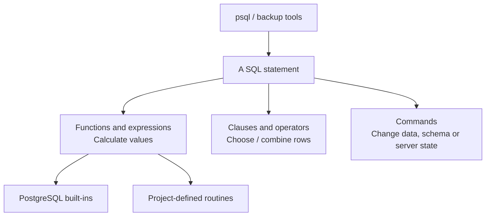

# PostgreSQL function and command index

[Overview](../../README.md) · [PostgreSQL explained](../POSTGRESQL.md) · [SQLAlchemy APIs](SQLALCHEMY_APIS.md)

The tables identify **87 observed function/routine/expression names** and **46 SQL command forms**, with source examples. Ordinary functions, special SQL expressions, repository-defined routines, and client programs are separated so their responsibilities are clear.

Scope: literal SQL and SQL f-string fragments in Python, SQL, shell, and PowerShell sources under `college_maintenance/`, `labs/`, `migrations/`, `tests/`, and `docker/`, plus Python `func.NAME(...)` calls. A reviewed vocabulary excludes types, table names, and Python methods that resemble SQL calls. Dynamically assembled identifiers and operators cannot be exhaustively inferred this way; see their source and the [PostgreSQL 18 manual](https://www.postgresql.org/docs/18/functions.html). The full core Python definition inventory is on the [application function page](APPLICATION_FUNCTIONS.md).

## Dates and generated rows

| Name | Meaning | Source examples |
|---|---|---|
| `date_trunc` | Truncate a timestamp to a boundary such as the start of a month. | [analytics.py:32](../../college_maintenance/analytics.py#L32) |
| `gen_random_uuid` | Generate a random version-4 UUID. | [models.py:32](../../college_maintenance/models.py#L32) [labs/shared/column_models.py:29](../../labs/shared/column_models.py#L29) [labs/step-04/query.sql:28](../../labs/step-04/query.sql#L28) |
| `generate_series` | Generate a set of numbers or timestamps, including empty reporting months. | [analytics.py:29](../../college_maintenance/analytics.py#L29) [labs/shared/performance_lab.py:11](../../labs/shared/performance_lab.py#L11) [labs/step-65/Python:35](../../labs/step-65/python_lab.py#L35) |
| `now` | Read the transaction start timestamp. | [labs/step-70/Python:15](../../labs/step-70/python_lab.py#L15) |
| `timezone` | Convert timestamps according to the input type and specified zone. | [analytics.py:32](../../college_maintenance/analytics.py#L32) |
| `uuid_extract_version` | Inspect the version encoded in a UUID. | [labs/step-04/query.sql:70](../../labs/step-04/query.sql#L70) |
| `uuidv7` | Generate a time-ordered version-7 UUID in PostgreSQL 18. | [labs/step-04/query.sql:181](../../labs/step-04/query.sql#L181) |

## Aggregates and windows

| Name | Meaning | Source examples |
|---|---|---|
| `avg` | Calculate the arithmetic mean of non-null input values. | [labs/step-11/query.sql:193](../../labs/step-11/query.sql#L193) |
| `bool_and` | Return true when all non-null boolean inputs are true. | [labs/shared/orm-cleanup.sql:18](../../labs/shared/orm-cleanup.sql#L18) [labs/step-05/query.sql:276](../../labs/step-05/query.sql#L276) [labs/step-06/query.sql:334](../../labs/step-06/query.sql#L334) |
| `count` | Count rows with count(*) or non-null values with count(expression). | [reports.py:21](../../college_maintenance/reports.py#L21) [labs/shared/orm-cleanup.sql:18](../../labs/shared/orm-cleanup.sql#L18) [labs/step-02/query.sql:71](../../labs/step-02/query.sql#L71) |
| `dense_rank` | Rank peer groups without gaps after ties. | [analytics.py:10](../../college_maintenance/analytics.py#L10) |
| `lag` | Read a preceding row's value in an ordered window. | [analytics.py:39](../../college_maintenance/analytics.py#L39) [labs/step-51/Python:34](../../labs/step-51/python_lab.py#L34) |
| `max` | Find the greatest non-null input value. | [labs/step-04/query.sql:217](../../labs/step-04/query.sql#L217) [labs/step-50/Python:44](../../labs/step-50/python_lab.py#L44) |
| `min` | Find the least non-null input value. | [labs/step-03/query.sql:246](../../labs/step-03/query.sql#L246) [labs/step-04/query.sql:217](../../labs/step-04/query.sql#L217) |
| `row_number` | Number rows in a window; include tie breakers for deterministic results. | [analytics.py:12](../../college_maintenance/analytics.py#L12) |
| `sum` | Sum non-null values; an empty input returns NULL. | [analytics.py:33](../../college_maintenance/analytics.py#L33) [inventory.py:71](../../college_maintenance/inventory.py#L71) [report_views.py:7](../../college_maintenance/report_views.py#L7) |

## SQL expressions and syntax

| Name | Meaning | Source examples |
|---|---|---|
| `cast` | Convert an expression to a target SQL type. | [labs/shared/orm_lab.py:101](../../labs/shared/orm_lab.py#L101) |
| `coalesce` | Return the first non-null expression; this is conditional syntax, not an ordinary function. | [analytics.py:36](../../college_maintenance/analytics.py#L36) [inventory.py:72](../../college_maintenance/inventory.py#L72) [report_views.py:9](../../college_maintenance/report_views.py#L9) |
| `current_user` | Read the effective database role; SQL uses this special value without parentheses. | [labs/shared/orm-cleanup.sql:7](../../labs/shared/orm-cleanup.sql#L7) [labs/shared/orm-guard.sql:3](../../labs/shared/orm-guard.sql#L3) [labs/shared/orm_lab.py:79](../../labs/shared/orm_lab.py#L79) |
| `exists` | Check whether a subquery returns any row. | [labs/shared/concurrency_lab.py:24](../../labs/shared/concurrency_lab.py#L24) [labs/shared/orm-reconnect.sql:8](../../labs/shared/orm-reconnect.sql#L8) [labs/step-03/query.sql:152](../../labs/step-03/query.sql#L152) |
| `extract` | Extract a named field from a date/time or interval expression. | [labs/step-05/query.sql:191](../../labs/step-05/query.sql#L191) [labs/step-52/Python:32](../../labs/step-52/python_lab.py#L32) [labs/step-68/Python:20](../../labs/step-68/python_lab.py#L20) |
| `nullif` | Return NULL when two expressions compare equal. | [labs/step-06/query.sql:122](../../labs/step-06/query.sql#L122) [labs/step-07/query.sql:162](../../labs/step-07/query.sql#L162) [labs/step-09/query.sql:177](../../labs/step-09/query.sql#L177) |

## Text and numeric values

| Name | Meaning | Source examples |
|---|---|---|
| `btrim` | Remove characters from both ends of text; default is spaces. | [models.py:28](../../college_maintenance/models.py#L28) [labs/shared/column_models.py:25](../../labs/shared/column_models.py#L25) [labs/step-04/query.sql:102](../../labs/step-04/query.sql#L102) |
| `char_length` | Count characters rather than encoded bytes. | [labs/step-04/query.sql:242](../../labs/step-04/query.sql#L242) [labs/step-09/query.sql:121](../../labs/step-09/query.sql#L121) |
| `format` | Build formatted text; %I quotes identifiers and %L quotes literals. | [labs/shared/orm-cleanup.sql:18](../../labs/shared/orm-cleanup.sql#L18) [labs/shared/orm-reconnect.sql:6](../../labs/shared/orm-reconnect.sql#L6) [migrations/versions/0010_history_guards.py:23](../../migrations/versions/0010_history_guards.py#L23) |
| `length` | Measure the length of a text or supported binary value. | [labs/step-80/migration.sql:16](../../labs/step-80/migration.sql#L16) |
| `lower` | Convert text to lowercase. With a range input, return the lower/upper bound instead. | [models.py:55](../../college_maintenance/models.py#L55) [labs/shared/column_models.py:51](../../labs/shared/column_models.py#L51) [labs/step-06/query.sql:44](../../labs/step-06/query.sql#L44) |
| `octet_length` | Count the encoded bytes of a value. | [labs/step-04/query.sql:243](../../labs/step-04/query.sql#L243) |
| `quote_nullable` | Quote a value as a SQL literal, returning the text NULL for null input. | [labs/step-09/query.sql:121](../../labs/step-09/query.sql#L121) |
| `repeat` | Repeat a text value a requested number of times. | [labs/shared/performance_lab.py:11](../../labs/shared/performance_lab.py#L11) [labs/step-04/query.sql:241](../../labs/step-04/query.sql#L241) |
| `replace` | Replace occurrences of a text substring. | [labs/shared/orm-cleanup.sql:21](../../labs/shared/orm-cleanup.sql#L21) [labs/step-02/start.ps1:21](../../labs/step-02/start.ps1#L21) |
| `scale` | Read a numeric value's number of fractional digits. | [labs/step-05/query.sql:55](../../labs/step-05/query.sql#L55) |
| `to_char` | Format a timestamp or numeric value as text. | [labs/step-05/query.sql:330](../../labs/step-05/query.sql#L330) |
| `upper` | Convert text to uppercase. With a range input, return the lower/upper bound instead. | [models.py:28](../../college_maintenance/models.py#L28) [labs/shared/column_models.py:25](../../labs/shared/column_models.py#L25) [labs/shared/orm-cleanup.sql:21](../../labs/shared/orm-cleanup.sql#L21) |

## Full-text search

| Name | Meaning | Source examples |
|---|---|---|
| `plainto_tsquery` | Convert plain search text to a normalized AND-style text-search query. | [search.py:13](../../college_maintenance/search.py#L13) [labs/step-66/Python:23](../../labs/step-66/python_lab.py#L23) |
| `to_tsvector` | Normalize text into searchable lexemes using a text-search configuration. | [search.py:7](../../college_maintenance/search.py#L7) [labs/step-66/Python:18](../../labs/step-66/python_lab.py#L18) |
| `ts_rank_cd` | Calculate cover-density relevance for a text-search match. | [search.py:14](../../college_maintenance/search.py#L14) |

## JSON and collections

| Name | Meaning | Source examples |
|---|---|---|
| `json_agg` | Aggregate input values into a JSON array. | [labs/step-05/query.sql:229](../../labs/step-05/query.sql#L229) |
| `json_build_object` | Build a JSON object from alternating keys and values. | [labs/step-05/query.sql:323](../../labs/step-05/query.sql#L323) |
| `jsonb_agg` | Aggregate input values into a binary JSON array. | [labs/shared/orm-reconnect.sql:12](../../labs/shared/orm-reconnect.sql#L12) [labs/shared/orm_lab.py:99](../../labs/shared/orm_lab.py#L99) [labs/step-10/query.sql:115](../../labs/step-10/query.sql#L115) |
| `jsonb_build_object` | Build a binary JSON object from keys and values. | [labs/shared/orm_lab.py:100](../../labs/shared/orm_lab.py#L100) [labs/step-41/Python:23](../../labs/step-41/python_lab.py#L23) [labs/step-65/Python:35](../../labs/step-65/python_lab.py#L35) |
| `jsonb_each` | Expand a JSONB object into key/value rows. | [labs/shared/orm-reconnect.sql:11](../../labs/shared/orm-reconnect.sql#L11) |
| `jsonb_typeof` | Return the JSON type of a JSONB value. | [labs/step-65/Python:44](../../labs/step-65/python_lab.py#L44) |
| `to_jsonb` | Convert a SQL value or record to JSONB. | [labs/shared/orm-reconnect.sql:12](../../labs/shared/orm-reconnect.sql#L12) [labs/shared/orm_lab.py:99](../../labs/shared/orm_lab.py#L99) [labs/step-10/query.sql:115](../../labs/step-10/query.sql#L115) |
| `unnest` | Expand array elements into rows. | [labs/shared/concurrency_lab.py:22](../../labs/shared/concurrency_lab.py#L22) [migrations/versions/0010_history_guards.py:22](../../migrations/versions/0010_history_guards.py#L22) |

## Locks and administration

| Name | Meaning | Source examples |
|---|---|---|
| `hashtext` | Hash text to an integer used as an advisory-lock key; collisions are possible. | [labs/step-67/Python:26](../../labs/step-67/python_lab.py#L26) |
| `pg_advisory_xact_lock` | Acquire an application-defined advisory lock until transaction end. | [labs/step-67/Python:26](../../labs/step-67/python_lab.py#L26) |
| `pg_backend_pid` | Read the current connection's PostgreSQL process ID. | [labs/shared/orm-reconnect.sql:7](../../labs/shared/orm-reconnect.sql#L7) [labs/shared/orm_lab.py:79](../../labs/shared/orm_lab.py#L79) [labs/step-02/query.sql:5](../../labs/step-02/query.sql#L5) |
| `pg_blocking_pids` | List process IDs blocking a specified backend. | [labs/shared/concurrency_lab.py:22](../../labs/shared/concurrency_lab.py#L22) [labs/step-60/Python:19](../../labs/step-60/python_lab.py#L19) |
| `pg_terminate_backend` | Terminate a selected backend in a controlled administration experiment. | [labs/step-61/Python:30](../../labs/step-61/python_lab.py#L30) |

## Database context

| Name | Meaning | Source examples |
|---|---|---|
| `current_database` | Read the current database name. | [labs/shared/orm-guard.sql:3](../../labs/shared/orm-guard.sql#L3) [labs/shared/orm_lab.py:79](../../labs/shared/orm_lab.py#L79) [labs/step-02/query.sql:9](../../labs/step-02/query.sql#L9) |
| `current_schema` | Read the first effective schema in the search path. | [labs/step-02/query.sql:12](../../labs/step-02/query.sql#L12) [labs/step-02/reconnect.sql:9](../../labs/step-02/reconnect.sql#L9) |
| `current_schemas` | Read effective schemas, optionally including implicit ones. | [labs/step-02/query.sql:21](../../labs/step-02/query.sql#L21) [labs/step-15/Python:143](../../labs/step-15/python_lab.py#L143) |
| `current_setting` | Read a server/session configuration setting. | [labs/shared/orm-cleanup.sql:16](../../labs/shared/orm-cleanup.sql#L16) [labs/shared/orm-reconnect.sql:4](../../labs/shared/orm-reconnect.sql#L4) [labs/shared/orm_lab.py:79](../../labs/shared/orm_lab.py#L79) |
| `inet_server_addr` | Read the server address of the current connection. | [labs/step-02/query.sql:13](../../labs/step-02/query.sql#L13) |
| `inet_server_port` | Read the server port of the current connection. | [labs/step-02/query.sql:14](../../labs/step-02/query.sql#L14) |
| `pg_my_temp_schema` | Read the current session's temporary-schema OID, or zero. | [labs/step-54/Python:21](../../labs/step-54/python_lab.py#L21) [labs/step-56/Python:20](../../labs/step-56/python_lab.py#L20) [labs/step-76/Python:18](../../labs/step-76/python_lab.py#L18) |
| `pg_typeof` | Inspect the SQL type of an expression. | [labs/step-05/query.sql:310](../../labs/step-05/query.sql#L310) [labs/step-11/query.sql:232](../../labs/step-11/query.sql#L232) |
| `set_config` | Change a configuration setting for the session or current transaction. | [labs/shared/orm-cleanup.sql:14](../../labs/shared/orm-cleanup.sql#L14) [labs/shared/orm-reconnect.sql:3](../../labs/shared/orm-reconnect.sql#L3) [labs/step-73/Python:42](../../labs/step-73/python_lab.py#L42) |
| `to_regclass` | Resolve a relation name to its OID, or NULL when absent. | [labs/step-07/query.sql:437](../../labs/step-07/query.sql#L437) [labs/step-08/cleanup.sql:8](../../labs/step-08/cleanup.sql#L8) [labs/step-08/reconnect.sql:5](../../labs/step-08/reconnect.sql#L5) |
| `to_regnamespace` | Resolve a schema name to its OID, or NULL when absent. | [labs/shared/orm-cleanup-check.sql:2](../../labs/shared/orm-cleanup-check.sql#L2) [labs/shared/orm-cleanup.sql:2](../../labs/shared/orm-cleanup.sql#L2) [labs/shared/orm_lab.py:81](../../labs/shared/orm_lab.py#L81) |

## Project-defined routines

| Name | Meaning | Source examples |
|---|---|---|
| `assert_keys` | Check a result's expected key set in SQL learning proofs. | [labs/step-09/query.sql:85](../../labs/step-09/query.sql#L85) [labs/step-10/query.sql:101](../../labs/step-10/query.sql#L101) |
| `assert_rows` | Check expected row results in SQL learning proofs. | [labs/step-10/query.sql:109](../../labs/step-10/query.sql#L109) [labs/step-11/query.sql:71](../../labs/step-11/query.sql#L71) [labs/step-12/query.sql:74](../../labs/step-12/query.sql#L74) |
| `assert_true` | Raise an error when an SQL proof condition is not true. | [labs/step-09/query.sql:95](../../labs/step-09/query.sql#L95) [labs/step-10/query.sql:119](../../labs/step-10/query.sql#L119) [labs/step-11/query.sql:79](../../labs/step-11/query.sql#L79) |
| `canonical_code` | Normalize a code in the stored-function/trigger experiment. | [labs/step-73/Python:39](../../labs/step-73/python_lab.py#L39) |
| `expect_error` | Run a statement and assert an expected database rejection in SQL proofs. | [labs/step-09/query.sql:101](../../labs/step-09/query.sql#L101) [labs/step-10/query.sql:125](../../labs/step-10/query.sql#L125) [labs/step-11/query.sql:85](../../labs/step-11/query.sql#L85) |
| `expect_rejection` | Assert a forbidden mutation is rejected in SQL history proofs. | [labs/step-06/query.sql:104](../../labs/step-06/query.sql#L104) [labs/step-07/query.sql:144](../../labs/step-07/query.sql#L144) |
| `protect_history` | Reject forbidden mutation of completed facts or append-only history. | [labs/shared/orm-cleanup.sql:26](../../labs/shared/orm-cleanup.sql#L26) [migrations/versions/0010_history_guards.py:11](../../migrations/versions/0010_history_guards.py#L11) |
| `record_event` | Write a trigger-generated event in an isolated trigger experiment. | [labs/step-73/Python:35](../../labs/step-73/python_lab.py#L35) |
| `require_money` | Validate money precision/range in the domain experiment. | [labs/step-05/query.sql:49](../../labs/step-05/query.sql#L49) |

## Storage and inspection

| Name | Meaning | Source examples |
|---|---|---|
| `pg_column_size` | Measure bytes occupied by a stored value. | [labs/step-04/query.sql:168](../../labs/step-04/query.sql#L168) |
| `pg_get_constraintdef` | Read a reconstructed database constraint definition. | [labs/step-06/query.sql:313](../../labs/step-06/query.sql#L313) [labs/step-07/query.sql:393](../../labs/step-07/query.sql#L393) |
| `pg_get_indexdef` | Read a reconstructed index definition. | [labs/step-55/Python:27](../../labs/step-55/python_lab.py#L27) |
| `pg_relation_size` | Measure one relation's selected fork, normally its main table/index storage. | [labs/step-55/Python:21](../../labs/step-55/python_lab.py#L21) |
| `pg_total_relation_size` | Measure table storage including indexes and TOAST. | [labs/step-60/Python:33](../../labs/step-60/python_lab.py#L33) |

## Ranges and geometry

| Name | Meaning | Source examples |
|---|---|---|
| `box` | Construct a geometric box used in an index experiment. | [labs/step-76/Python:24](../../labs/step-76/python_lab.py#L24) |
| `int4range` | Construct an integer range with specified bounds. | [labs/step-68/Python:21](../../labs/step-68/python_lab.py#L21) [labs/step-80/feature.py:32](../../labs/step-80/feature.py#L32) [labs/step-80/migration.sql:15](../../labs/step-80/migration.sql#L15) |
| `isempty` | Check whether a range is empty. | [labs/step-68/Python:17](../../labs/step-68/python_lab.py#L17) [labs/step-80/migration.sql:14](../../labs/step-80/migration.sql#L14) |
| `lower_inc` | Check whether a range's lower bound is inclusive. | [labs/step-80/migration.sql:14](../../labs/step-80/migration.sql#L14) |
| `point` | Construct a geometric point used in an index experiment. | [labs/step-76/Python:21](../../labs/step-76/python_lab.py#L21) |
| `tstzrange` | Construct a timestamp-with-time-zone range with specified bounds. | [labs/step-80/Python:76](../../labs/step-80/python_lab.py#L76) |
| `upper_inc` | Check whether a range's upper bound is inclusive. | [labs/step-80/migration.sql:14](../../labs/step-80/migration.sql#L14) |

## Recovery

| Name | Meaning | Source examples |
|---|---|---|
| `pg_create_restore_point` | Write a named WAL restore point in a private recovery cluster. | [labs/step-78/recovery.sh:41](../../labs/step-78/recovery.sh#L41) |
| `pg_current_wal_lsn` | Read the current WAL write location. | [labs/step-78/recovery.sh:69](../../labs/step-78/recovery.sh#L69) |
| `pg_is_in_recovery` | Check whether the server is in recovery/standby mode. | [labs/step-78/recovery.sh:49](../../labs/step-78/recovery.sh#L49) |
| `pg_switch_wal` | Request a switch to the next WAL segment. | [labs/step-78/recovery.sh:70](../../labs/step-78/recovery.sh#L70) |
| `pg_walfile_name` | Find the WAL filename corresponding to a WAL location. | [labs/step-78/recovery.sh:69](../../labs/step-78/recovery.sh#L69) |

## Data, transaction, and maintenance commands

| Command | Meaning | Source examples |
|---|---|---|
| `ANALYZE` | Update column statistics used by the query planner. | [labs/shared/performance_lab.py:12](../../labs/shared/performance_lab.py#L12) [labs/step-54/Python:14](../../labs/step-54/python_lab.py#L14) [labs/step-56/Python:13](../../labs/step-56/python_lab.py#L13) |
| `BEGIN` | Start a transaction. | [labs/shared/fail.sql:4](../../labs/shared/fail.sql#L4) [labs/shared/orm-cleanup.sql:6](../../labs/shared/orm-cleanup.sql#L6) [labs/shared/orm-reconnect.sql:2](../../labs/shared/orm-reconnect.sql#L2) |
| `COMMIT` | Commit transaction changes. | [labs/shared/orm-cleanup.sql:29](../../labs/shared/orm-cleanup.sql#L29) [labs/shared/orm-reconnect.sql:18](../../labs/shared/orm-reconnect.sql#L18) [labs/shared/performance_lab.py:10](../../labs/shared/performance_lab.py#L10) |
| `COPY` | Stream rows between PostgreSQL and a client/file; driver copy methods use this protocol. | [labs/step-57/Python:29](../../labs/step-57/python_lab.py#L29) |
| `DELETE FROM` | Remove qualifying records subject to constraints and history guards. | [labs/step-07/query.sql:236](../../labs/step-07/query.sql#L236) [labs/step-08/query.sql:134](../../labs/step-08/query.sql#L134) [labs/step-18/Python:245](../../labs/step-18/python_lab.py#L245) |
| `DO` | Execute an anonymous procedural block, including SQL assertions. | [labs/shared/fail.sql:4](../../labs/shared/fail.sql#L4) [labs/shared/orm-cleanup.sql:16](../../labs/shared/orm-cleanup.sql#L16) [labs/shared/orm-reconnect.sql:4](../../labs/shared/orm-reconnect.sql#L4) |
| `EXPLAIN` | Inspect the plan; ANALYZE actually executes the statement and adds measured timings/rows. | [labs/shared/performance_lab.py:16](../../labs/shared/performance_lab.py#L16) [labs/step-54/Python:14](../../labs/step-54/python_lab.py#L14) |
| `GRANT` | Assign database privileges or role membership. | [deployment.py:24](../../college_maintenance/deployment.py#L24) [labs/shared/operations_lab.py:35](../../labs/shared/operations_lab.py#L35) |
| `INSERT INTO` | Insert records; conflict handling and RETURNING may modify its behavior. | [labs/shared/orm_lab.py:87](../../labs/shared/orm_lab.py#L87) [labs/shared/performance_lab.py:11](../../labs/shared/performance_lab.py#L11) [labs/step-02/query.sql:62](../../labs/step-02/query.sql#L62) |
| `REFRESH MATERIALIZED VIEW` | Recompute the stored rows of a materialized view. | [labs/step-53/Python:23](../../labs/step-53/python_lab.py#L23) |
| `REVOKE` | Remove privileges or role membership. | [deployment.py:23](../../college_maintenance/deployment.py#L23) [labs/shared/operations_lab.py:40](../../labs/shared/operations_lab.py#L40) |
| `ROLLBACK` | Discard transaction changes, optionally to a savepoint. | [labs/step-02/query.sql:78](../../labs/step-02/query.sql#L78) [labs/step-03/query.sql:257](../../labs/step-03/query.sql#L257) [labs/step-04/query.sql:295](../../labs/step-04/query.sql#L295) |
| `SELECT` | Read/project rows; joins, grouping, windows, and subqueries shape the answer. | [deployment.py:16](../../college_maintenance/deployment.py#L16) [report_views.py:7](../../college_maintenance/report_views.py#L7) [labs/shared/concurrency_lab.py:22](../../labs/shared/concurrency_lab.py#L22) |
| `SET` | Change session/transaction configuration or the effective role. | [docker/postgres/init/01-learning-database.sql:3](../../docker/postgres/init/01-learning-database.sql#L3) [labs/shared/fail.sql:3](../../labs/shared/fail.sql#L3) [labs/shared/orm-cleanup.sql:15](../../labs/shared/orm-cleanup.sql#L15) |
| `SHOW` | Read a configuration setting. | [labs/step-02/query.sql:8](../../labs/step-02/query.sql#L8) [labs/step-02/reconnect.sql:12](../../labs/step-02/reconnect.sql#L12) [labs/step-42/Python:17](../../labs/step-42/python_lab.py#L17) |
| `TRUNCATE` | Empty tables under stronger table locks in controlled fixtures. | [labs/step-58/Python:21](../../labs/step-58/python_lab.py#L21) |
| `UPDATE` | Change qualifying records; predicates can enforce stock/version guards. | [deployment.py:25](../../college_maintenance/deployment.py#L25) [labs/shared/operations_lab.py:36](../../labs/shared/operations_lab.py#L36) [labs/shared/orm_lab.py:69](../../labs/shared/orm_lab.py#L69) |
| `VACUUM` | Reclaim reusable dead-row space and maintain visibility information. | [labs/step-60/Python:32](../../labs/step-60/python_lab.py#L32) |

## Schema, roles, and replication commands

| Command | Meaning | Source examples |
|---|---|---|
| `ALTER DATABASE` | Change a database in the database. | [deployment.py:18](../../college_maintenance/deployment.py#L18) [docker/postgres/init/01-learning-database.sql:12](../../docker/postgres/init/01-learning-database.sql#L12) |
| `ALTER TABLE` | Change a table in the database. | [labs/step-15/Python:183](../../labs/step-15/python_lab.py#L183) [labs/step-56/Python:12](../../labs/step-56/python_lab.py#L12) [labs/step-58/Python:21](../../labs/step-58/python_lab.py#L21) |
| `ALTER TYPE` | Change a type in the database. | [labs/step-68/Python:34](../../labs/step-68/python_lab.py#L34) |
| `CREATE DATABASE` | Define a database in the database. | [docker/postgres/init/01-learning-database.sql:11](../../docker/postgres/init/01-learning-database.sql#L11) [labs/shared/migration_lab.py:21](../../labs/shared/migration_lab.py#L21) [labs/shared/operations_lab.py:21](../../labs/shared/operations_lab.py#L21) |
| `CREATE DOMAIN` | Define a domain in the database. | [labs/step-68/Python:14](../../labs/step-68/python_lab.py#L14) |
| `CREATE FUNCTION` | Define a function in the database. | [labs/step-05/query.sql:49](../../labs/step-05/query.sql#L49) [labs/step-06/query.sql:104](../../labs/step-06/query.sql#L104) [labs/step-07/query.sql:144](../../labs/step-07/query.sql#L144) |
| `CREATE INDEX` | Define a index in the database. | [report_views.py:13](../../college_maintenance/report_views.py#L13) [labs/step-07/query.sql:80](../../labs/step-07/query.sql#L80) [labs/step-08/query.sql:55](../../labs/step-08/query.sql#L55) |
| `CREATE MATERIALIZED VIEW` | Define a materialized view in the database. | [report_views.py:12](../../college_maintenance/report_views.py#L12) |
| `CREATE POLICY` | Define a policy in the database. | [labs/step-74/Python:29](../../labs/step-74/python_lab.py#L29) |
| `CREATE PUBLICATION` | Define a publication in the database. | [labs/step-78/recovery.sh:59](../../labs/step-78/recovery.sh#L59) |
| `CREATE ROLE` | Define a role in the database. | [deployment.py:17](../../college_maintenance/deployment.py#L17) [docker/postgres/init/01-learning-database.sql:6](../../docker/postgres/init/01-learning-database.sql#L6) [labs/shared/operations_lab.py:32](../../labs/shared/operations_lab.py#L32) |
| `CREATE SCHEMA` | Define a schema in the database. | [labs/step-02/query.sql:57](../../labs/step-02/query.sql#L57) [labs/step-03/query.sql:38](../../labs/step-03/query.sql#L38) [labs/step-04/query.sql:25](../../labs/step-04/query.sql#L25) |
| `CREATE SUBSCRIPTION` | Define a subscription in the database. | [labs/step-78/recovery.sh:61](../../labs/step-78/recovery.sh#L61) |
| `CREATE TABLE` | Define a table in the database. | [labs/shared/orm_lab.py:86](../../labs/shared/orm_lab.py#L86) [labs/step-02/query.sql:58](../../labs/step-02/query.sql#L58) [labs/step-03/query.sql:41](../../labs/step-03/query.sql#L41) |
| `CREATE TRIGGER` | Define a trigger in the database. | [labs/step-73/Python:38](../../labs/step-73/python_lab.py#L38) [migrations/versions/0010_history_guards.py:32](../../migrations/versions/0010_history_guards.py#L32) |
| `CREATE TYPE` | Define a type in the database. | [labs/step-68/Python:13](../../labs/step-68/python_lab.py#L13) |
| `CREATE VIEW` | Define a view in the database. | [report_views.py:6](../../college_maintenance/report_views.py#L6) |
| `DROP DATABASE` | Remove a database in the database. | [labs/shared/migration_lab.py:28](../../labs/shared/migration_lab.py#L28) [labs/shared/operations_lab.py:26](../../labs/shared/operations_lab.py#L26) |
| `DROP DOMAIN` | Remove a domain in the database. | [labs/step-68/Python:54](../../labs/step-68/python_lab.py#L54) |
| `DROP FUNCTION` | Remove a function in the database. | [labs/shared/orm-cleanup.sql:26](../../labs/shared/orm-cleanup.sql#L26) [labs/step-73/Python:65](../../labs/step-73/python_lab.py#L65) [migrations/versions/0010_history_guards.py:39](../../migrations/versions/0010_history_guards.py#L39) |
| `DROP INDEX` | Remove a index in the database. | [labs/step-55/Python:14](../../labs/step-55/python_lab.py#L14) [labs/step-76/Python:26](../../labs/step-76/python_lab.py#L26) |
| `DROP MATERIALIZED VIEW` | Remove a materialized view in the database. | [report_views.py:17](../../college_maintenance/report_views.py#L17) |
| `DROP ROLE` | Remove a role in the database. | [labs/shared/operations_lab.py:42](../../labs/shared/operations_lab.py#L42) |
| `DROP SCHEMA` | Remove a schema in the database. | [labs/shared/orm-cleanup.sql:27](../../labs/shared/orm-cleanup.sql#L27) [labs/step-08/cleanup.sql:30](../../labs/step-08/cleanup.sql#L30) [labs/step-14/cleanup.sql:30](../../labs/step-14/cleanup.sql#L30) |
| `DROP TABLE` | Remove a table in the database. | [labs/shared/orm-cleanup.sql:24](../../labs/shared/orm-cleanup.sql#L24) [labs/step-08/cleanup.sql:26](../../labs/step-08/cleanup.sql#L26) [labs/step-14/cleanup.sql:26](../../labs/step-14/cleanup.sql#L26) |
| `DROP TRIGGER` | Remove a trigger in the database. | [migrations/versions/0010_history_guards.py:38](../../migrations/versions/0010_history_guards.py#L38) |
| `DROP TYPE` | Remove a type in the database. | [labs/step-68/Python:53](../../labs/step-68/python_lab.py#L53) |
| `DROP VIEW` | Remove a view in the database. | [report_views.py:18](../../college_maintenance/report_views.py#L18) |

## Client programs

| Program | Meaning | Source examples |
|---|---|---|
| `initdb` | Initialize a new private PostgreSQL cluster. | [labs/step-78/recovery.sh:22](../../labs/step-78/recovery.sh#L22) |
| `pg_basebackup` | Copy a running cluster for a physical backup/standby. | [labs/step-78/recovery.sh:37](../../labs/step-78/recovery.sh#L37) |
| `pg_ctl` | Start, stop, or inspect a PostgreSQL server process. | [labs/step-78/recovery.sh:12](../../labs/step-78/recovery.sh#L12) |
| `pg_dump` | Create a logical database backup. | [labs/shared/backup.sh:17](../../labs/shared/backup.sh#L17) |
| `pg_restore` | Restore a non-plain pg_dump archive. | [labs/shared/backup.sh:17](../../labs/shared/backup.sh#L17) |
| `psql` | Run SQL and psql meta-commands in a command-line client. | [labs/shared/verify.ps1:41](../../labs/shared/verify.ps1#L41) [labs/step-02/psql.sh:9](../../labs/step-02/psql.sh#L9) [labs/step-02/start.ps1:31](../../labs/step-02/start.ps1#L31) |

## Other SQL building blocks

| Construct | Meaning | Source |
|---|---|---|
| `CASE WHEN … THEN … ELSE … END` | Choose a value by conditions. | [model constraints](../../college_maintenance/models.py) |
| `JOIN`, `LEFT JOIN`, `LATERAL` | Combine row sources; lateral can use the preceding row. | [advanced reports](../../college_maintenance/advanced_reports.py) |
| `WITH`, recursive CTE | Name a query result or repeatedly traverse a hierarchy. | [recursive CTE](../../labs/step-67/python_lab.py), [report CTE](../../college_maintenance/advanced_reports.py) |
| `DISTINCT ON`, `ORDER BY`, `LIMIT`, `OFFSET` | Choose representatives and deterministic pages. | [reports](../../college_maintenance/advanced_reports.py), [pagination](../../college_maintenance/pagination.py) |
| `OVER (PARTITION BY … ORDER BY …)` | Calculate values over related rows without collapsing each group. | [analytics](../../college_maintenance/analytics.py) |
| `FILTER (WHERE …)`, `GROUP BY`, `HAVING` | Limit aggregate inputs, define groups, and filter grouped output. | [SQL reporting examples](../../labs/step-11/query.sql) |
| `UNION`, `INTERSECT`, `EXCEPT` | Combine, intersect, or subtract compatible result sets. | [set operations](../../labs/step-67/python_lab.py) |
| `IS NULL`, `IS NOT NULL`, `IN`, `ANY`, `ARRAY` | Null tests, membership, and collection expressions. | [type experiments](../../labs/step-72/python_lab.py) |
| `::`, `->`, `->>`, `@>`, `&&`, `@@` | PostgreSQL casts, JSON access, containment, overlap, and search operators. | [search](../../college_maintenance/search.py), [type experiments](../../labs/step-72/python_lab.py) |
| `FOR UPDATE`, `ON CONFLICT`, `RETURNING` | Coordinate writers, handle targeted duplicates, and obtain affected values. | [inventory](../../college_maintenance/inventory.py), [imports](../../college_maintenance/imports.py) |

`psycopg.connect()`, cursor `execute()`/`fetchone()`/`fetchall()`, `copy()`/`write_row()`, `commit()`/`rollback()`, and `psycopg.sql.SQL`/`Identifier`/`Literal` are Python driver APIs, not PostgreSQL server functions. See the [driver connection example](../../labs/step-13/python_lab.py) and [COPY comparison](../../labs/step-76/python_lab.py). SQLAlchemy methods are explained in their [own index](SQLALCHEMY_APIS.md).

<!-- Generated by tools/build_reference.py; explanations: tools/reference_data.py. -->
