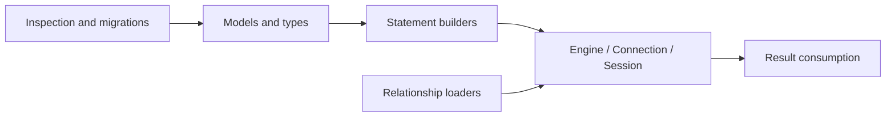

# SQLAlchemy and Alembic API index

[Overview](../../README.md) · [SQLAlchemy explained](../SQLALCHEMY.md) · [Application functions](APPLICATION_FUNCTIONS.md)

This page explains **98 distinct imported/referenced library symbols** and **114 observed method names**. A symbol may be a class, annotation, namespace, exception, decorator, or function. Import rows identify names available to a module; an import alone does not prove runtime execution.

The offline scanner reads Python under `college_maintenance/`, `labs/`, `migrations/`, and `tests/`. It resolves direct SQLAlchemy/Alembic imports and known namespace attributes. Method rows use a reviewed vocabulary and conservative receiver filtering, with representative source locations; this is a navigation aid, not full Python type inference. Dynamic calls and installed-library internals are outside this index. A source link in `labs/` denotes an isolated experiment, not an enabled application feature.

## Imported and namespace-referenced symbols

### Statements

| Symbol | Meaning | Source examples |
|---|---|---|
| `and_` | Combine SQL conditions with AND. Import: `sqlalchemy.and_` | [pagination.py:9](../../college_maintenance/pagination.py#L9) |
| `bindparam` | Declare a bound parameter, including expanding IN parameters. Import: `sqlalchemy.bindparam` | [labs/step-16/Python:10](../../labs/step-16/python_lab.py#L10) [labs/step-76/Python:4](../../labs/step-76/python_lab.py#L4) |
| `cast` | Convert a SQL expression to a specified database type. Import: `sqlalchemy.cast` | [analytics.py:22](../../college_maintenance/analytics.py#L22) [labs/step-72/Python:5](../../labs/step-72/python_lab.py#L5) |
| `delete` | Build a DELETE expression. Import: `sqlalchemy.delete` | [repairs.py:2](../../college_maintenance/repairs.py#L2) [labs/step-16/Python:10](../../labs/step-16/python_lab.py#L10) |
| `distinct_on` | Build the PostgreSQL DISTINCT ON extension for a SELECT. Import: `sqlalchemy.dialects.postgresql.distinct_on` | [advanced_reports.py:3](../../college_maintenance/advanced_reports.py#L3) |
| `func` | Build SQL function expressions; PostgreSQL executes the resulting functions. Import: `sqlalchemy.func` | [analytics.py:2](../../college_maintenance/analytics.py#L2) [inventory.py:3](../../college_maintenance/inventory.py#L3) [reports.py:3](../../college_maintenance/reports.py#L3) |
| `insert` | Build an INSERT expression; the PostgreSQL version adds conflict handling. Import: `sqlalchemy.dialects.postgresql.insert` | [imports.py:3](../../college_maintenance/imports.py#L3) [labs/step-79/Python:10](../../labs/step-79/python_lab.py#L10) |
| `insert` | Build an INSERT expression; the PostgreSQL version adds conflict handling. Import: `sqlalchemy.insert` | [labs/shared/orm_lab.py:9](../../labs/shared/orm_lab.py#L9) [labs/step-16/Python:10](../../labs/step-16/python_lab.py#L10) [labs/step-17/Python:13](../../labs/step-17/python_lab.py#L13) |
| `literal_column` | Use a literal SQL column expression; the text is trusted code. Import: `sqlalchemy.literal_column` | [search.py:2](../../college_maintenance/search.py#L2) |
| `literal` | Represent a Python value as a bound SQL expression. Import: `sqlalchemy.literal` | [analytics.py:22](../../college_maintenance/analytics.py#L22) [labs/step-13/Python:14](../../labs/step-13/python_lab.py#L14) |
| `or_` | Combine SQL conditions with OR. Import: `sqlalchemy.or_` | [pagination.py:9](../../college_maintenance/pagination.py#L9) [reads.py:5](../../college_maintenance/reads.py#L5) |
| `postgresql` | Access PostgreSQL-specific types, SQL constructs, or the compilation dialect. Import: `sqlalchemy.dialects.postgresql` | [migrations/versions/0003_audit_events.py:4](../../migrations/versions/0003_audit_events.py#L4) |
| `select` | Build a SELECT expression without executing it. Import: `sqlalchemy.select` | [advanced_reports.py:2](../../college_maintenance/advanced_reports.py#L2) [analytics.py:2](../../college_maintenance/analytics.py#L2) [api.py:28](../../college_maintenance/api.py#L28) |
| `text` | Wrap textual SQL for execution with bound values. Import: `sqlalchemy.text` | [analytics.py:22](../../college_maintenance/analytics.py#L22) [models.py:7](../../college_maintenance/models.py#L7) [labs/shared/column_models.py:6](../../labs/shared/column_models.py#L6) |
| `true` | Produce a SQL true expression, including a lateral-join condition. Import: `sqlalchemy.true` | [advanced_reports.py:2](../../college_maintenance/advanced_reports.py#L2) [analytics.py:22](../../college_maintenance/analytics.py#L22) [reads.py:5](../../college_maintenance/reads.py#L5) |
| `update` | Build an UPDATE expression. Import: `sqlalchemy.update` | [inventory.py:3](../../college_maintenance/inventory.py#L3) [labs/step-16/Python:10](../../labs/step-16/python_lab.py#L10) [labs/step-45/Python:8](../../labs/step-45/python_lab.py#L8) |

### Types

| Symbol | Meaning | Source examples |
|---|---|---|
| `Boolean` | Map Python booleans to database boolean values. Import: `sqlalchemy.Boolean` | [labs/step-15/schema.py:3](../../labs/step-15/schema.py#L3) [labs/step-16/schema.py:3](../../labs/step-16/schema.py#L3) [migrations/versions/0001_initial.py:15](../../migrations/versions/0001_initial.py#L15) |
| `DateTime` | Represent timestamps; timezone=True requests timezone support. Import: `sqlalchemy.DateTime` | [analytics.py:22](../../college_maintenance/analytics.py#L22) [models.py:7](../../college_maintenance/models.py#L7) [labs/shared/column_models.py:6](../../labs/shared/column_models.py#L6) |
| `INT4RANGE` | Use PostgreSQL integer ranges. Import: `sqlalchemy.dialects.postgresql.INT4RANGE` | [labs/step-80/feature.py:13](../../labs/step-80/feature.py#L13) |
| `Integer` | Map integer values. Import: `sqlalchemy.Integer` | [labs/step-76/Python:4](../../labs/step-76/python_lab.py#L4) [labs/step-80/feature.py:11](../../labs/step-80/feature.py#L11) [migrations/versions/0001_initial.py:35](../../migrations/versions/0001_initial.py#L35) |
| `JSONB` | Use PostgreSQL binary JSON values and operators. Import: `sqlalchemy.dialects.postgresql.JSONB` | [models.py:8](../../college_maintenance/models.py#L8) [labs/step-65/Python:6](../../labs/step-65/python_lab.py#L6) [labs/step-79/Python:10](../../labs/step-79/python_lab.py#L10) |
| `Numeric` | Represent exact decimal values with precision and scale. Import: `sqlalchemy.Numeric` | [models.py:7](../../college_maintenance/models.py#L7) [labs/step-69/Python:5](../../labs/step-69/python_lab.py#L5) [migrations/versions/0001_initial.py:37](../../migrations/versions/0001_initial.py#L37) |
| `Range` | Construct a Python value representing a PostgreSQL range. Import: `sqlalchemy.dialects.postgresql.Range` | [labs/step-80/feature.py:13](../../labs/step-80/feature.py#L13) |
| `String` | Represent text with an optional length bound. Import: `sqlalchemy.String` | [models.py:7](../../college_maintenance/models.py#L7) [labs/shared/column_models.py:6](../../labs/shared/column_models.py#L6) [labs/step-15/Python:11](../../labs/step-15/python_lab.py#L11) |
| `Text` | Represent unbounded text. Import: `sqlalchemy.Text` | [models.py:7](../../college_maintenance/models.py#L7) [labs/shared/column_models.py:6](../../labs/shared/column_models.py#L6) [labs/step-15/schema.py:3](../../labs/step-15/schema.py#L3) |
| `TSTZRANGE` | Use PostgreSQL timestamp ranges with time zones. Import: `sqlalchemy.dialects.postgresql.TSTZRANGE` | [labs/step-80/feature.py:13](../../labs/step-80/feature.py#L13) |
| `TypeDecorator` | Customize binding and result conversion around an existing type. Import: `sqlalchemy.types.TypeDecorator` | [labs/step-72/Python:6](../../labs/step-72/python_lab.py#L6) |
| `Uuid` | Map UUID identifiers. Import: `sqlalchemy.Uuid` | [models.py:7](../../college_maintenance/models.py#L7) [labs/shared/column_models.py:6](../../labs/shared/column_models.py#L6) [labs/step-15/Python:11](../../labs/step-15/python_lab.py#L11) |

### Errors

| Symbol | Meaning | Source examples |
|---|---|---|
| `DataError` | Report invalid data conversion or out-of-range database values. Import: `sqlalchemy.exc.DataError` | [labs/step-13/Python:16](../../labs/step-13/python_lab.py#L16) |
| `DBAPIError` | Wrap a database-driver error; orig exposes the original exception. Import: `sqlalchemy.exc.DBAPIError` | [api.py:7](../../college_maintenance/api.py#L7) [retries.py:3](../../college_maintenance/retries.py#L3) [labs/step-45/Python:9](../../labs/step-45/python_lab.py#L9) |
| `DetachedInstanceError` | Report an unloaded/expired attribute access on a detached ORM object. Import: `sqlalchemy.orm.exc.DetachedInstanceError` | [labs/step-21/Python:9](../../labs/step-21/python_lab.py#L9) [labs/step-31/Python:6](../../labs/step-31/python_lab.py#L6) |
| `IntegrityError` | Report a database constraint violation. Import: `sqlalchemy.exc.IntegrityError` | [api.py:7](../../college_maintenance/api.py#L7) [imports.py:4](../../college_maintenance/imports.py#L4) [labs/step-14/Python:13](../../labs/step-14/python_lab.py#L13) |
| `InvalidRequestError` | Report an invalid SQLAlchemy operation or API state. Import: `sqlalchemy.exc.InvalidRequestError` | [persistence.py:3](../../college_maintenance/persistence.py#L3) [labs/step-14/Python:13](../../labs/step-14/python_lab.py#L13) [labs/step-28/Python:7](../../labs/step-28/python_lab.py#L7) |
| `MultipleResultsFound` | Report more rows than a one-result operation permits. Import: `sqlalchemy.exc.MultipleResultsFound` | [labs/step-16/Python:11](../../labs/step-16/python_lab.py#L11) |
| `NoReferencedTableError` | Report a ForeignKey whose referenced table is absent from metadata. Import: `sqlalchemy.exc.NoReferencedTableError` | [labs/step-15/Python:15](../../labs/step-15/python_lab.py#L15) |
| `NoResultFound` | Report no row when exactly one was required. Import: `sqlalchemy.exc.NoResultFound` | [labs/step-16/Python:11](../../labs/step-16/python_lab.py#L11) |
| `NoSuchTableError` | Report an absent table during reflection. Import: `sqlalchemy.exc.NoSuchTableError` | [labs/step-15/Python:15](../../labs/step-15/python_lab.py#L15) |
| `PendingRollbackError` | Require rollback after a failed transaction before further Session work. Import: `sqlalchemy.exc.PendingRollbackError` | [labs/step-20/Python:13](../../labs/step-20/python_lab.py#L13) |
| `ResourceClosedError` | Report access to an already closed result or resource. Import: `sqlalchemy.exc.ResourceClosedError` | [labs/step-16/Python:11](../../labs/step-16/python_lab.py#L11) |
| `StaleDataError` | Report unexpected affected-row counts, including stale versioned writes. Import: `sqlalchemy.orm.exc.StaleDataError` | [api.py:22](../../college_maintenance/api.py#L22) [labs/step-48/Python:7](../../labs/step-48/python_lab.py#L7) |
| `StatementError` | Wrap a statement execution/binding error and its context. Import: `sqlalchemy.exc.StatementError` | [labs/step-14/Python:13](../../labs/step-14/python_lab.py#L13) [labs/step-72/Python:8](../../labs/step-72/python_lab.py#L8) |
| `TimeoutError` | Report SQLAlchemy timeout conditions, including pool checkout exhaustion. Import: `sqlalchemy.exc.TimeoutError` | [labs/step-61/Python:5](../../labs/step-61/python_lab.py#L5) |

### Connections and transactions

| Symbol | Meaning | Source examples |
|---|---|---|
| `Connection` | Represent a checked-out Core connection used to execute SQL. Import: `sqlalchemy.engine.Connection` | [labs/step-13/Python:15](../../labs/step-13/python_lab.py#L15) |
| `create_engine` | Configure a synchronous Engine and its pool; connections open on demand. Import: `sqlalchemy.create_engine` | [database.py:6](../../college_maintenance/database.py#L6) [deployment.py:4](../../college_maintenance/deployment.py#L4) [labs/shared/concurrency_lab.py:4](../../labs/shared/concurrency_lab.py#L4) |
| `Engine` | Represent a connection pool and database dialect, not one transaction. Import: `sqlalchemy.engine.Engine` | [labs/step-13/Python:15](../../labs/step-13/python_lab.py#L15) |
| `make_url` | Parse a connection string into a structured URL. Import: `sqlalchemy.engine.make_url` | [database.py:7](../../college_maintenance/database.py#L7) [deployment.py:5](../../college_maintenance/deployment.py#L5) |
| `NullPool` | Open a connection per checkout instead of retaining idle connections. Import: `sqlalchemy.pool.NullPool` | [labs/shared/concurrency_lab.py:6](../../labs/shared/concurrency_lab.py#L6) [labs/shared/migration_lab.py:8](../../labs/shared/migration_lab.py#L8) [labs/shared/operations_lab.py:8](../../labs/shared/operations_lab.py#L8) |
| `QueuePool` | Bound and reuse synchronous connections in a queue-based pool. Import: `sqlalchemy.pool.QueuePool` | [labs/step-13/Python:18](../../labs/step-13/python_lab.py#L18) |
| `Session` | Track ORM objects and coordinate a transaction using an Engine. Import: `sqlalchemy.orm.Session` | [labs/step-13/Python:17](../../labs/step-13/python_lab.py#L17) [labs/step-18/asset_crud.py:6](../../labs/step-18/asset_crud.py#L6) [labs/step-18/Python:15](../../labs/step-18/python_lab.py#L15) |
| `sessionmaker` | Configure a factory that creates independent Sessions. Import: `sqlalchemy.orm.sessionmaker` | [sessions.py:3](../../college_maintenance/sessions.py#L3) [labs/shared/concurrency_lab.py:5](../../labs/shared/concurrency_lab.py#L5) [labs/shared/deployment_lab.py:10](../../labs/shared/deployment_lab.py#L10) |
| `URL` | Represent a structured connection URL without manual credential concatenation. Import: `sqlalchemy.URL` | [database.py:6](../../college_maintenance/database.py#L6) |
| `URL` | Represent a structured connection URL without manual credential concatenation. Import: `sqlalchemy.engine.URL` | [labs/shared/deployment_lab.py:9](../../labs/shared/deployment_lab.py#L9) |

### Loading

| Symbol | Meaning | Source examples |
|---|---|---|
| `defer` | Defer a mapped column until it is accessed, unless raiseload is enabled. Import: `sqlalchemy.orm.defer` | [labs/step-32/Python:8](../../labs/step-32/python_lab.py#L8) |
| `joinedload` | Load a relationship through a join; collection results require unique(). Import: `sqlalchemy.orm.joinedload` | [labs/step-32/Python:8](../../labs/step-32/python_lab.py#L8) |
| `load_only` | Load only selected mapped columns. Import: `sqlalchemy.orm.load_only` | [loading.py:5](../../college_maintenance/loading.py#L5) [labs/step-32/Python:8](../../labs/step-32/python_lab.py#L8) [labs/step-69/Python:6](../../labs/step-69/python_lab.py#L6) |
| `raiseload` | Raise when an unspecified relationship would load lazily. Import: `sqlalchemy.orm.raiseload` | [loading.py:5](../../college_maintenance/loading.py#L5) [labs/step-32/Python:8](../../labs/step-32/python_lab.py#L8) [labs/step-75/Python:7](../../labs/step-75/python_lab.py#L7) |
| `selectin_polymorphic` | Load subclass attributes in additional batched queries. Import: `sqlalchemy.orm.selectin_polymorphic` | [labs/step-71/Python:5](../../labs/step-71/python_lab.py#L5) |
| `selectinload` | Load related rows in an additional batched SELECT. Import: `sqlalchemy.orm.selectinload` | [loading.py:5](../../college_maintenance/loading.py#L5) [labs/step-67/Python:5](../../labs/step-67/python_lab.py#L5) [labs/step-70/Python:7](../../labs/step-70/python_lab.py#L7) |

### Migrations

| Symbol | Meaning | Source examples |
|---|---|---|
| `command` | Access Alembic commands such as upgrade and downgrade. Import: `alembic.command` | [migrations.py:3](../../college_maintenance/migrations.py#L3) [labs/step-27/Python:5](../../labs/step-27/python_lab.py#L5) |
| `compare_metadata` | Compare Python metadata with installed database schema. Import: `alembic.autogenerate.compare_metadata` | [labs/step-27/Python:6](../../labs/step-27/python_lab.py#L6) [labs/step-30/Python:9](../../labs/step-30/python_lab.py#L9) [labs/step-40/Python:8](../../labs/step-40/python_lab.py#L8) |
| `Config` | Hold Alembic paths and configuration for migration commands. Import: `alembic.config.Config` | [migrations.py:4](../../college_maintenance/migrations.py#L4) |
| `context` | Access the current Alembic environment and configure migration execution. Import: `alembic.context` | [migrations/env.py:2](../../migrations/env.py#L2) |
| `MigrationContext` | Inspect/configure migration state on a connection. Import: `alembic.migration.MigrationContext` | [labs/step-27/Python:7](../../labs/step-27/python_lab.py#L7) [labs/step-30/Python:10](../../labs/step-30/python_lab.py#L10) [labs/step-40/Python:9](../../labs/step-40/python_lab.py#L9) |
| `op` | Access schema operations inside a migration revision. Import: `alembic.op` | [migrations/versions/0001_initial.py:2](../../migrations/versions/0001_initial.py#L2) [migrations/versions/0002_condition_and_part_name.py:2](../../migrations/versions/0002_condition_and_part_name.py#L2) [migrations/versions/0003_audit_events.py:2](../../migrations/versions/0003_audit_events.py#L2) |
| `ScriptDirectory` | Read the migration revision graph from configured scripts. Import: `alembic.script.ScriptDirectory` | [labs/step-26/Python:6](../../labs/step-26/python_lab.py#L6) |

### Models and schema

| Symbol | Meaning | Source examples |
|---|---|---|
| `CheckConstraint` | Declare a SQL predicate checked for each affected row. Import: `sqlalchemy.CheckConstraint` | [models.py:7](../../college_maintenance/models.py#L7) [labs/shared/column_models.py:6](../../labs/shared/column_models.py#L6) [labs/step-15/Python:11](../../labs/step-15/python_lab.py#L11) |
| `Column` | Declare a Core column or a traditional mapped column. Import: `sqlalchemy.Column` | [labs/step-15/Python:11](../../labs/step-15/python_lab.py#L11) [labs/step-15/schema.py:3](../../labs/step-15/schema.py#L3) [labs/step-16/schema.py:3](../../labs/step-16/schema.py#L3) |
| `Computed` | Declare a value generated by the database from an expression. Import: `sqlalchemy.Computed` | [labs/step-80/feature.py:11](../../labs/step-80/feature.py#L11) |
| `CreateSchema` | Build a CREATE SCHEMA DDL statement. Import: `sqlalchemy.schema.CreateSchema` | [labs/shared/orm_lab.py:10](../../labs/shared/orm_lab.py#L10) [labs/step-15/Python:16](../../labs/step-15/python_lab.py#L16) [labs/step-16/Python:12](../../labs/step-16/python_lab.py#L12) |
| `CreateTable` | Build a CREATE TABLE DDL statement. Import: `sqlalchemy.schema.CreateTable` | [labs/step-15/Python:16](../../labs/step-15/python_lab.py#L16) [labs/step-17/Python:17](../../labs/step-17/python_lab.py#L17) |
| `DeclarativeBase` | Provide a base class for declaratively mapped ORM models. Import: `sqlalchemy.orm.DeclarativeBase` | [models.py:9](../../college_maintenance/models.py#L9) [labs/shared/column_models.py:7](../../labs/shared/column_models.py#L7) [labs/step-25/Python:9](../../labs/step-25/python_lab.py#L9) |
| `ForeignKey` | Declare a column reference to a parent key. Import: `sqlalchemy.ForeignKey` | [models.py:7](../../college_maintenance/models.py#L7) [labs/shared/column_models.py:6](../../labs/shared/column_models.py#L6) [labs/step-15/Python:11](../../labs/step-15/python_lab.py#L11) |
| `ForeignKeyConstraint` | Declare a table-level foreign key, including composite references. Import: `sqlalchemy.ForeignKeyConstraint` | [migrations/versions/0001_initial.py:57](../../migrations/versions/0001_initial.py#L57) [migrations/versions/0003_audit_events.py:19](../../migrations/versions/0003_audit_events.py#L19) [migrations/versions/0005_ticket_comments.py:18](../../migrations/versions/0005_ticket_comments.py#L18) |
| `Identity` | Declare a database-generated identity column. Import: `sqlalchemy.Identity` | [labs/step-80/feature.py:11](../../labs/step-80/feature.py#L11) |
| `Index` | Describe an index, including PostgreSQL partial or specialized indexes. Import: `sqlalchemy.Index` | [models.py:7](../../college_maintenance/models.py#L7) [labs/step-15/schema.py:3](../../labs/step-15/schema.py#L3) [labs/step-16/schema.py:3](../../labs/step-16/schema.py#L3) |
| `mapped_column` | Declare a typed ORM column and its database options. Import: `sqlalchemy.orm.mapped_column` | [models.py:9](../../college_maintenance/models.py#L9) [labs/shared/column_models.py:7](../../labs/shared/column_models.py#L7) [labs/step-25/Python:9](../../labs/step-25/python_lab.py#L9) |
| `Mapped` | Annotate a mapped attribute and its Python value type. Import: `sqlalchemy.orm.Mapped` | [models.py:9](../../college_maintenance/models.py#L9) [labs/shared/column_models.py:7](../../labs/shared/column_models.py#L7) [labs/step-17/Python:15](../../labs/step-17/python_lab.py#L15) |
| `MappedAsDataclass` | Add dataclass behavior to mapped classes. Import: `sqlalchemy.orm.MappedAsDataclass` | [labs/step-70/Python:7](../../labs/step-70/python_lab.py#L7) |
| `MetaData` | Collect table definitions, naming conventions, and schema operations. Import: `sqlalchemy.MetaData` | [models.py:7](../../college_maintenance/models.py#L7) [labs/shared/column_models.py:6](../../labs/shared/column_models.py#L6) [labs/step-15/Python:11](../../labs/step-15/python_lab.py#L11) |
| `PrimaryKeyConstraint` | Declare the primary key over one or more columns. Import: `sqlalchemy.PrimaryKeyConstraint` | [migrations/versions/0001_initial.py:18](../../migrations/versions/0001_initial.py#L18) [migrations/versions/0003_audit_events.py:17](../../migrations/versions/0003_audit_events.py#L17) [migrations/versions/0005_ticket_comments.py:17](../../migrations/versions/0005_ticket_comments.py#L17) |
| `Table` | Describe a database table in Python metadata. Import: `sqlalchemy.Table` | [labs/step-15/Python:11](../../labs/step-15/python_lab.py#L11) [labs/step-15/schema.py:3](../../labs/step-15/schema.py#L3) [labs/step-16/schema.py:3](../../labs/step-16/schema.py#L3) |
| `UniqueConstraint` | Reject duplicate combinations of column values. Import: `sqlalchemy.UniqueConstraint` | [labs/step-15/Python:11](../../labs/step-15/python_lab.py#L11) [labs/step-17/Python:13](../../labs/step-17/python_lab.py#L13) [migrations/versions/0001_initial.py:19](../../migrations/versions/0001_initial.py#L19) |

### Mapping helpers

| Symbol | Meaning | Source examples |
|---|---|---|
| `aliased` | Give a mapped class or selectable a separate query identity. Import: `sqlalchemy.orm.aliased` | [reads.py:6](../../college_maintenance/reads.py#L6) [labs/step-23/Python:7](../../labs/step-23/python_lab.py#L7) |
| `association_proxy` | Expose an attribute through a related object or collection. Import: `sqlalchemy.ext.associationproxy.association_proxy` | [labs/step-70/Python:8](../../labs/step-70/python_lab.py#L8) |
| `column_property` | Map a SQL expression as an ORM attribute. Import: `sqlalchemy.orm.column_property` | [labs/step-69/Python:6](../../labs/step-69/python_lab.py#L6) |
| `composite` | Map several columns into one Python value object. Import: `sqlalchemy.orm.composite` | [labs/step-70/Python:7](../../labs/step-70/python_lab.py#L7) |
| `ConcreteBase` | Support concrete-table inheritance and its polymorphic selectable. Import: `sqlalchemy.ext.declarative.ConcreteBase` | [labs/step-71/Python:6](../../labs/step-71/python_lab.py#L6) |
| `hybrid_property` | Expose behavior usable as a Python property and a SQL expression. Import: `sqlalchemy.ext.hybrid.hybrid_property` | [models.py:10](../../college_maintenance/models.py#L10) |
| `InstrumentedAttribute` | Represent the ORM-managed descriptor of a mapped attribute. Import: `sqlalchemy.orm.attributes.InstrumentedAttribute` | [labs/step-17/Python:16](../../labs/step-17/python_lab.py#L16) |
| `MutableDict` | Track in-place changes to a mapped dictionary value. Import: `sqlalchemy.ext.mutable.MutableDict` | [labs/step-65/Python:7](../../labs/step-65/python_lab.py#L7) |
| `relationship` | Define ORM navigation and loading behavior between related objects. Import: `sqlalchemy.orm.relationship` | [models.py:9](../../college_maintenance/models.py#L9) [labs/step-25/Python:9](../../labs/step-25/python_lab.py#L9) [labs/step-67/Python:5](../../labs/step-67/python_lab.py#L5) |
| `validates` | Validate values assigned through mapped attributes. Import: `sqlalchemy.orm.validates` | [labs/step-72/Python:7](../../labs/step-72/python_lab.py#L7) |

### Inspection and events

| Symbol | Meaning | Source examples |
|---|---|---|
| `event` | Register and remove SQLAlchemy lifecycle listeners. Import: `sqlalchemy.event` | [labs/shared/orm_lab.py:9](../../labs/shared/orm_lab.py#L9) [labs/step-13/Python:14](../../labs/step-13/python_lab.py#L14) [labs/step-14/Python:12](../../labs/step-14/python_lab.py#L12) |
| `inspect` | Obtain inspection information for an Engine, mapper, or ORM object. Import: `sqlalchemy.inspect` | [labs/step-15/Python:11](../../labs/step-15/python_lab.py#L11) [labs/step-17/Python:13](../../labs/step-17/python_lab.py#L13) [labs/step-19/Python:11](../../labs/step-19/python_lab.py#L11) |

### Results

| Symbol | Meaning | Source examples |
|---|---|---|
| `Row` | Represent one tuple-like SQLAlchemy result row. Import: `sqlalchemy.Row` | [labs/step-16/Python:10](../../labs/step-16/python_lab.py#L10) |
| `RowMapping` | Represent the read-only mapping view of a result row. Import: `sqlalchemy.RowMapping` | [labs/step-16/Python:10](../../labs/step-16/python_lab.py#L10) |

### Async

| Symbol | Meaning | Source examples |
|---|---|---|
| `async_sessionmaker` | Configure a factory for independent AsyncSessions. Import: `sqlalchemy.ext.asyncio.async_sessionmaker` | [labs/step-75/Python:6](../../labs/step-75/python_lab.py#L6) |
| `create_async_engine` | Configure an Engine for an asyncio-compatible database driver. Import: `sqlalchemy.ext.asyncio.create_async_engine` | [labs/step-75/Python:6](../../labs/step-75/python_lab.py#L6) |

## Methods

### Advanced queries

| Method | Meaning | Source examples |
|---|---|---|
| `.correlate()` | Specify which outer row sources a subquery correlates against. | [advanced_reports.py:17](../../college_maintenance/advanced_reports.py#L17) |
| `.cte()` | Build a common table expression, including a recursive CTE. | [advanced_reports.py:10](../../college_maintenance/advanced_reports.py#L10) [analytics.py:30](../../college_maintenance/analytics.py#L30) [labs/step-67/Python:21](../../labs/step-67/python_lab.py#L21) |
| `.except_()` | Keep rows from the first compatible set absent from the second. | [labs/step-50/Python:50](../../labs/step-50/python_lab.py#L50) |
| `.exists()` | Build an EXISTS predicate from a SELECT. | [labs/step-50/Python:51](../../labs/step-50/python_lab.py#L51) |
| `.ext()` | Apply a dialect-specific SELECT extension such as DISTINCT ON. | [advanced_reports.py:9](../../college_maintenance/advanced_reports.py#L9) |
| `.intersect()` | Keep rows present in both compatible result sets. | [labs/step-50/Python:53](../../labs/step-50/python_lab.py#L53) |
| `.lateral()` | Allow a FROM subquery to refer to preceding row sources. | [advanced_reports.py:19](../../college_maintenance/advanced_reports.py#L19) |
| `.on_conflict_do_nothing()` | Skip an INSERT row that conflicts with the targeted unique key. | [imports.py:22](../../college_maintenance/imports.py#L22) [labs/step-79/Python:35](../../labs/step-79/python_lab.py#L35) |
| `.over()` | Turn a function into a window calculation with partition/order definitions. | [analytics.py:10](../../college_maintenance/analytics.py#L10) |
| `.prefix_with()` | Add a SQL statement prefix, such as the query-tracing comment used in the connection experiment. | [labs/step-13/Python:88](../../labs/step-13/python_lab.py#L88) |
| `.scalar_subquery()` | Use a single-value SELECT as a SQL expression. | [advanced_reports.py:25](../../college_maintenance/advanced_reports.py#L25) |
| `.subquery()` | Turn a SELECT into a named FROM subquery. | [analytics.py:9](../../college_maintenance/analytics.py#L9) [inventory.py:71](../../college_maintenance/inventory.py#L71) [reports.py:13](../../college_maintenance/reports.py#L13) |
| `.union()` | Combine compatible result sets and remove duplicates. | [labs/step-50/Python:48](../../labs/step-50/python_lab.py#L48) |
| `.union_all()` | Combine compatible result sets while retaining duplicates. | [labs/step-50/Python:48](../../labs/step-50/python_lab.py#L48) [labs/step-67/Python:22](../../labs/step-67/python_lab.py#L22) |

### Statements

| Method | Meaning | Source examples |
|---|---|---|
| `.add_columns()` | Add output expressions to a SELECT. | [advanced_reports.py:20](../../college_maintenance/advanced_reports.py#L20) [api.py:307](../../college_maintenance/api.py#L307) [search.py:15](../../college_maintenance/search.py#L15) |
| `.compile()` | Compile an expression for a dialect without sending it to the server. | [labs/step-13/Python:89](../../labs/step-13/python_lab.py#L89) [labs/step-15/Python:35](../../labs/step-15/python_lab.py#L35) [labs/step-16/Python:35](../../labs/step-16/python_lab.py#L35) |
| `.contains()` | Build a type-specific containment expression, such as range containment. | [labs/step-65/Python:42](../../labs/step-65/python_lab.py#L42) [labs/step-68/Python:31](../../labs/step-68/python_lab.py#L31) |
| `.desc()` | Request descending ordering for an expression. | [advanced_reports.py:10](../../college_maintenance/advanced_reports.py#L10) [analytics.py:11](../../college_maintenance/analytics.py#L11) [loading.py:21](../../college_maintenance/loading.py#L21) |
| `.group_by()` | Define grouping keys for aggregate queries. | [analytics.py:34](../../college_maintenance/analytics.py#L34) [inventory.py:71](../../college_maintenance/inventory.py#L71) [reports.py:13](../../college_maintenance/reports.py#L13) |
| `.ilike()` | Build case-insensitive pattern matching. | [labs/step-66/Python:30](../../labs/step-66/python_lab.py#L30) |
| `.in_()` | Build SQL membership against values or a subquery. | [completion.py:46](../../college_maintenance/completion.py#L46) [loading.py:20](../../college_maintenance/loading.py#L20) [repairs.py:14](../../college_maintenance/repairs.py#L14) |
| `.is_()` | Build IS comparisons, including IS NULL. | [inventory.py:76](../../college_maintenance/inventory.py#L76) [labs/step-65/Python:43](../../labs/step-65/python_lab.py#L43) [labs/step-79/Python:54](../../labs/step-79/python_lab.py#L54) |
| `.join()` | Join another row source using an ON condition or relationship. | [analytics.py:34](../../college_maintenance/analytics.py#L34) [reads.py:53](../../college_maintenance/reads.py#L53) [reports.py:16](../../college_maintenance/reports.py#L16) |
| `.label()` | Name a SQL expression/result column. | [advanced_reports.py:8](../../college_maintenance/advanced_reports.py#L8) [analytics.py:14](../../college_maintenance/analytics.py#L14) [inventory.py:71](../../college_maintenance/inventory.py#L71) |
| `.limit()` | Bound the number of rows returned by SQL. | [advanced_reports.py:17](../../college_maintenance/advanced_reports.py#L17) [api.py:173](../../college_maintenance/api.py#L173) [loading.py:21](../../college_maintenance/loading.py#L21) |
| `.offset()` | Skip an initial number of SQL result rows. | [loading.py:32](../../college_maintenance/loading.py#L32) [pagination.py:59](../../college_maintenance/pagination.py#L59) |
| `.op()` | Use a custom SQL operator such as PostgreSQL full-text @@. | [search.py:15](../../college_maintenance/search.py#L15) |
| `.order_by()` | Set deterministic output ordering. | [advanced_reports.py:10](../../college_maintenance/advanced_reports.py#L10) [analytics.py:9](../../college_maintenance/analytics.py#L9) [api.py:173](../../college_maintenance/api.py#L173) |
| `.outerjoin()` | Retain unmatched left-side rows in a LEFT OUTER JOIN. | [advanced_reports.py:20](../../college_maintenance/advanced_reports.py#L20) [analytics.py:37](../../college_maintenance/analytics.py#L37) [inventory.py:72](../../college_maintenance/inventory.py#L72) |
| `.returning()` | Return values from affected rows in a DML statement. | [imports.py:22](../../college_maintenance/imports.py#L22) [inventory.py:78](../../college_maintenance/inventory.py#L78) [labs/shared/orm_lab.py:44](../../labs/shared/orm_lab.py#L44) |
| `.select_from()` | Choose the explicit FROM row source. | [analytics.py:36](../../college_maintenance/analytics.py#L36) [reports.py:16](../../college_maintenance/reports.py#L16) [labs/step-16/Python:155](../../labs/step-16/python_lab.py#L155) |
| `.values()` | Set INSERT or UPDATE values. | [imports.py:22](../../college_maintenance/imports.py#L22) [inventory.py:77](../../college_maintenance/inventory.py#L77) [labs/shared/orm_lab.py:44](../../labs/shared/orm_lab.py#L44) |
| `.where()` | Add filtering predicates to a statement. | [advanced_reports.py:16](../../college_maintenance/advanced_reports.py#L16) [analytics.py:15](../../college_maintenance/analytics.py#L15) [api.py:172](../../college_maintenance/api.py#L172) |
| `.with_for_update()` | Request row locking for selected rows. | [attachments.py:53](../../college_maintenance/attachments.py#L53) [completion.py:30](../../college_maintenance/completion.py#L30) [inventory.py:48](../../college_maintenance/inventory.py#L48) |
| `.with_only_columns()` | Replace a SELECT's output expressions. | [advanced_reports.py:25](../../college_maintenance/advanced_reports.py#L25) [loading.py:19](../../college_maintenance/loading.py#L19) |

### Connections and execution

| Method | Meaning | Source examples |
|---|---|---|
| `.begin()` | Create a transaction context with commit on success and rollback on error. | [api.py:116](../../college_maintenance/api.py#L116) [persistence.py:11](../../college_maintenance/persistence.py#L11) [retries.py:12](../../college_maintenance/retries.py#L12) |
| `.close()` | Release result/connection resources or close a Session context. | [labs/shared/orm_lab.py:104](../../labs/shared/orm_lab.py#L104) [labs/step-18/Python:253](../../labs/step-18/python_lab.py#L253) [labs/step-19/Python:185](../../labs/step-19/python_lab.py#L185) |
| `.connect()` | Check out an Engine connection. | [deployment.py:13](../../college_maintenance/deployment.py#L13) [labs/step-13/Python:95](../../labs/step-13/python_lab.py#L95) [labs/step-14/Python:112](../../labs/step-14/python_lab.py#L112) |
| `.dispose()` | Dispose of an Engine's pool and its idle connections. | [deployment.py:26](../../college_maintenance/deployment.py#L26) [labs/shared/concurrency_lab.py:14](../../labs/shared/concurrency_lab.py#L14) [labs/shared/deployment_lab.py:53](../../labs/shared/deployment_lab.py#L53) |
| `.exec_driver_sql()` | Execute driver-level SQL using the driver's parameter conventions. | [deployment.py:23](../../college_maintenance/deployment.py#L23) [labs/shared/history_lab.py:16](../../labs/shared/history_lab.py#L16) [labs/step-53/Python:23](../../labs/step-53/python_lab.py#L23) |
| `.execute()` | Execute a statement and return a result object. | [api.py:116](../../college_maintenance/api.py#L116) [inventory.py:82](../../college_maintenance/inventory.py#L82) [loading.py:30](../../college_maintenance/loading.py#L30) |
| `.execution_options()` | Set statement/connection execution options, such as isolation or refresh behavior. | [attachments.py:52](../../college_maintenance/attachments.py#L52) [completion.py:30](../../college_maintenance/completion.py#L30) [deployment.py:13](../../college_maintenance/deployment.py#L13) |
| `.get_bind()` | Obtain the Session's bound Engine/Connection, or the connection used by an Alembic migration. | [labs/step-18/Python:48](../../labs/step-18/python_lab.py#L48) [labs/step-19/Python:71](../../labs/step-19/python_lab.py#L71) [migrations/versions/0010_history_guards.py:34](../../migrations/versions/0010_history_guards.py#L34) |
| `.in_transaction()` | Check whether a transaction is active. | [persistence.py:9](../../college_maintenance/persistence.py#L9) [labs/shared/orm_lab.py:90](../../labs/shared/orm_lab.py#L90) [labs/step-14/Python:113](../../labs/step-14/python_lab.py#L113) |

### Results

| Method | Meaning | Source examples |
|---|---|---|
| `.all()` | Consume all remaining rows or values from a result. | [completion.py:15](../../college_maintenance/completion.py#L15) [repairs.py:67](../../college_maintenance/repairs.py#L67) [workflow.py:81](../../college_maintenance/workflow.py#L81) |
| `.first()` | Consume the first result and close it; this does not add SQL LIMIT. | [labs/step-16/Python:123](../../labs/step-16/python_lab.py#L123) [labs/step-32/Python:38](../../labs/step-32/python_lab.py#L38) |
| `.keys()` | Inspect labels in a result mapping, or names in an inspected column/attribute collection. | [labs/step-17/Python:86](../../labs/step-17/python_lab.py#L86) |
| `.mappings()` | Expose each row as a key-to-value mapping. | [api.py:173](../../college_maintenance/api.py#L173) [loading.py:32](../../college_maintenance/loading.py#L32) [reads.py:54](../../college_maintenance/reads.py#L54) |
| `.one()` | Require exactly one result row/value. | [labs/shared/orm_lab.py:79](../../labs/shared/orm_lab.py#L79) [labs/step-13/Python:102](../../labs/step-13/python_lab.py#L102) [labs/step-14/Python:79](../../labs/step-14/python_lab.py#L79) |
| `.one_or_none()` | Require zero or one result row/value. | [api.py:308](../../college_maintenance/api.py#L308) [inventory.py:82](../../college_maintenance/inventory.py#L82) [reads.py:54](../../college_maintenance/reads.py#L54) |
| `.partitions()` | Iterate result data in bounded groups. | [labs/step-75/Python:47](../../labs/step-75/python_lab.py#L47) |
| `.scalar()` | Return the first column of the first row, or None. | [attachments.py:49](../../college_maintenance/attachments.py#L49) [completion.py:30](../../college_maintenance/completion.py#L30) [imports.py:22](../../college_maintenance/imports.py#L22) |
| `.scalar_one()` | Require exactly one row and return its first column. | [api.py:116](../../college_maintenance/api.py#L116) [labs/shared/orm_lab.py:44](../../labs/shared/orm_lab.py#L44) [labs/step-13/Python:127](../../labs/step-13/python_lab.py#L127) |
| `.scalars()` | Expose first-column values, commonly mapped ORM entities. | [api.py:228](../../college_maintenance/api.py#L228) [attachments.py:96](../../college_maintenance/attachments.py#L96) [completion.py:15](../../college_maintenance/completion.py#L15) |
| `.supports_sane_rowcount()` | Ask whether the dialect reports reliable affected-row counts. | [labs/step-16/Python:176](../../labs/step-16/python_lab.py#L176) |
| `.unique()` | Deduplicate ORM identities or result values during consumption. | [labs/step-32/Python:33](../../labs/step-32/python_lab.py#L33) |

### Session lifecycle

| Method | Meaning | Source examples |
|---|---|---|
| `.add()` | Attach a new object to the Session; INSERT normally occurs at flush. | [attachments.py:44](../../college_maintenance/attachments.py#L44) [completion.py:60](../../college_maintenance/completion.py#L60) [inventory.py:33](../../college_maintenance/inventory.py#L33) |
| `.add_all()` | Attach several objects to the Session. | [labs/step-25/Python:29](../../labs/step-25/python_lab.py#L29) [labs/step-29/Python:18](../../labs/step-29/python_lab.py#L18) [labs/step-30/Python:22](../../labs/step-30/python_lab.py#L22) |
| `.begin_nested()` | Create a SAVEPOINT; pending Session state is flushed first. | [imports.py:27](../../college_maintenance/imports.py#L27) [labs/step-17/Python:60](../../labs/step-17/python_lab.py#L60) [labs/step-22/Python:32](../../labs/step-22/python_lab.py#L32) |
| `.commit()` | Flush and commit the transaction; ORM attributes normally expire. | [labs/step-19/Python:130](../../labs/step-19/python_lab.py#L130) [labs/step-21/Python:30](../../labs/step-21/python_lab.py#L30) |
| `.delete()` | Mark a persistent object for deletion on flush. | [repairs.py:53](../../college_maintenance/repairs.py#L53) [labs/step-18/asset_crud.py:44](../../labs/step-18/asset_crud.py#L44) [labs/step-19/Python:124](../../labs/step-19/python_lab.py#L124) |
| `.expire()` | Mark loaded attributes for reloading from the database on access. | [labs/step-21/Python:24](../../labs/step-21/python_lab.py#L24) |
| `.flush()` | Send pending SQL while keeping the transaction open. | [attachments.py:44](../../college_maintenance/attachments.py#L44) [completion.py:57](../../college_maintenance/completion.py#L57) [inventory.py:33](../../college_maintenance/inventory.py#L33) |
| `.get()` | Find an ORM object by primary key, consulting the identity map. | [attachments.py:87](../../college_maintenance/attachments.py#L87) [inventory.py:52](../../college_maintenance/inventory.py#L52) [reads.py:20](../../college_maintenance/reads.py#L20) |
| `.is_modified()` | Check whether an object's attribute history contains net changes. | [labs/step-19/Python:113](../../labs/step-19/python_lab.py#L113) [labs/step-73/Python:30](../../labs/step-73/python_lab.py#L30) |
| `.merge()` | Copy state into a Session-managed object; use the returned object. | [labs/step-21/Python:40](../../labs/step-21/python_lab.py#L40) |
| `.refresh()` | Reload selected object state immediately with a query. | [labs/step-21/Python:28](../../labs/step-21/python_lab.py#L28) [labs/step-42/Python:27](../../labs/step-42/python_lab.py#L27) |
| `.rollback()` | Discard transaction changes and reset the failed Session transaction. | [labs/step-14/Python:159](../../labs/step-14/python_lab.py#L159) [labs/step-28/Python:51](../../labs/step-28/python_lab.py#L51) [labs/step-48/Python:35](../../labs/step-48/python_lab.py#L35) |

### Schema and reflection

| Method | Meaning | Source examples |
|---|---|---|
| `.append_column()` | Append a Column to in-memory table metadata. | [labs/step-15/Python:199](../../labs/step-15/python_lab.py#L199) |
| `.clear_cache()` | Discard cached Inspector reflection results. | [labs/step-15/Python:187](../../labs/step-15/python_lab.py#L187) |
| `.create()` | Create a schema object, or construct a structured URL when called on URL. | [database.py:28](../../college_maintenance/database.py#L28) [labs/shared/deployment_lab.py:29](../../labs/shared/deployment_lab.py#L29) |
| `.create_all()` | Create missing tables from metadata; this does not migrate existing tables. | [labs/shared/orm_lab.py:85](../../labs/shared/orm_lab.py#L85) [labs/step-15/Python:133](../../labs/step-15/python_lab.py#L133) [labs/step-16/Python:62](../../labs/step-16/python_lab.py#L62) |
| `.get_check_constraints()` | Inspect installed CHECK constraints. | [labs/step-15/Python:61](../../labs/step-15/python_lab.py#L61) [labs/step-17/Python:164](../../labs/step-17/python_lab.py#L164) [labs/step-50/Python:23](../../labs/step-50/python_lab.py#L23) |
| `.get_columns()` | Inspect installed column definitions. | [labs/step-15/Python:58](../../labs/step-15/python_lab.py#L58) [labs/step-17/Python:156](../../labs/step-17/python_lab.py#L156) [labs/step-26/Python:32](../../labs/step-26/python_lab.py#L32) |
| `.get_foreign_keys()` | Inspect installed foreign keys. | [labs/step-15/Python:64](../../labs/step-15/python_lab.py#L64) [labs/step-17/Python:172](../../labs/step-17/python_lab.py#L172) [labs/step-26/Python:26](../../labs/step-26/python_lab.py#L26) |
| `.get_indexes()` | Inspect installed indexes. | [labs/step-15/Python:68](../../labs/step-15/python_lab.py#L68) [labs/step-17/Python:177](../../labs/step-17/python_lab.py#L177) [labs/step-26/Python:30](../../labs/step-26/python_lab.py#L30) |
| `.get_pk_constraint()` | Inspect the installed primary key. | [labs/step-15/Python:55](../../labs/step-15/python_lab.py#L55) [labs/step-17/Python:162](../../labs/step-17/python_lab.py#L162) [labs/step-26/Python:25](../../labs/step-26/python_lab.py#L25) |
| `.get_table_names()` | List installed tables in a schema. | [labs/step-15/Python:141](../../labs/step-15/python_lab.py#L141) [labs/step-26/Python:20](../../labs/step-26/python_lab.py#L20) |
| `.get_unique_constraints()` | Inspect installed unique constraints. | [labs/step-15/Python:60](../../labs/step-15/python_lab.py#L60) [labs/step-17/Python:163](../../labs/step-17/python_lab.py#L163) |
| `.has_table()` | Test whether an installed table exists. | [labs/step-15/Python:142](../../labs/step-15/python_lab.py#L142) |
| `.reflect()` | Load installed table definitions into metadata. | [labs/step-15/Python:160](../../labs/step-15/python_lab.py#L160) |
| `.to_metadata()` | Copy a Table definition into another MetaData collection. | [labs/step-15/Python:198](../../labs/step-15/python_lab.py#L198) |

### Loading

| Method | Meaning | Source examples |
|---|---|---|
| `.options()` | Apply ORM loading strategies to a statement. | [loading.py:22](../../college_maintenance/loading.py#L22) [labs/step-32/Python:26](../../labs/step-32/python_lab.py#L26) [labs/step-67/Python:41](../../labs/step-67/python_lab.py#L41) |

### Migrations

| Method | Meaning | Source examples |
|---|---|---|
| `.add_column()` | Add a column to an existing table. | [migrations/versions/0002_condition_and_part_name.py:11](../../migrations/versions/0002_condition_and_part_name.py#L11) [migrations/versions/0006_ticket_resolution_notes.py:10](../../migrations/versions/0006_ticket_resolution_notes.py#L10) [migrations/versions/0007_audit_context.py:9](../../migrations/versions/0007_audit_context.py#L9) |
| `.alter_column()` | Change a column definition. | [migrations/versions/0002_condition_and_part_name.py:13](../../migrations/versions/0002_condition_and_part_name.py#L13) |
| `.begin_transaction()` | Enter the Alembic migration transaction context. | [migrations/env.py:8](../../migrations/env.py#L8) |
| `.configure()` | Configure an Alembic migration context; on an ORM registry, finalize mapper relationships. | [labs/step-17/Python:76](../../labs/step-17/python_lab.py#L76) [labs/step-27/Python:25](../../labs/step-27/python_lab.py#L25) [labs/step-30/Python:78](../../labs/step-30/python_lab.py#L78) |
| `.create_check_constraint()` | Create a named CHECK constraint. | [migrations/versions/0002_condition_and_part_name.py:14](../../migrations/versions/0002_condition_and_part_name.py#L14) [migrations/versions/0011_ticket_version.py:10](../../migrations/versions/0011_ticket_version.py#L10) |
| `.create_foreign_key()` | Create a named foreign key. | [migrations/versions/0007_audit_context.py:13](../../migrations/versions/0007_audit_context.py#L13) |
| `.create_index()` | Create an index in a migration. | [migrations/versions/0001_initial.py:62](../../migrations/versions/0001_initial.py#L62) [migrations/versions/0003_audit_events.py:22](../../migrations/versions/0003_audit_events.py#L22) [migrations/versions/0004_ticket_feed_index.py:7](../../migrations/versions/0004_ticket_feed_index.py#L7) |
| `.create_table()` | Create a table in a migration. | [migrations/versions/0001_initial.py:11](../../migrations/versions/0001_initial.py#L11) [migrations/versions/0003_audit_events.py:11](../../migrations/versions/0003_audit_events.py#L11) [migrations/versions/0005_ticket_comments.py:10](../../migrations/versions/0005_ticket_comments.py#L10) |
| `.downgrade()` | Reverse revisions toward a target revision in an isolated migration proof. | [labs/step-27/Python:47](../../labs/step-27/python_lab.py#L47) |
| `.drop_column()` | Remove a column in a migration. | [migrations/versions/0002_condition_and_part_name.py:21](../../migrations/versions/0002_condition_and_part_name.py#L21) [migrations/versions/0006_ticket_resolution_notes.py:14](../../migrations/versions/0006_ticket_resolution_notes.py#L14) [migrations/versions/0007_audit_context.py:20](../../migrations/versions/0007_audit_context.py#L20) |
| `.drop_constraint()` | Remove a named database constraint. | [migrations/versions/0002_condition_and_part_name.py:20](../../migrations/versions/0002_condition_and_part_name.py#L20) [migrations/versions/0007_audit_context.py:19](../../migrations/versions/0007_audit_context.py#L19) [migrations/versions/0011_ticket_version.py:13](../../migrations/versions/0011_ticket_version.py#L13) |
| `.drop_index()` | Remove a named index. | [migrations/versions/0001_initial.py:143](../../migrations/versions/0001_initial.py#L143) [migrations/versions/0004_ticket_feed_index.py:8](../../migrations/versions/0004_ticket_feed_index.py#L8) [migrations/versions/0007_audit_context.py:18](../../migrations/versions/0007_audit_context.py#L18) |
| `.drop_table()` | Remove a table in a migration. | [migrations/versions/0001_initial.py:144](../../migrations/versions/0001_initial.py#L144) [migrations/versions/0003_audit_events.py:25](../../migrations/versions/0003_audit_events.py#L25) [migrations/versions/0005_ticket_comments.py:24](../../migrations/versions/0005_ticket_comments.py#L24) |
| `.f()` | Mark a constraint name as already formatted by the naming convention. | [migrations/versions/0001_initial.py:16](../../migrations/versions/0001_initial.py#L16) [migrations/versions/0002_condition_and_part_name.py:14](../../migrations/versions/0002_condition_and_part_name.py#L14) [migrations/versions/0003_audit_events.py:17](../../migrations/versions/0003_audit_events.py#L17) |
| `.from_config()` | Load an Alembic script directory from configuration. | [labs/step-26/Python:48](../../labs/step-26/python_lab.py#L48) |
| `.get_current_head()` | Read the head revision represented by the migration context or script graph. | [labs/step-26/Python:48](../../labs/step-26/python_lab.py#L48) |
| `.is_offline_mode()` | Check whether Alembic should emit SQL rather than execute it. | [migrations/env.py:13](../../migrations/env.py#L13) |
| `.run_migrations()` | Execute the selected Alembic migration revisions. | [migrations/env.py:8](../../migrations/env.py#L8) |
| `.set_main_option()` | Set an Alembic configuration value. | [migrations.py:9](../../college_maintenance/migrations.py#L9) |
| `.upgrade()` | Apply revisions toward a target Alembic revision. | [migrations.py:14](../../college_maintenance/migrations.py#L14) |

### Configuration and events

| Method | Meaning | Source examples |
|---|---|---|
| `.checkedin()` | Count idle checked-in pool connections. | [labs/step-13/Python:39](../../labs/step-13/python_lab.py#L39) [labs/step-15/Python:107](../../labs/step-15/python_lab.py#L107) [labs/step-17/Python:121](../../labs/step-17/python_lab.py#L121) |
| `.checkedout()` | Count checked-out pool connections. | [labs/shared/orm_lab.py:90](../../labs/shared/orm_lab.py#L90) [labs/step-13/Python:39](../../labs/step-13/python_lab.py#L39) [labs/step-14/Python:161](../../labs/step-14/python_lab.py#L161) |
| `.listen()` | Register an event listener. | [labs/shared/orm_lab.py:75](../../labs/shared/orm_lab.py#L75) [labs/step-13/Python:68](../../labs/step-13/python_lab.py#L68) [labs/step-14/Python:73](../../labs/step-14/python_lab.py#L73) |
| `.remove()` | Remove an event listener. | [labs/shared/orm_lab.py:107](../../labs/shared/orm_lab.py#L107) [labs/step-13/Python:151](../../labs/step-13/python_lab.py#L151) [labs/step-14/Python:217](../../labs/step-14/python_lab.py#L217) |
| `.render_as_string()` | Render a URL; credential hiding is the default. | [labs/shared/deployment_lab.py:30](../../labs/shared/deployment_lab.py#L30) [labs/step-13/Python:41](../../labs/step-13/python_lab.py#L41) [labs/step-58/Python:27](../../labs/step-58/python_lab.py#L27) |
| `.set()` | Return a URL with selected fields replaced. | [labs/shared/deployment_lab.py:42](../../labs/shared/deployment_lab.py#L42) [labs/shared/migration_lab.py:23](../../labs/shared/migration_lab.py#L23) [labs/shared/operations_lab.py:22](../../labs/shared/operations_lab.py#L22) |
| `.size()` | Read the configured pool size. | [labs/step-13/Python:38](../../labs/step-13/python_lab.py#L38) |
| `.translate_connect_args()` | Convert URL fields to driver connection arguments. | [labs/shared/migration_lab.py:15](../../labs/shared/migration_lab.py#L15) [labs/shared/operations_lab.py:12](../../labs/shared/operations_lab.py#L12) [labs/shared/orm_lab.py:36](../../labs/shared/orm_lab.py#L36) |

### Mapping helpers

| Method | Meaning | Source examples |
|---|---|---|
| `.as_mutable()` | Associate mutable-value change tracking with a mapped SQL type. | [labs/step-65/Python:17](../../labs/step-65/python_lab.py#L17) |

### Async

| Method | Meaning | Source examples |
|---|---|---|
| `.run_sync()` | Run a synchronous SQLAlchemy callable through an async connection bridge. | [labs/step-75/Python:23](../../labs/step-75/python_lab.py#L23) |
| `.stream()` | Execute a statement using a streaming async result. | [labs/step-75/Python:46](../../labs/step-75/python_lab.py#L46) |

<!-- Generated by tools/build_reference.py; explanations: tools/reference_data.py. -->
