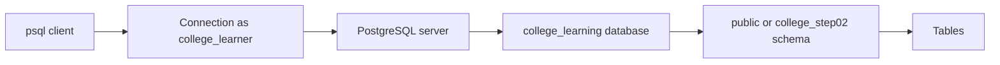

# Step 2: understand the running database

Goal: connect without a GUI and identify the PostgreSQL server, database, role, schema, tables, and transaction boundaries. The learning database is separate from the future application database.

## Connect the terms to this project

| Term | Meaning | This lab |
|---|---|---|
| Server | The running PostgreSQL program that accepts client connections and manages data | The Compose `postgres` service |
| Database cluster | Databases managed by one PostgreSQL server installation; roles are shared across it | Files in the `college-maintenance-lab_postgres_data` Docker volume |
| Database | A named collection of schemas; a connection selects one database | `college_learning` |
| Schema | A namespace for tables and other database objects | `public`; a temporary exercise namespace named `college_step02` |
| Role | A PostgreSQL identity with permissions; a role with LOGIN can connect | `college_learner`, a non-superuser that owns the learning database |
| Client | A program that sends commands to the server | `psql` included in the PostgreSQL image |
| Connection/session | One client conversation with a server backend | Each `psql` invocation has its own `pg_backend_pid()` |
| Transaction | An all-or-nothing group of database operations within a connection | `BEGIN` through `ROLLBACK` in `query.sql` |

PostgreSQL roles are separate from the application's Student, Technician, Department Admin, and Super Admin roles. Application role records arrive later. `postgres` is used only to bootstrap this lab; the exercises connect as `college_learner`. See the official [architecture](https://www.postgresql.org/docs/18/tutorial-arch.html), [schemas](https://www.postgresql.org/docs/18/ddl-schemas.html), and [database roles](https://www.postgresql.org/docs/18/database-roles.html) documentation.



## Start and connect

From PowerShell in the project directory, with Docker Desktop running:

```powershell
.\labs\step-02\start.ps1
docker compose ps
docker compose exec postgres sh /labs/step-02/psql.sh
```

The start script creates two random local passwords under `.local/` if absent, then starts the database and waits for readiness. Existing secrets and database files are preserved. `.local/` is ignored by Git. There are no passwords in the tracked configuration, SQL, or evidence. The bootstrap initialization creates the non-superuser learner role and database only on the volume's first start.

Connection facts:

| Setting | Value |
|---|---|
| Image | `postgres:18.6-bookworm` |
| Database | `college_learning` |
| Exercise login | `college_learner` |
| Windows host address / port | `127.0.0.1:55432` |
| PostgreSQL port inside container | `5432` |
| Event display timezone | `UTC` |

The wrapper connects over authenticated TCP to `127.0.0.1:5432` **inside the database container** and reads the learner secret there. A Windows client would use the published port `55432` and the same learner credential. You do not need a Windows installation of `psql` or pgAdmin for this lab. If host port 55432 is occupied, set `$env:COLLEGE_POSTGRES_PORT = '55433'` before starting; the internal port stays 5432.

PostgreSQL 18's official image stores its data under `/var/lib/postgresql/18/docker`, so Compose mounts the persistent volume at `/var/lib/postgresql`. This differs from older image examples. See the [official image documentation](https://hub.docker.com/_/postgres).

## Inspect it yourself

At the `psql` prompt, try these one at a time. Backslash commands belong to `psql` and have no SQL semicolon; SQL commands end with a semicolon.

```sql
\conninfo
SELECT version();
SHOW server_version;
SELECT current_database(), session_user, current_user, current_schema();
SHOW search_path;
SELECT current_schemas(true);
\list
\du college_learner
\dn
\dt public.*
SHOW transaction_isolation;
SHOW timezone;
SELECT pg_backend_pid();
\quit
```

An empty application table list is expected at this step. System catalog tables already exist. `\conninfo` reports the chosen database, login, and connection endpoint; `\list` lists databases; `\dn` lists schemas; `\dt` lists tables; `\d schema.table` describes one table. Reference: [psql commands](https://www.postgresql.org/docs/18/app-psql.html).

The initial `search_path` is `"$user", public`. Because no schema named `college_learner` exists, that entry is skipped and `current_schema()` is `public`. `current_schemas(true)` also includes implicitly searched system schemas such as `pg_catalog`. A schema name is not a database name. Reference: [schema search path](https://www.postgresql.org/docs/18/ddl-schemas.html#DDL-SCHEMAS-PATH).

## Run the transaction and reconnection proof

```powershell
.\labs\step-02\verify.ps1 -WriteEvidence
```

The verifier performs two real `psql` connections:

1. [query.sql](query.sql) reports server/connection facts, confirms the expected database and non-superuser role, then opens a transaction.
2. Inside that transaction, it creates `college_step02.connection_probe`, inserts one synthetic row, switches the local search path, lists the table, and describes its columns and primary key.
3. It rolls back. The schema, table, row, and transaction-local search-path setting disappear together. These objects are a table-inspection exercise, not the application schema.
4. [reconnect.sql](reconnect.sql) opens a new connection, confirms its database/role/schema/version, and verifies that the rolled-back namespace is absent. The verifier requires different backend identifiers for the two connections.
5. Successful output is saved to `evidence.txt` only when `-WriteEvidence` is supplied. An error fails the script instead of producing a successful evidence file.

`BEGIN` starts an explicit transaction; `ROLLBACK` abandons it. Without an explicit block, `psql` normally commits each successful SQL command automatically. `SET LOCAL` applies only within its transaction. A connection can execute many transactions; a connection is not itself a transaction. Reference: [PostgreSQL transactions](https://www.postgresql.org/docs/18/tutorial-transactions.html).

## Recorded outcome

The live verification passed on 22 October 2026. See [evidence.txt](evidence.txt) for the original output: PostgreSQL 18.6, database `college_learning`, non-superuser role `college_learner`, initial schema `public`, effective search path `{pg_catalog,public}`, UTC timezone, and `read committed` isolation. The temporary schema/table and its row were visible inside the transaction and absent after rollback and reconnection. Both connections used password authentication and different backend identifiers.

The machine initially had a Docker Desktop startup failure at its `dockerInference` runtime socket. While Docker was stopped, its runtime directory `%LOCALAPPDATA%\Docker\run` was preserved as `%LOCALAPPDATA%\Docker\run.stale-step02-20261022`, and a fresh `run` directory was created. Docker then started. Existing images and volumes were preserved, and the runtime backup remains. A matching failure and directory-preservation workaround are described in [Docker's issue tracker](https://github.com/docker/desktop-feedback/issues/554). This was a one-time repair on this machine, not part of the project's start script.

## Repeat and stop

The inspection script refuses to touch a pre-existing `college_step02` namespace. Inspect any such namespace before rerunning rather than deleting it automatically. The normal successful exercise leaves none behind.

To disconnect, enter `\quit`; this closes the client connection and leaves the server running. To stop only this lab's server:

```powershell
docker compose stop postgres
```

Run `start.ps1` again to resume using the same volume and credentials. Re-running initialization SQL or changing local secret files does not reset an already initialized database. Keep its original secret files while reusing that volume.

## Learning check

- Can you show the server version and the client connection endpoint?
- Can you name your database, login role, effective role, and current schema?
- Why does `"$user"` appear in the search path even though that schema does not exist?
- Why does `\d college_step02.connection_probe` work before rollback and not after it?
- What is the difference between `\quit`, `ROLLBACK`, and stopping the server?
- Why can the same role connect again with a different backend PID?

Next: Step 3 in the [learning path](../../docs/LEARNING_PATH.md) designs departments, categories, users, assets, and tickets. Application table design begins there.
